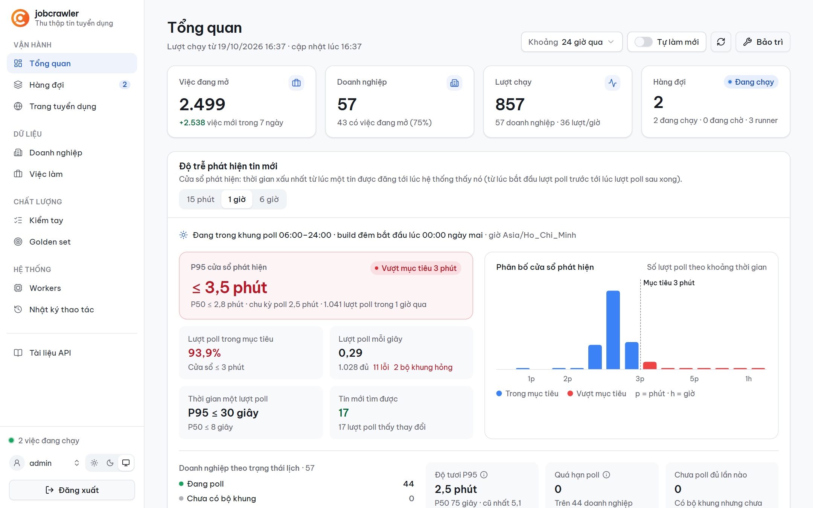
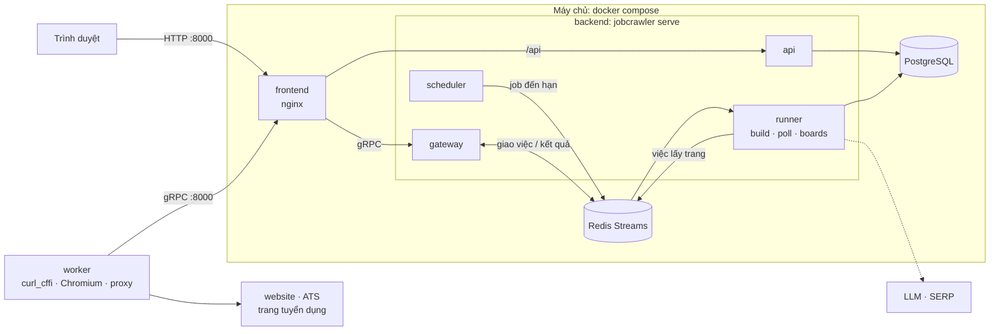
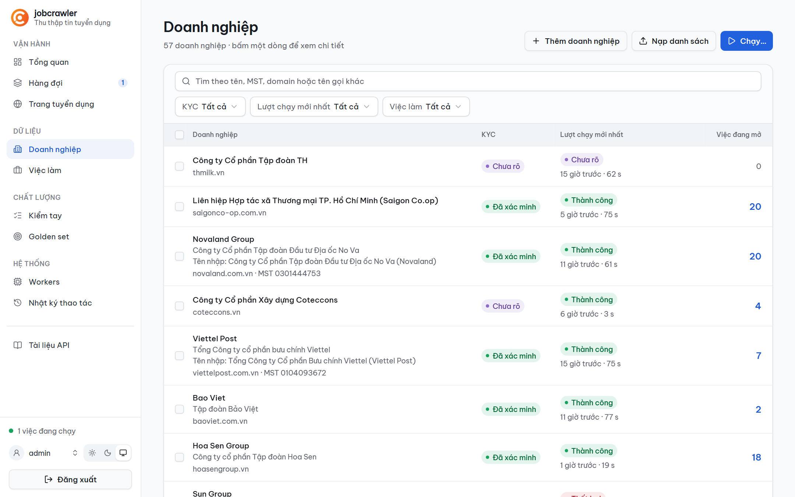
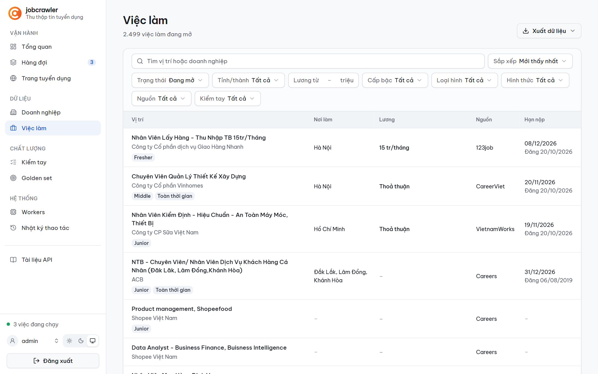
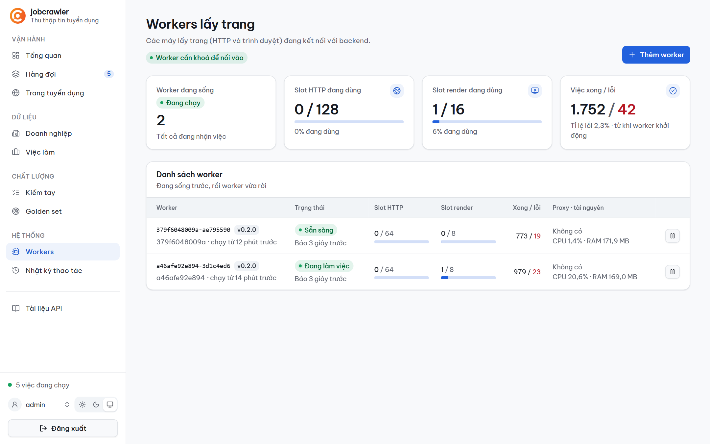

# job-crawler

Thu thập tin tuyển dụng đang mở cho ~10.000 doanh nghiệp (chủ yếu tại Việt Nam) từ trang careers,
ATS và các trang tuyển dụng; xác minh, chuẩn hoá, gộp trùng, lưu PostgreSQL. Mục tiêu: tin mới của
một doanh nghiệp được thấy trong **3 phút ở P95** (cả ngày lẫn đêm) và đẩy sang hệ thống ngoài
qua API tích hợp / webhook ([docs/INTEGRATION.md](docs/INTEGRATION.md)).



## Kiến trúc



1. **scheduler** xếp job vào hàng đợi Redis: **build** ban đêm (00:00–06:00, mỗi doanh nghiệp một
   lần) và **poll** cả ngày (00:00–24:00, mỗi doanh nghiệp 150 giây một lần).
2. **runner** chạy pipeline KYC → tìm nguồn → thu thập → chuẩn hoá → xác minh → gộp → lưu. Build
   đọc đủ site và ghi **bộ khung** (3–10 trang / API cần theo dõi); poll chỉ đọc theo bộ khung, mở
   trang của tin mới, bộ khung hỏng thì build lại ngay.
3. Mỗi request tới website là một việc trên Redis: **gateway** giao cho **worker** qua gRPC, worker
   tải bằng curl_cffi / Chromium qua proxy rồi trả kết quả. Robots, rate limit, retry, nhận diện
   trang chặn đều ở backend; worker không giữ trạng thái và chạy ở máy nào cũng được.
4. **frontend** (nginx) là cổng duy nhất mở ra ngoài: phục vụ giao diện, chuyển `/api` và gRPC của
   worker vào backend.

Chi tiết: [docs/ARCHITECTURE.md](docs/ARCHITECTURE.md) · gộp trùng: [docs/DEDUP.md](docs/DEDUP.md).

## Chạy nhanh

Cần [uv](https://docs.astral.sh/uv/), Node.js, Docker và [go-task](https://taskfile.dev).

```bash
task setup                                 # dependency mọi service + các file .env
task up                                    # postgres, redis, backend, frontend, worker
task backend:cli -- import companies.csv   # nạp doanh nghiệp (cột name, tax_code, website, note)
```

Giao diện ở http://127.0.0.1:8000. LLM, SERP, lịch, proxy… đặt ở trang **Cài đặt** (lưu trong DB);
thêm worker ở máy khác bằng nút **Thêm worker** trên trang Workers.

| Doanh nghiệp | Việc làm | Workers |
| --- | --- | --- |
| [](docs/images/companies.png) | [](docs/images/jobs.png) | [](docs/images/workers.png) |

## Repo

| Thư mục     | Nội dung                                                                     |
| ----------- | ---------------------------------------------------------------------------- |
| `backend/`  | gói `jobcrawler`: API, gateway gRPC, scheduler, runner, migration ([README](backend/README.md)) |
| `worker/`   | gói `jobworker`: lấy trang qua proxy ([README](worker/README.md))             |
| `frontend/` | React + shadcn/ui, nginx ([README](frontend/README.md))                      |
| `proto/`    | hợp đồng gRPC backend ↔ worker                                                |
| `docs/`     | [kiến trúc](docs/ARCHITECTURE.md), [vận hành](docs/OPERATIONS.md), [triển khai](docs/DEPLOY.md) |

Mỗi service tự đủ (mã, lockfile, `Dockerfile`, `Taskfile.yml`, `.env.example`). `task check` chạy
đúng những gì CI chạy; quy ước sửa mã: [AGENTS.md](AGENTS.md); báo lỗ hổng:
[SECURITY.md](.github/SECURITY.md).
