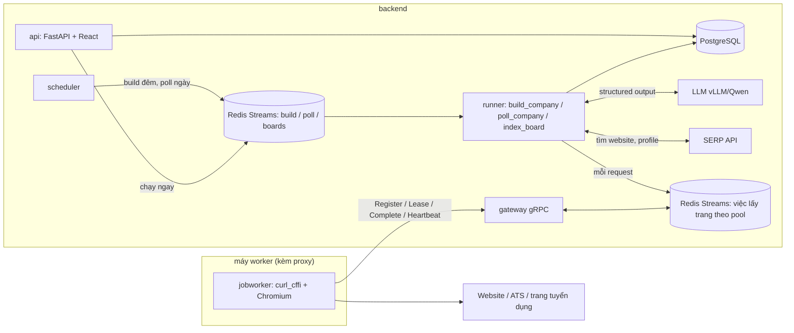
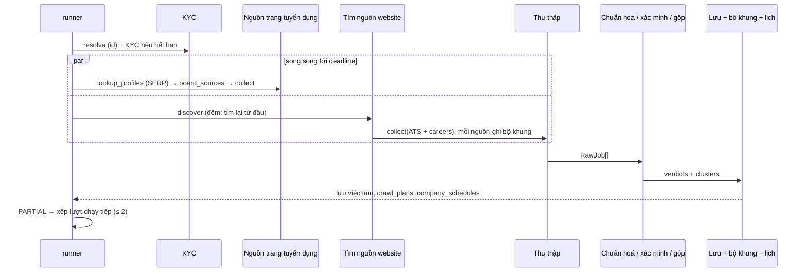
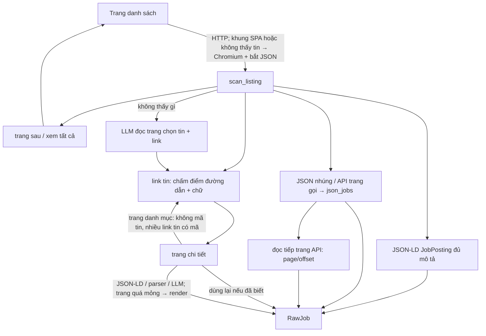
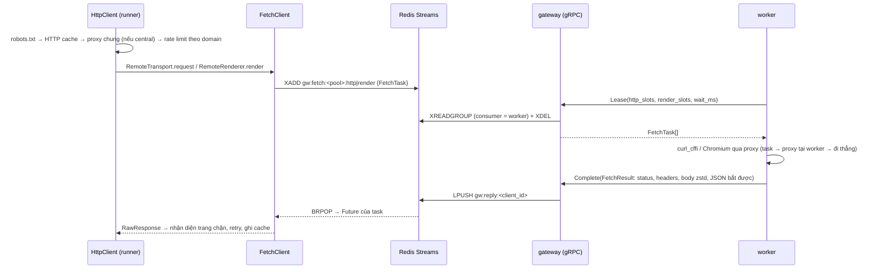
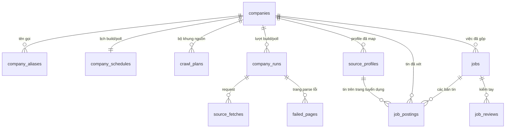

# Kiến trúc

Tài liệu này mô tả hệ thống chạy thế nào: các process, luồng dữ liệu, từng tầng trong mã nguồn và
các quyết định thiết kế quan trọng. Cách vận hành (dịch vụ, giới hạn đang đặt, bảo trì) xem
[OPERATIONS.md](OPERATIONS.md); triển khai và quy mô 10.000 doanh nghiệp xem
[DEPLOY.md](DEPLOY.md); đặc tả gốc xem [BUILD_PROMPT.md](BUILD_PROMPT.md).

## 1. Tổng quan

Đầu vào là danh sách doanh nghiệp (tên, MST, website — chủ yếu tại Việt Nam, quy mô ~10.000). Đầu
ra là các **việc làm đang mở** của từng doanh nghiệp: đã xác minh đúng nhà tuyển dụng, chuẩn hoá
trường (lương, tỉnh/thành, cấp bậc…), gộp trùng giữa các nguồn, lưu trong PostgreSQL và xem /
export qua giao diện web. Mục tiêu độ tươi: **tin mới của một doanh nghiệp được thấy trong 3 phút
ở P95** (ban ngày).

Tin được lấy từ ba loại nguồn:

| Nguồn                                   | Ví dụ                                           | Cách lấy                                                                        |
| --------------------------------------- | ----------------------------------------------- | ------------------------------------------------------------------------------- |
| ATS có API công khai                    | Greenhouse, Lever, Workday…                     | adapter gọi API của ATS                                                         |
| Trang careers trên website doanh nghiệp | tuyendung.vietcombank.com.vn, careers.shopee.vn | parser chung: JSON-LD, link tin, JSON của trang SPA, LLM                        |
| Trang tuyển dụng (job board)            | TopCV, VietnamWorks, ITviec…                    | index cả trang định kỳ, rồi gắn tin vào doanh nghiệp qua profile nhà tuyển dụng |

Hai nhịp thu thập:

- **Build (ban đêm, `BUILD_WINDOW`)**: mỗi doanh nghiệp một lượt đủ — KYC (nếu hết hạn), tìm
  nguồn trên website từ đầu, đọc hết danh sách + trang chi tiết, xác minh, gộp, lưu — và ghi lại
  **bộ khung** của từng nguồn (`crawl_plans`): trang danh sách, trang phải mở bằng trình duyệt,
  API danh sách tin của trang SPA, trang danh mục, link không phải tin, mã các tin.
- **Poll (ban ngày, `POLL_WINDOW`, mỗi `POLL_INTERVAL_SECONDS` = 150 giây)**: chỉ đọc lại đúng các
  trang / API trong bộ khung (API gọi thẳng bằng HTTP thay cho mở trình duyệt), so tập mã tin với
  lượt trước, chỉ mở trang chi tiết của tin mới. Không tìm nguồn lại, không đi "từ trang chủ vào".
  Bộ khung hỏng (trang chính 404, API không còn trả tin, trang trống, lỗi lặp lại, mất tin hàng
  loạt) thì doanh nghiệp được **build lại ngay**.



## 2. Các process

Repo là một workspace uv gồm ba gói: `backend/` (gói `jobcrawler`), `worker/` (gói `jobworker`),
`proto/` (gói `jobcrawler-proto`: hợp đồng gRPC). Backend chạy cùng một image
(`backend/Dockerfile`, không có Chromium), khác nhau ở lệnh; worker có image riêng
(`worker/Dockerfile`, Playwright + Chromium).

| Dịch vụ          | Lệnh                                  | Việc                                                                                                                                       |
| ---------------- | ------------------------------------- | ------------------------------------------------------------------------------------------------------------------------------------------ |
| `postgres`       |                                       | dữ liệu                                                                                                                                    |
| `redis`          |                                       | ba hàng đợi job, hàng việc lấy trang của worker, rate limit, proxy pool, robots/HTTP/LLM/SERP cache, khoá, số đo độ trễ, phiên bản cài đặt |
| `migrate`        | `jobcrawler db upgrade`               | chạy Alembic mỗi lần `up` rồi thoát                                                                                                        |
| `api`            | `jobcrawler ui`                       | API JSON `/api/...` + giao diện React                                                                                                      |
| `gateway`        | `jobcrawler gateway`                  | gRPC cho worker: giao việc lấy trang từ Redis Streams, nhận kết quả                                                                        |
| `scheduler`      | `jobcrawler scheduler`                | mỗi giây xếp build đến hạn (đêm / doanh nghiệp mới / bộ khung hỏng) và poll đến hạn; một replica giữ khoá Postgres                          |
| `runner-poll`    | `jobcrawler runner --role poll`       | queue `jobcrawler-poll`: `poll_company` (`RUNNER_POLL_CONCURRENCY` = 50 mỗi process)                                                       |
| `runner-build`   | `jobcrawler runner --role build`      | queue `jobcrawler-build`: `build_company` (10 mỗi process); cron bảo trì (mỗi giờ), số liệu tổng quan (5 phút)                             |
| `runner-boards`  | `jobcrawler runner --role boards`     | queue `jobcrawler-boards`: `index_board` (đủ, đêm), `tail_board` (đuôi, mỗi 2 phút ban ngày)                                               |
| `worker`         | `jobworker run`                       | lấy trang: nhận việc qua gRPC, tải bằng curl_cffi / Chromium qua proxy của mình, trả kết quả                                               |

CLI (`jobcrawler …`, `backend/jobcrawler/entrypoints/cli.py`) dùng đúng các hàm của tầng
`services/`: build / poll một doanh nghiệp (`build`, `poll`, `run`), KYC (`kyc`), thử một website
(`site`), nạp / xếp build (`import`, `enqueue`), index (`index-boards [--tail]`), export, thống kê,
đánh giá (`eval`), DB (`db …`), hàng đợi (`queue info`).

Mọi process backend mở tài nguyên qua `resources.open_resources()` → `Resources`: engine +
sessionmaker SQLAlchemy async, Redis, ba hàng đợi, `LLMClient`, `HttpClient` gửi request qua worker
(`fetch: FetchClient`), `api_http` gọi thẳng API bên ngoài (SERP), proxy pool chung. Cài đặt hiện
hành là env/.env cộng giá trị sửa ở trang Cài đặt, nạp lại khi đổi (`services/live_settings.py`).

## 3. Bản đồ mã nguồn

```
backend/jobcrawler/
  config.py            Settings (pydantic-settings, đọc .env)
  resources.py         mở/đóng tài nguyên dùng chung của một process
  schemas.py           kiểu dữ liệu: CompanyIn, RawJob, JobOut, enum trạng thái, RunKind, PlanStatus…
  queues.py, streamqueue.py   ba hàng đợi trên Redis Streams (consumer group, khoá job, cron)
  gateway/             registry worker, FetchClient (gửi việc / chờ kết quả), RemoteTransport,
                       server gRPC
  net/                 HttpClient (robots, cache, proxy, rate limit, retry, nhận diện chặn),
                       DirectTransport (httpx, gọi API bên ngoài), proxy pool, KV
  sources/             nguồn tin: base, plan (bộ khung), careers, json_jobs, jsonld, ats/*, boards/*
  pipeline/            KYC, tìm nguồn, thu thập, chuẩn hoá, xác minh, gộp, lưu, index board, map profile
  services/            nghiệp vụ: companies (build), crawl (build/poll/xếp job), schedule, plans,
                       sla, app_settings, live_settings, boards, batch, stats, overview, maintenance…
  entrypoints/         cli.py, runner.py, scheduler.py, gateway.py
  web/                 FastAPI (api.py, settings_api.py, queries.py, actions.py) phục vụ frontend/
  db/                  models, migration Alembic (một migration 0001), nén zstd, UUIDv7
worker/jobworker/      config, client gRPC, fetch (curl_cffi), browser (Playwright), proxy tại worker
proto/jcproto/v1/      crawl.proto + mã sinh sẵn (`scripts/gen_proto.py`)
frontend/              React + shadcn/ui + Tailwind (build vào backend/jobcrawler/web/dist)
backend/tests, worker/tests, proto/tests
scripts/loadtest/      seed + bench dữ liệu lớn, site giả đo độ trễ (sla_site, fake_sites, sla_report)
```

Quy ước phụ thuộc: `sources/` chỉ biết `SourceSession` (bọc `Fetcher` + `LLMClient`), không biết
DB; `pipeline/` là logic thuần hoặc nhận `AsyncSession`; `services/` ghép pipeline với
`Resources`; `entrypoints/` và `web/` chỉ gọi `services/`. Gói `jobworker` không phụ thuộc
`jobcrawler` (chỉ `jcproto`).

## 4. Lượt build (`services/crawl.build_company` → `services/companies.process_company`)

Lượt build xử lý một doanh nghiệp đủ đường và luôn ghi một dòng `company_runs` (`kind=build`, kể
cả khi lỗi hoặc bị huỷ). Thời gian: deadline mềm `COMPANY_DEADLINE_SECONDS` (165 s) cho phần thu
thập, timeout cứng `COMPANY_TIMEOUT_SECONDS` (180 s), 20 s cuối dành để lưu. Build và poll cùng một
doanh nghiệp không chạy chồng nhau (khoá Redis theo doanh nghiệp).



1. **Xác định doanh nghiệp** theo id (đã nạp bằng `import` / giao diện).
2. **KYC** (`pipeline/kyc.py`, ≤ `KYC_TIMEOUT_SECONDS`): kết quả còn hạn (`KYC_CACHE_DAYS`) thì dùng
   luôn; không thì lấy ứng viên từ SERP và website (chân trang, JSON-LD Organization), LLM chọn kèm
   trích đoạn, rule kiểm lại. Kết quả: `verified` / `ambiguous` / `not_found`, `primary_domain`.
3. **Nguồn trang tuyển dụng** (song song với bước 4): tìm thêm profile bằng SERP `site:` cho trang
   chưa có profile, rồi mỗi profile đã map một `BoardProfileSource`, lọc theo KYC (mục 7).
4. **Tìm nguồn trên website** (`pipeline/discovery.py`, ≤ `DISCOVERY_TIMEOUT_SECONDS`): trang chủ
   (thử cùng lúc domain trần / `www.`, https / http, và gốc đúng như người dùng nhập), link có từ
   khoá tuyển dụng (LLM chọn khi nhiều) → sitemap → subdomain `careers.`/`tuyendung.`/`jobs.` →
   đường dẫn phổ biến; mỗi ứng viên được mở để xác nhận. Build đêm và build lại khi bộ khung hỏng
   tìm lại từ đầu (`BUILD_REFRESH_DISCOVERY`); lượt khác dùng cache 7 ngày.
5. **Thu thập** (`pipeline/collect.py`, chế độ `build`): mỗi nguồn một task, chạy tới deadline;
   nguồn chưa xong bị huỷ nhưng tin đã yield vẫn giữ. Tin website/ATS đã tải chi tiết trong
   `JOB_REUSE_DAYS` được dùng lại. Mỗi nguồn ghi bộ khung của mình (mục 5.4).
6. **Chuẩn hoá → xác minh → gộp → lưu** (mục 8).
7. **Kết thúc**: ghi `company_runs`, `source_fetches`, `failed_pages`; ghi bộ khung
   (`crawl_plans`, nguồn không còn thấy → `retired` khi tìm nguồn trọn vẹn) và lịch
   (`company_schedules`): có nguồn website/ATS thì `ready` + mốc poll đầu, không thì
   `no_sources`; mốc build đêm kế tiếp. Lượt `partial` tự xếp lượt chạy tiếp
   (`COMPANY_MAX_CONTINUATIONS`, cách `COMPANY_CONTINUATION_DELAY_SECONDS`).

**Lượt đủ và đóng việc cũ.** Chỉ khi mọi nguồn xong trọn (không huỷ, không bị cắt, không lỗi,
không tin hoãn xác minh) thì việc đang mở mà lượt này không còn thấy mới bị đánh `removed`
(hoặc `expired` nếu quá hạn nộp).

## 5. Nguồn tin (`sources/`)

Mọi nguồn cài `Source.jobs(session) -> AsyncIterator[RawJob]` và chỉ gọi mạng qua
`SourceSession`. Session ghi mỗi request thành `FetchRecord` (→ `source_fetches`), giữ trang parse
lỗi (→ `failed_pages`), dừng nguồn khi bị chặn (`SourceError`), và nhận lời báo
`truncate(reason)` khi nguồn phải dừng trước khi lấy hết tin. Giới hạn mỗi nguồn ở
`SourceLimits`. Phiên có chế độ `build` (đi đủ đường, ghi bộ khung vào `session.plan`) hoặc
`poll` (đi theo bộ khung đã lưu, không dùng HTTP cache, báo `mark_broken` khi bộ khung không còn
đúng).

`RawJob` giữ giá trị thô của nguồn (HTML mô tả, chuỗi địa điểm, chuỗi lương…), kèm cách bóc
`ExtractionMethod` (`ats_api`, `jsonld`, `parser`, `heuristic`, `llm`) — quyết định độ tin cậy ban
đầu khi xác minh (0.95 → 0.75; tin do LLM bóc luôn phải được LLM xác nhận lại).

### 5.1 ATS (`sources/ats/`)

Greenhouse, Lever, Ashby, Workable, Workday, BambooHR, Recruitee, Teamtailor (SmartRecruiters
chỉ nhận diện: robots.txt cấm API). `ats.detect()` nhận ra ATS từ URL hoặc HTML (link, iframe,
script). Bộ khung của nguồn ATS là chính bảng tin (`AtsRef`); poll gọi lại API của ATS (một lời
gọi, Workday thêm chi tiết của tin mới).

### 5.2 Trang careers chung (`sources/careers.py`)



- **Đọc danh sách**: tối đa `SOURCE_MAX_LISTING_PAGES` trang (phân trang `?page=`, `/page/N`, link
  "xem tất cả vị trí"). HTML là khung SPA hoặc không thấy tin thì mở bằng Chromium (trên worker),
  chờ mạng yên và giữ các phản hồi JSON trang gọi.
- **Link tin** (`job_links`): cùng site, chấm điểm theo đoạn đường dẫn, slug có mã số, chữ trên
  link giống tên vị trí; loại trang chính sách, tìm kiếm, tin tức.
- **JSON của trang SPA** (`sources/json_jobs.py`): tìm mảng phần tử giống tin, chặn theo đường dẫn
  API / khoá JSON có từ về việc làm; nhận ra tham số phân trang và tổng số tin để đọc tiếp qua HTTP
  (chỉ header `Accept`, không cookie), tối đa `SOURCE_MAX_API_PAGES`.
- **Trang chi tiết**: JSON-LD JobPosting → parser chung → trang không rõ là tin thì LLM quyết. Trang
  quá mỏng thì render lại. **Trang danh mục** (theo ngành, tỉnh) được đi tiếp, không lưu thành tin.
- **LLM đọc danh sách** chỉ khi rule không thấy gì (không được bịa link).

### 5.3 Profile trên trang tuyển dụng (`sources/boards/profile_source.py`)

Một `BoardProfileSource` cho mỗi profile đã map. Index của profile còn mới (`indexed_at` trong
`BOARD_STALE_HOURS`) → lấy tin từ `job_postings`, không gọi mạng; không thì (chỉ ở lượt build) đọc
danh sách tin trên trang profile và gộp với index. **Lượt poll không bao giờ gọi trang tuyển dụng
theo từng doanh nghiệp** (`board_sources(network=False)`): tin mới trên trang tuyển dụng đến qua
index đuôi (mục 6).

### 5.4 Bộ khung (`sources/plan.py`, bảng `crawl_plans`)

Lượt build ghi cho mỗi nguồn website/ATS:

| Trường       | Ý nghĩa                                                                                          |
| ------------ | ------------------------------------------------------------------------------------------------ |
| `listings`   | trang danh sách đã đọc (kể cả trang sau / "xem tất cả")                                          |
| `hubs`       | trang danh mục dẫn tới tin (poll mở như trang danh sách)                                         |
| `rendered`   | trang phải mở bằng trình duyệt                                                                   |
| `apis`       | API bắt được: có phân trang (đọc tiếp page/offset) hoặc feed không phân trang (gọi lại nguyên văn) |
| `api_only`   | trang mà mọi tin trên đó đều có trong API bắt được: poll gọi API, không mở trang                 |
| `ignored`    | link đã mở mà không phải tin: poll không mở lại                                                  |
| `indirect`   | mã tin chỉ tới được qua trang tin khác ("vị trí khác") hoặc chỉ có trong feed (có thể xoay vòng) |
| `names`      | danh mục mã → tên (thành phố…) trang tải kèm, để đọc tin từ API khi không mở trang               |
| `ats`        | bảng tin ATS                                                                                     |

Cùng với đó `crawl_plans.job_keys` là mã các tin nguồn trả về ở lượt đủ gần nhất.

## 6. Poll (`services/crawl.poll_company`)

1. Nạp bộ khung các nguồn `active` và (nguồn, mã, URL) các tin đã lưu — **không** đọc nội dung tin.
2. Thu thập chế độ `poll` (deadline `POLL_DEADLINE_SECONDS` = 60 s): careers đọc API trong bộ khung
   (HTTP thẳng), trang danh sách bằng HTTP (chỉ render khi HTML không có tin và lượt build đã phải
   render), tối đa `POLL_MAX_LISTING_PAGES` trang (0 = mọi trang); link đã biết dùng lại bản lưu,
   link trong `ignored` bỏ qua, chỉ mở tối đa `POLL_MAX_DETAIL_PAGES` (10) trang tin mới.
3. So với `job_keys`: **mới** = mã chưa có; **đã gỡ** = mã cũ vắng mặt, chỉ khi nguồn đọc trọn và
   mã không thuộc `indirect`.
4. Không đổi → chỉ cập nhật lịch (không ghi `company_runs`, không đụng `jobs`) — đa số lượt poll.
5. Có đổi → chỉ **tin mới** được chuẩn hoá → xác minh → gộp với việc đã có → lưu (chi phí theo số
   tin mới, không theo số tin của doanh nghiệp); tin đã gỡ được đánh `removed`, việc của nó đóng
   nếu không còn tin nào khác (tin trang tuyển dụng còn mở, hoặc tin website/ATS vẫn thấy). Ghi
   `company_runs` (`kind=poll`).
6. **Bộ khung hỏng → build lại ngay** (`REBUILD_ON_ERROR`): trang chính 404/410, API không còn JSON
   / không còn tin, trang danh sách mở được mà không còn tin nào trong khi bộ khung có tin, lỗi tạm
   lặp lại `POLL_MAX_FAILURES` (3) lượt. **Chốt chặn đóng nhầm**: mất từ 30% tin (≥ 3 tin, nguồn
   ≥ 5 tin) trong một lượt → không đóng việc, đếm như lỗi; lặp đủ 3 lượt thì build lại, lượt build
   đọc đủ mới đóng đúng việc đã gỡ.
7. Số đo: mỗi lượt ghi vào histogram Redis theo phút (`services/sla.py`) thời gian một lượt và
   **cửa sổ phát hiện** = lúc xong − lúc bắt đầu lượt poll đủ trước (độ trễ xấu nhất của một tin
   đăng ngay sau lượt trước); trang Tổng quan hiện P50/P95, % trong 3 phút, độ tươi hiện tại.

## 7. Lịch (`services/schedule.py`, bảng `company_schedules`)

- Mỗi doanh nghiệp có pha cố định trong [0, 1) (hash của id) để rải đều: build đêm ở
  `đầu BUILD_WINDOW + pha × độ dài khung` (10.000 doanh nghiệp / 6 giờ ≈ 0,46 lượt/giây), poll đầu
  ngày ở `đầu POLL_WINDOW + pha × chu kỳ`.
- Scheduler (một replica giữ `pg_try_advisory_lock`) mỗi `SCHEDULER_TICK_SECONDS`:
  tạo lịch cho doanh nghiệp mới (`new` → build ngay, bất kể khung giờ); lấy dòng đến hạn bằng
  `FOR UPDATE SKIP LOCKED`, dời mốc kế tiếp, xếp job (khoá theo doanh nghiệp nên không trùng).
  Hàng đợi còn quá `BUILD_QUEUE_MAX_BACKLOG` / `POLL_QUEUE_MAX_BACKLOG` việc chờ thì không xếp thêm.
- Mốc poll kế tiếp tính từ lúc xếp (± `POLL_JITTER_SECONDS`) nên chu kỳ giữ đều dù lượt poll dài
  ngắn. Trạng thái: `new`, `ready`, `no_sources`, `broken` (đã xếp build lại; build lại vẫn hỏng
  thì thử lại sau 2 giờ), `paused`.
- Cron theo `CRAWL_TIMEZONE`: bảo trì mỗi giờ, số liệu tổng quan 5 phút, index trang tuyển dụng đủ
  `BOARD_INDEX_CRON` (00:30), đuôi `BOARD_TAIL_CRON` (mỗi 2 phút, 6h–23h).

## 8. Index trang tuyển dụng (`pipeline/board_index.py`)

Mỗi trang tuyển dụng là một `BoardAdapter` (`sources/boards/`): `SitemapBoard` (TopCV, JobsGO,
CareerViet, Glints, TopDev, ITviec), `ListingBoard` (CareerLink, Vieclam24h, 123job), hoặc tự cài
(VietnamWorks). Hai kiểu lượt (khoá advisory Postgres: mỗi trang một lượt tại một thời điểm):

- **Đủ (đêm)**: đọc toàn bộ danh sách (`entries()`, có `lastmod`), tải tin mới / đổi / lâu chưa tải
  (cắt ở `BOARD_MAX_JOBS_PER_RUN`, `BOARD_INDEX_BUDGET_SECONDS`), upsert theo lô; danh sách đọc đủ
  thì tin vắng 2 lượt → `removed`, đánh `indexed_at` cho profile đủ tin; map profile mới.
- **Đuôi (ngày)**: `recent()` chỉ đọc phần mới nhất (1–4 request mỗi trang: sitemap mới nhất, trang
  đầu danh sách mới nhất, API tìm kiếm theo ngày duyệt), tải tin chưa từng thấy (≤
  `BOARD_TAIL_MAX_JOBS`, `BOARD_TAIL_BUDGET_SECONDS`), không đánh dấu gỡ, không đặt `indexed_at`;
  khoá đang bận (lượt đủ đang chạy) thì bỏ qua ngay.
- Sau mỗi lượt: doanh nghiệp có profile vừa có tin mới (hoặc vừa map) được **poll ngay**
  (`BOARD_POLL_COMPANIES`). Độ tươi của nguồn này giới hạn bởi tần suất trang tự làm mới danh sách
  (vd. sitemap TopCV ~1 giờ).

## 9. Map profile ↔ doanh nghiệp (`pipeline/profiles.py`)

- Khoá so tên riêng `text.company_match_key()`: bỏ dấu, loại hình pháp lý, phần trong ngoặc, phần
  chi nhánh; mở rộng "TMCP"; bỏ đuôi chung ("Việt Nam", "Group") khi còn từ riêng.
- Lọc ứng viên bằng pg_trgm (`PROFILE_MATCH_TRIGRAM`), rồi rule: cùng MST (1.0) → website trùng
  domain (0.95) → tên khớp đúng một doanh nghiệp (0.85 / 0.8); mâu thuẫn MST/website hoặc khác chi
  nhánh thì loại. Còn mơ hồ → LLM chọn kèm lý do (`prompts/profile_match`).
- Profile được dùng theo KYC: `verified` → mọi profile; `not_found` → profile khớp MST/website
  hoặc khớp tên chặt và đủ riêng; `ambiguous` → chỉ MST/website.

## 10. Chuẩn hoá, xác minh, gộp, lưu

**Chuẩn hoá** (`pipeline/normalize.py`, rule trước, LLM sau): HTML → markdown sạch (bỏ
boilerplate, ẩn SĐT/email cá nhân/tên người liên hệ); lương → min/max/tiền tệ/kỳ; địa điểm → 34
tỉnh/thành sau sáp nhập 2025; ngày → UTC; cấp bậc / loại hình / hình thức bằng rule, còn `unknown`
thì `classify_unclear` hỏi LLM sau khi gộp.

**Xác minh** (`pipeline/verify.py`): mỗi tin một `Verdict` có lý do. Rule loại: `EXPIRED`,
`EMPTY_JD`, `NOT_A_JOB`, `EMPLOYER_MISMATCH`, `AGENCY_POSTING`, `SCAM_SIGNALS`, `SPAM_REPOST`. Tin
có điểm cần xem bị hạ dưới `VERIFY_MIN_CONFIDENCE` và phải được LLM xác nhận (cache theo nội dung 7
ngày). LLM không kịp / lỗi → **hoãn** (`DEFERRED`): không nhận, không loại, việc cũ giữ nguyên.

**Gộp trùng** (`pipeline/dedup.py`): cùng tiêu đề (không lệch cấp bậc), chung tỉnh/thành, JD giống
(MinHash ≥ 0.8) hoặc cùng nơi nộp. Bản chuẩn: ATS/careers > trang tuyển dụng có JD đầy đủ > mới
nhất. Tin mới được gắn vào việc đang mở cùng dấu vân tay / khớp mờ thay vì tạo việc mới.

**Lưu** (`pipeline/store.py`, một transaction): upsert tin vào `job_postings`, mỗi cụm một dòng
`jobs` (khoá cụm ổn định qua các lượt, index duy nhất chặn hai việc đang mở y hệt), đóng việc cũ
khi lượt đủ (build) hoặc đóng đúng tin đã gỡ (`close_postings`, poll), cập nhật
`companies.active_jobs`.

## 11. Lấy trang qua worker (`gateway/`, `worker/`)



- **Một việc = một request** (HTTP hoặc mở trang). Mọi logic (robots, rate limit, retry, nhận diện
  chặn, parse) nằm ở backend; worker không giữ trạng thái, chỉ tải và trả nguyên văn.
- `task_id = <client_id>.<seq>`: gateway biết trả kết quả về process nào mà không cần nhớ gì, nên
  chạy nhiều replica sau load balancer. Việc quá `deadline_ms` (timeout + `FETCH_QUEUE_GRACE_SECONDS`)
  bị bỏ — backend đã thôi chờ và tự thử lại theo retry của `HttpClient`.
- **Pool**: worker khai `WORKER_POOL`; `FETCH_ROUTES` định tuyến domain → pool (vd. trang tuyển dụng
  qua pool proxy dân cư); pool không có worker sống thì về `default`; không có worker nào thì lỗi
  ngay (`no_worker`).
- **Proxy** (`PROXY_MODE`): `worker` (mặc định — mỗi worker dùng proxy của mình, gắn theo domain,
  nghỉ khi lỗi), `central` (backend chọn từ danh sách chung, giữ sức khoẻ proxy trên Redis), `off`.
- **Đăng ký / sống / dừng**: `Register` trả `WorkerConfig` (slot, impersonate, heartbeat… sửa ở
  trang Cài đặt, đẩy xuống qua `config_version`); `Heartbeat` mỗi 5 s kèm số liệu; gateway quên
  worker (khởi động lại) → `NOT_FOUND` → worker đăng ký lại; trang Workers yêu cầu "dừng nhận việc"
  (drain) → worker làm nốt rồi `Leave`. Token (`GATEWAY_TOKEN`) và TLS tuỳ chọn.

## 12. Hàng đợi (Redis Streams, `streamqueue.py`)

| Job             | Queue               | Khoá                  | Giới hạn                                                    |
| --------------- | ------------------- | --------------------- | ----------------------------------------------------------- |
| `build_company` | `jobcrawler-build`  | `build:<id>[:contN]`  | timeout 180 s, chạy tối đa `COMPANY_JOB_RETRIES` lần        |
| `poll_company`  | `jobcrawler-poll`   | `poll:<id>`           | timeout `POLL_TIMEOUT_SECONDS` (90 s)                        |
| `index_board`   | `jobcrawler-boards` | `board:<trang>`       | `BOARD_INDEX_BUDGET_SECONDS` + 15 phút                      |
| `tail_board`    | `jobcrawler-boards` | `board:<trang>`       | `BOARD_TAIL_BUDGET_SECONDS` + 2 phút                        |

Mỗi queue là một stream với consumer group `workers`; mỗi runner là một consumer, chỉ đọc khi còn
slot rảnh. Khoá job (hash trạng thái + Lua) bảo đảm một doanh nghiệp / một trang chỉ có một job
đang chờ hoặc chạy. Job hẹn giờ nằm ở sorted set và vào stream khi tới giờ. Runner chết: entry
im quá `QUEUE_RECLAIM_SECONDS` bị runner khác thu hồi (`XAUTOCLAIM`) và chạy lại.

## 13. Dữ liệu (`db/`)



| Bảng                                                     | Nội dung                                                                                                   |
| -------------------------------------------------------- | ---------------------------------------------------------------------------------------------------------- |
| `companies`                                              | doanh nghiệp đầu vào + KYC + tóm tắt lượt mới nhất, số việc đang mở                                        |
| `company_schedules`                                      | trạng thái lịch, mốc build/poll kế tiếp, lượt poll đủ gần nhất (độ tươi), số lỗi; fillfactor 70            |
| `crawl_plans`                                            | bộ khung từng nguồn website/ATS (`spec`), trạng thái `active`/`broken`/`retired`, `job_keys`, lỗi          |
| `company_aliases`                                        | tên chuẩn hoá để tra cache (`input`, `legal`, `brand`…, `match` chỉ để map profile)                        |
| `source_profiles`                                        | nhà tuyển dụng trên trang tuyển dụng; `company_id` khi đã map, `indexed_at` khi index đủ tin               |
| `job_postings`                                           | mỗi tin của mỗi nguồn (khoá `source + external_id`): nội dung thô nén, quyết định xác minh, trạng thái     |
| `jobs`                                                   | việc đã gộp: trường chuẩn hoá, nguồn chuẩn, URL nguồn, trạng thái `active` / `expired` / `removed`         |
| `company_runs`                                           | lượt build / poll (`kind`, `trigger`, tin mới / việc đóng); poll không đổi gì thì không ghi                |
| `source_fetches`, `failed_pages`, `logs`                 | từng request, trang parse lỗi kèm HTML, log                                                                 |
| `board_index_runs`                                       | lịch sử index từng trang tuyển dụng (`stats.mode`: `full` / `tail`)                                        |
| `job_reviews`, `app_settings`, `compression_dicts`       | kiểm tay; cài đặt sửa ở giao diện; từ điển zstd                                                             |

- Một migration duy nhất (`0001_initial_schema`): extension `pg_trgm`, `unaccent`, hàm `uuid_v7()`,
  mọi bảng, ràng buộc đặt tên theo `NAMING_CONVENTION`, cột nén `STORAGE EXTERNAL`.
- Khoá chính UUIDv7 (sinh ở ứng dụng, tăng theo thời gian). Cột lớn nén zstd kèm từ điển huấn luyện
  trên chính dữ liệu (`db/compress.py`).

## 14. Giao diện web

FastAPI (`web/app.py`, `web/api.py`, `web/settings_api.py`) phục vụ API `/api/...` (tài liệu
`/api/docs`) và bản build React. Trang: Tổng quan (độ trễ phát hiện tin mới, độ tươi, lượt chạy,
request), Hàng đợi (build / poll / trang tuyển dụng), Trang tuyển dụng (lượt đủ / đuôi), Doanh
nghiệp (tab "Bộ khung & lịch": nguồn, trang/API trong bộ khung, mốc poll/build, nút Poll ngay /
Build lại), Việc làm, Kiểm tay, Golden set, **Workers** (worker đang kết nối, slot, proxy, dừng nhận
việc), **Cài đặt** (10 nhóm, ghi rõ mục cần khởi động lại). Đăng nhập HTTP Basic khi đặt
`UI_PASSWORD`; request ghi từ site khác bị chặn. Giao diện chỉ hiện trạng thái, không hướng dẫn
chạy lệnh.

## 15. Quan sát

- Log structlog có ngữ cảnh (`run_id`, `company`, `source`, `poll`) ra terminal và bảng `logs`;
  `poll.done` mỗi lượt poll (số request, mới / gỡ, cửa sổ phát hiện, thời gian).
- `source_fetches`: mọi request của một lượt build / poll có thay đổi (nguồn, mã HTTP, proxy — kể cả
  proxy tại worker `w:…`, thời gian, số tin, kết quả).
- `crawl_plans.last_error`, `company_schedules.last_error`: vì sao bộ khung hỏng / poll lỗi.
- `/api/crawl/status`: P50/P95 thời gian poll và cửa sổ phát hiện, % trong 3 phút, độ tươi.
- `/api/workers`: worker sống, slot đang dùng, việc xong / lỗi.
- `jobcrawler stats`, `jobcrawler queue info`, `jobcrawler eval`.

## 16. Kiểm thử

- **Unit** (`backend/tests/test_*.py`, `worker/tests/`, `proto/tests/`): không gọi mạng; nguồn chạy
  trên `FakeFetcher` với HTML/JSON chụp từ trang thật; worker test với gateway giả + server HTTP cục
  bộ (+ Chromium thật nếu có).
- **Integration** (`backend/tests/integration/`, cần `TEST_DATABASE_URL` và Redis): migration khớp
  model, vòng đời build → poll (không đổi / tin mới / tin gỡ / trang hỏng / mất tin hàng loạt),
  gateway gRPC đầu-cuối với worker giả, index trang tuyển dụng (đủ, đuôi), API, cài đặt.
- **Đo thật**: `scripts/loadtest/sla_site.py` + `sla_report.py` (độ trễ đầu-cuối trên site giả),
  `fake_sites.py` (hàng trăm site giả để thử tải poll).
- Kiểm tra mỗi thay đổi: `ruff format`, `ruff check`, `pyright`, `pytest`.
