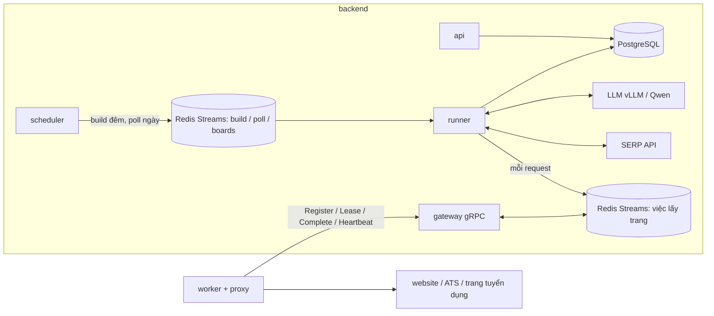
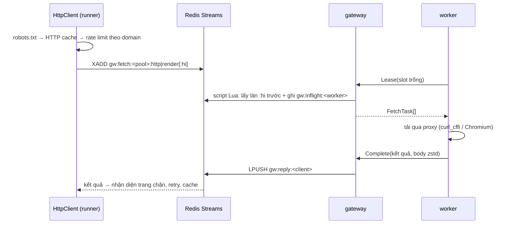

# Kiến trúc

Hệ thống chạy thế nào và vì sao. Vận hành hằng ngày: [OPERATIONS.md](OPERATIONS.md). Triển khai và
quy mô: [DEPLOY.md](DEPLOY.md).

## 1. Mục tiêu

Đầu vào: danh sách doanh nghiệp (tên, MST, website). Đầu ra: **việc làm đang mở** của từng doanh
nghiệp — đúng nhà tuyển dụng, trường đã chuẩn hoá (lương, tỉnh/thành, cấp bậc…), gộp trùng giữa
các nguồn — trong PostgreSQL, xem / export qua giao diện web.

| Yêu cầu                                                 | Cách đạt                                                                                                                            |
| ------------------------------------------------------- | ----------------------------------------------------------------------------------------------------------------------------------- |
| Tin mới thấy trong **≤ 3 phút ở P95** (ban ngày)        | poll mỗi doanh nghiệp mỗi 150 s; một lượt poll ≤ ~20 s → cửa sổ phát hiện ≤ ~170 s                                                  |
| **Đêm**: dựng bộ khung mỗi doanh nghiệp, **3–10 trang** | build 00:00–06:00 đọc đủ site, ghi các trang / API cần theo dõi, chia ≤ 10 trang / doanh nghiệp, mỗi nguồn ≥ 3 trang khi site có đủ |
| **Ngày**: chỉ gọi theo bộ khung, lỗi mới build lại      | poll 06:00–24:00 chỉ đọc trang / API trong bộ khung, mở trang chi tiết của tin mới; bộ khung hỏng → build lại ngay                  |
| **Proxy**: worker tải danh sách về, xoay dần            | gateway gửi danh sách proxy chung xuống worker; worker giữ một proxy mỗi domain 10 phút rồi chuyển proxy kế tiếp                    |

Ba loại nguồn:

| Nguồn                          | Ví dụ                                   | Cách lấy                                                                           |
| ------------------------------ | --------------------------------------- | ---------------------------------------------------------------------------------- |
| ATS có API công khai           | Greenhouse, Lever, Workday…             | adapter gọi API của ATS                                                            |
| Trang careers của doanh nghiệp | careers.shopee.vn, tuyendung.vcb.com.vn | parser chung: JSON-LD, link tin, JSON / API của trang SPA, LLM khi rule không thấy |
| Trang tuyển dụng (job board)   | TopCV, VietnamWorks, ITviec…            | index cả trang, gắn tin vào doanh nghiệp qua profile nhà tuyển dụng                |

## 2. Service và process

Mỗi thư mục là một service tự đủ (mã, lockfile, `Dockerfile`, `Taskfile.yml`, `.env`):
`backend/` (gói `jobcrawler`), `worker/` (gói `jobworker`, có Chromium), `frontend/` (React, nginx).
`proto/` là hợp đồng gRPC dùng chung (backend và worker phụ thuộc theo đường dẫn `../proto`).

| Container  | Lệnh               | Việc                                                                                            |
| ---------- | ------------------ | ----------------------------------------------------------------------------------------------- |
| `postgres` |                    | dữ liệu                                                                                         |
| `redis`    |                    | hàng đợi, việc lấy trang, khoá, rate limit, số đo, phiên bản cài đặt, cache (AOF, `noeviction`) |
| `backend`  | `jobcrawler serve` | migration rồi 4 process con dưới đây; một process thoát → container thoát, Docker dựng lại      |
| `frontend` | nginx              | bản build React; `/api/` chuyển tới `backend`                                                   |
| `worker`   | `jobworker run`    | nhận việc qua gRPC, tải bằng curl_cffi / Chromium qua proxy, trả kết quả                        |

| Process   | Lệnh                   | Việc                                                                   |
| --------- | ---------------------- | ---------------------------------------------------------------------- |
| api       | `jobcrawler api`       | API JSON `/api/...` (chỉ trong mạng nội bộ, sau `frontend`)            |
| gateway   | `jobcrawler gateway`   | gRPC cho worker (cổng 50051): giao việc từ Redis Streams, nhận kết quả |
| scheduler | `jobcrawler scheduler` | mỗi giây xếp build / poll đến hạn; một bản giữ lease leader trên Redis |
| runner    | `jobcrawler runner`    | chạy job của 3 hàng đợi (`--role poll\|build\|boards` để tách vai)     |

Mỗi process có event loop và watchdog riêng (vòng lặp đứng quá `WATCHDOG_SECONDS` → thoát mã 70).
Cài đặt = `backend/.env` (chỉ kết nối, bí mật hạ tầng, gateway, đăng nhập, log) + bảng `app_settings`
(mọi thứ khác, sửa ở trang Cài đặt, nạp lại ≤ 5 s). Cài đặt chỉ đọc lúc khởi động (`live=False`)
thì `jobcrawler serve` tự khởi động lại các process con khi chúng đổi.

Mã nguồn backend (`backend/jobcrawler/`) chia như `core-api/src` của open-asm:

| Thư mục                | Nội dung                                                                        |
| ---------------------- | ------------------------------------------------------------------------------- |
| `bootstrap/`           | điểm vào process: CLI `jobcrawler` (`cli.py`), `serve`, ứng dụng FastAPI (`app.py`: middleware, ghép router), `gateway`, `runner`, `scheduler` |
| `modules/<tính năng>/` | `router.py` (API `/api/...`), `schemas.py` (mô hình `...Out` / `...In`), `queries.py` (truy vấn cho giao diện), `actions.py` (thao tác của API) và service: `companies/`, `crawl/` (build, poll, bộ khung, lịch, độ trễ phát hiện), `jobs/`, `runs/`, `boards/`, `queue/`, `overview/`, `maintenance/`, `evaluate/`, `audit/`, `auth/`, `meta/`, `settings/`, `proxies/`, `gateway/` (gRPC cho worker + API Workers), `live/` (SSE) |
| `pipeline/`            | logic: KYC, tìm nguồn, thu thập, chuẩn hoá, xác minh, gộp, lưu                  |
| `sources/`             | nguồn tin (ATS, careers, trang tuyển dụng), chỉ biết `SourceSession`, không biết DB |
| `services/`            | hạ tầng dùng chung: `resources.py` (`Resources`), `redis/` (hàng đợi Streams, khoá, heartbeat), `net/` (HttpClient, proxy pool, rate limit, robots), LLM, SERP, mã hoá, fake cho test |
| `database/`            | model, phiên, migration Alembic, ID, nén zstd, fencing token                    |
| `common/`              | cấu hình, log, DTO dùng chung, phần chung của API (`api.py`, `pagination.py`), tiện ích văn bản / HTML / URL |
| `prompts/`             | prompt LLM (mỗi prompt một file, kèm schema output)                             |

Chiều gọi: `sources/` → `pipeline/` → service trong `modules/` (ghép pipeline với `Resources`) →
`router.py` của module và `bootstrap/`; router chỉ gọi service / `queries` / `actions` của module.

## 3. Build đêm (`modules/crawl/crawl.build_company`)

Mỗi doanh nghiệp một lượt trong `BUILD_WINDOW` (00:00–06:00, `CRAWL_TIMEZONE`), rải đều theo pha
cố định (hash của id). Doanh nghiệp mới và bộ khung hỏng thì build ngay, bất kể giờ. Deadline mềm
`COMPANY_DEADLINE_SECONDS` (165 s), timeout cứng 180 s; lượt chưa xong tự xếp lượt nối tiếp (≤ 2).

1. **KYC** (`pipeline/kyc.py`): còn hạn thì dùng lại; không thì SERP + website (chân trang, JSON-LD)
   → LLM chọn kèm trích đoạn → rule kiểm lại. Kết quả `verified` / `ambiguous` / `not_found`.
2. **Nguồn trang tuyển dụng** (song song bước 3): profile đã map → tin từ index chung.
3. **Tìm nguồn trên website** (`pipeline/discovery.py`): trang chủ → link tuyển dụng (LLM chọn khi
   nhiều; link tới một tin được thay bằng trang danh sách cha) → sitemap → subdomain
   `careers.` / `tuyendung.` / `jobs.` → đường dẫn phổ biến. Kết quả cache 7 ngày; build đêm tìm lại.
4. **Thu thập** (`pipeline/collect.py`): mỗi nguồn một task, đọc **đủ** site (≤ 10 trang danh sách,
   ≤ 20 trang API, ≤ 80 trang chi tiết mỗi nguồn); tin đã tải trong `JOB_REUSE_DAYS` dùng lại.
5. **Chuẩn hoá → xác minh → gộp → lưu** (mục 6). Lượt đọc đủ mọi nguồn mới đóng việc không còn thấy.
6. **Ghi bộ khung** (`crawl_plans`) và lịch (`company_schedules`).

### Bộ khung (`sources/plan.py`, bảng `crawl_plans`)

Mỗi nguồn website / ATS một dòng: trang / API cần đọc lại và mã các tin lượt build thấy.

| Trường (`spec`)        | Ý nghĩa                                                                      |
| ---------------------- | ---------------------------------------------------------------------------- |
| `listings`             | trang danh sách đã đọc (kể cả trang sau, "xem tất cả")                       |
| `hubs`                 | trang danh mục / theo tỉnh dẫn tới tin                                       |
| `apis`                 | API danh sách tin của trang SPA (cách phân trang, tổng số tin)               |
| `rendered`, `api_only` | trang phải mở bằng trình duyệt; trang mà API thay được (poll chỉ gọi API)    |
| `ignored`, `indirect`  | link không phải tin (poll không mở lại); tin chỉ tới được qua trang tin khác |
| `ats`                  | bảng tin ATS                                                                 |
| `pages`                | **số trang một lượt poll được đọc ở nguồn này**                              |

**Chia trang** (`modules/crawl/plans.allocate_pages`): mỗi doanh nghiệp có `PLAN_MAX_PAGES` (10)
trang mỗi lượt poll. Nhu cầu của một nguồn = trang danh sách + danh mục (bỏ trang có API thay) + số
trang API (tổng tin / cỡ trang); bảng tin ATS = 1 (Workday: 20 tin / trang). Chia theo thứ tự: mỗi
nguồn tới `min(nhu cầu, PLAN_MIN_PAGES)` (3) → chia vòng tới đủ nhu cầu → trang dư cho nguồn careers
(site thêm trang sau vẫn đọc trọn). Site 1–2 trang thì bộ khung đúng 1–2 trang.

## 4. Poll ngày (`modules/crawl/crawl.poll_company`)

Trong `POLL_WINDOW` (06:00–24:00), mỗi doanh nghiệp mỗi `POLL_INTERVAL_SECONDS` (150 s) ±
`POLL_JITTER_SECONDS` (10 s). Ngoài khung không poll: tin đăng ban đêm được lượt build đêm hoặc lượt
poll đầu tiên lúc 06:00 thấy.

1. Nạp bộ khung các nguồn `active` và (nguồn, mã, URL) các tin đã lưu — không đọc nội dung tin.
2. Mỗi nguồn đọc tối đa `pages` trang: **API trước** (gọi thẳng bằng HTTP, không mở trình duyệt),
   rồi trang danh sách / danh mục bằng HTTP (chỉ render khi HTML trống mà lượt build đã phải render).
   Không đi ra ngoài phần trang của mình.
3. So với mã tin lượt trước: **mới** = mã chưa có → chỉ mở trang chi tiết của tin mới (≤
   `POLL_MAX_DETAIL_PAGES` = 10 mỗi nguồn, còn lại lượt sau). **Đã gỡ** = mã cũ vắng mặt, chỉ khi
   nguồn đọc trọn (không bị cắt vì hết trang / deadline, không lỗi).
4. Không đổi gì → chỉ cập nhật lịch (đa số lượt, không ghi `company_runs`). Có tin mới → chuẩn hoá →
   xác minh → gộp với việc đã có → lưu; tin đã gỡ → đóng việc nếu không còn bản tin nào khác.
5. **Bộ khung hỏng → build lại ngay** (`REBUILD_ON_ERROR`): trang chính 404/410, API không còn JSON /
   không còn tin, trang danh sách hết sạch tin, lỗi tạm lặp `POLL_MAX_FAILURES` (3) lượt. Build lại
   vẫn hỏng → thử lại sau 2 giờ (trạng thái "Bộ khung hỏng").
6. **Chốt chặn đóng nhầm**: mất ≥ 30% tin (≥ 3 tin, nguồn ≥ 5 tin) trong một lượt → không đóng, đếm
   như lỗi; lặp 3 lượt → build lại, lượt build đọc đủ mới đóng đúng.

Build và poll của cùng doanh nghiệp không chạy chồng (`crawl.company_lock`):

- Khoá Redis `<prefix>:lock:company:<id>` (`locks.RedisLease`, 60 s, tự gia hạn mỗi 20 s). Poll gặp
  khoá thì bỏ lượt; build chờ tối đa `POLL_TIMEOUT_SECONDS` + 15 s, vẫn không giữ được (lượt build
  khác đang chạy) thì bỏ lượt (`skipped`, scheduler xếp lại khi còn cần) — không chạy chồng.
- Mất khoá giữa chừng (process đứng quá 60 s, Redis mất) → lượt bị huỷ ở lần gia hạn kế tiếp
  (`LeaseLost`).
- **Fencing token** (`database/fencing.py`, bảng `company_fences`): mỗi lần giữ khoá, token của doanh
  nghiệp tăng một trong Postgres; mọi commit trong lượt kiểm `fence = token` (`SELECT … FOR SHARE`)
  ngay trước commit. Lượt cũ đã mất khoá mà vẫn chạy tiếp (GC, máy ngủ) bị từ chối (`FencedOut`,
  rollback) từ lúc lượt mới lấy token — không ghi đè được dữ liệu mới hơn.

Lượt poll đi làn ưu tiên ở hàng việc lấy trang, nên build ban ngày không làm chậm poll.

**Độ trễ phát hiện** (`modules/crawl/sla.py`): mỗi lượt poll đủ ghi **cửa sổ phát hiện** = lúc xong
− lúc bắt đầu lượt poll đủ trước (độ trễ xấu nhất của tin đăng ngay sau lượt trước) vào histogram
Redis theo phút. P95 ≈ 0,95 × T + thời gian một lượt ≈ 142 + 10–20 s. Trang Tổng quan hiện P50 /
P95, % trong 3 phút, độ tươi (tuổi lượt poll đủ gần nhất của từng doanh nghiệp).

## 5. Lịch và scheduler (`modules/crawl/schedule.py`)

- Mỗi doanh nghiệp có pha cố định trong [0, 1): build đêm lúc `đầu BUILD_WINDOW + pha × độ dài`
  (10.000 doanh nghiệp / 6 giờ ≈ 0,46 lượt / giây), poll đầu ngày lúc `đầu POLL_WINDOW + pha × T`.
- Scheduler mỗi giây: tạo lịch cho doanh nghiệp mới (`new` → build ngay); lấy dòng đến hạn bằng
  `FOR UPDATE SKIP LOCKED`, dời mốc kế tiếp, xếp job. Hàng đợi còn quá
  `BUILD_QUEUE_MAX_BACKLOG` / `POLL_QUEUE_MAX_BACKLOG` việc chờ thì không xếp thêm.
- Chỉ một scheduler làm việc: lease Redis `<prefix>:lock:scheduler` (`locks.RedisLease`, 30 s, gia
  hạn mỗi nhịp; hai scheduler chồng nhau trong chốc lát vô hại vì job có khoá duy nhất). Bảo trì giữ
  lease bằng `hold()`: mất lease thì lượt bảo trì bị huỷ. Không dùng khoá advisory theo phiên
  Postgres (hỏng sau PgBouncer chế độ transaction).
- Trạng thái lịch: `new`, `ready`, `no_sources`, `broken`, `paused`.
- Cron (theo `CRAWL_TIMEZONE`): bảo trì mỗi giờ, số liệu tổng quan 5 phút, index trang tuyển dụng
  đủ 00:30, đuôi mỗi 2 phút (6h–23h).

## 6. Trang tuyển dụng và xử lý tin

**Index trang tuyển dụng** (`pipeline/board_index.py`, mỗi trang một `BoardAdapter`):

- **Đủ** (đêm): đọc toàn bộ danh sách, tải tin mới / đổi, tin vắng 2 lượt → gỡ; map profile mới.
- **Đuôi** (ngày, mỗi 2 phút): 1–4 request tới phần mới nhất, tải tin chưa từng thấy.
- Doanh nghiệp có profile vừa có tin mới → **poll ngay**. Lượt poll không gọi trang tuyển dụng theo
  từng doanh nghiệp.
- Map profile ↔ doanh nghiệp (`pipeline/profiles.py`): cùng MST → website trùng domain → tên khớp
  đúng một doanh nghiệp; còn mơ hồ thì LLM chọn kèm lý do.

**Chuẩn hoá** (`pipeline/normalize.py`, rule trước, LLM sau): HTML → markdown sạch (ẩn SĐT / email cá
nhân); lương → min / max / tiền tệ / kỳ; địa điểm → 34 tỉnh/thành sau sáp nhập 2025; cấp bậc / loại
hình / hình thức.

**Xác minh** (`pipeline/verify.py`): mỗi tin một quyết định có lý do (`EXPIRED`, `EMPTY_JD`,
`NOT_A_JOB`, `EMPLOYER_MISMATCH`, `AGENCY_POSTING`, `SCAM_SIGNALS`, `SPAM_REPOST`). Tin đáng ngờ phải
được LLM xác nhận (cache 7 ngày); LLM lỗi → hoãn (không nhận, không loại, việc cũ giữ nguyên).

**Gộp** (`pipeline/dedup.py`): cùng tiêu đề, chung tỉnh/thành, JD giống (MinHash ≥ 0,8) hoặc cùng nơi
nộp → một việc. Bản chuẩn: ATS / careers > trang tuyển dụng đủ JD > mới nhất. Index duy nhất trong DB
chặn hai việc đang mở y hệt.

## 7. Lấy trang qua worker (`modules/gateway/`, `worker/`)

- **Một việc = một request.** Mọi logic (robots, rate limit, retry, nhận diện chặn, parse) ở
  backend; worker không giữ trạng thái. Gateway không nhớ gì ngoài Redis → chạy nhiều bản sau load
  balancer.
- **Ưu tiên poll**: việc của lượt poll vào làn `:hi`, Lease đọc trước.
- **Giao việc nguyên tử**: một script Lua lấy entry khỏi stream (XRANGE + XDEL) và ghi
  `gw:inflight:<worker>` (task_id → hạn + mốc giao) cùng lúc, nên gateway chết giữa chừng không làm
  mất việc. Chưa có việc thì Lease chờ bằng XREAD BLOCK (chỉ để thức dậy). Mỗi việc giao tối đa một
  lần (at-most-once); mất thì backend gửi lại.
- **Worker rời / quá hạn báo sống** → gateway trả `worker_lost` cho việc nó đang giữ, backend gửi lại
  (sau 0,5–1 s, một lần; sau đó là retry của `HttpClient`). Prune từng worker trong Lua và chỉ khi nó
  vẫn quá hạn: worker vừa đăng ký lại không bị trả oan việc mới.
- **Đối soát qua Heartbeat**: worker kể mọi việc còn nợ kết quả (`task_ids`). Việc đã giao quá 60 s
  mà worker không kể (lời trả Lease không tới worker) → `worker_lost`; việc worker kể mà gateway đã
  thu hồi → `revoked_task_ids`, worker huỷ ngay. Worker cũ không kể việc thì không đối soát.
- **Đồng hồ**: hạn báo sống, mốc giao việc, hạn của việc so theo `TIME` của Redis, không theo đồng
  hồ từng máy. `GATEWAY_WORKER_TTL_SECONDS` phải ≥ 3 × `GATEWAY_HEARTBEAT_SECONDS`.
- **Pool**: worker khai `WORKER_POOL`; `FETCH_ROUTES` định tuyến domain → pool (vd. trang tuyển dụng qua
  proxy dân cư); pool không có worker thì về `default`; không có worker nào → lỗi `no_worker` ngay.
- **Đăng ký**: `Register` trả `WorkerConfig` (slot trần, impersonate, heartbeat, danh sách proxy
  chung). Lease / Heartbeat chỉ trả `config_version`; đổi phiên bản → worker đăng ký lại.
- **Xác thực** (bật khi đặt `GATEWAY_TOKEN`): `Register` bằng khoá tham gia (`GATEWAY_TOKEN` hoặc khoá
  dùng một lần, TTL 15 phút) → nhận `worker_token` riêng (chỉ trên Redis, băm SHA-256, hạn trượt 7
  ngày); mọi RPC sau phải dùng token đó và đúng `worker_id`. "Thêm worker" ghép lệnh `docker run`
  từ khoá + `GATEWAY_PUBLIC_URL` (trống = địa chỉ trang web) + `GATEWAY_WORKER_IMAGE`.
- **Slot**: `WORKER_HTTP_SLOTS` / `WORKER_RENDER_SLOTS` trống = tự tính theo máy (HTTP 8 / CPU trong
  [8, 64], render 1 / 768 MiB trong [1, 8]); gateway gửi mức trần.

### Proxy (`PROXY_MODE`)

| Chế độ                               | Ai chọn proxy         | Cách xoay                                                                                                                                                                                                                                                                                                                             |
| ------------------------------------ | --------------------- | ------------------------------------------------------------------------------------------------------------------------------------------------------------------------------------------------------------------------------------------------------------------------------------------------------------------------------------- |
| `worker` "Worker tự xoay" (mặc định) | worker                | danh sách: proxy riêng của máy (`WORKER_PROXIES`) nếu có, không thì **danh sách chung** gateway gửi xuống. Mỗi domain giữ một proxy `WORKER_PROXY_STICKY_SECONDS` (600 s) rồi sang proxy kế tiếp (vòng tròn, mỗi worker bắt đầu ở vị trí riêng); 403/407/429 → proxy nghỉ với domain đó 120 s; 5 lỗi kết nối liên tiếp → loại 10 phút |
| `central` "Backend chọn"             | backend, từng request | chọn theo điểm (thành công +1, bị chặn −5, lỗi −10), giữ theo domain 30 phút, trạng thái trên Redis; worker dùng đúng proxy được chỉ định                                                                                                                                                                                             |
| `off`                                | không                 | đi thẳng                                                                                                                                                                                                                                                                                                                              |

Danh sách chung = bảng proxy ở trang Cài đặt (lưu mã hoá) + `PROXIES_FILE`. Gateway gửi kèm mã băm
của danh sách trong phiên bản cấu hình: đổi danh sách → worker nhận bản mới trong khoảng 15 s và giữ
sức khoẻ của các proxy còn lại. Proxy chung giữ đúng id của backend nên `source_fetches.proxy_id` khớp
bảng proxy.

## 8. Hàng đợi (Redis Streams, `services/redis/streamqueue.py`)

| Job                         | Hàng đợi            | Khoá                 | Giới hạn                                 |
| --------------------------- | ------------------- | -------------------- | ---------------------------------------- |
| `build_company`             | `jobcrawler-build`  | `build:<id>[:contN]` | timeout 180 s, `COMPANY_JOB_RETRIES` lần |
| `poll_company`              | `jobcrawler-poll`   | `poll:<id>`          | `POLL_TIMEOUT_SECONDS` (90 s)            |
| `index_board`, `tail_board` | `jobcrawler-boards` | `board:<trang>`      | ngân sách thời gian của lượt             |

Mỗi hàng đợi một stream, consumer group `workers`, mỗi runner một consumer chỉ đọc khi còn slot. Khoá
job bảo đảm mỗi doanh nghiệp chỉ một build và một poll đang chờ / chạy.

- **Báo sống / thu hồi**: runner báo sống mỗi `QUEUE_RECLAIM_SECONDS` / 6 (hạn theo `TIME` của Redis)
  và làm mới idle của entry đang chạy; entry im quá `QUEUE_RECLAIM_SECONDS` (60 s) bị runner khác thu
  hồi, chạy lại nếu còn lượt. Id entry đổi mỗi lần xếp lại và mọi chuyển trạng thái so id đó (Lua),
  nên lượt cũ không ghi đè trạng thái job.
- **Lượt bị thu hồi tự dừng**: lần báo sống chỉ làm mới entry mà hash job còn ghi đúng entry + runner;
  entry không còn là của mình thì runner huỷ lượt đó (`queue.job_revoked`).
- **Runner đứng tự thoát trước khi bị thu hồi**: watchdog của runner dùng min(`WATCHDOG_SECONDS`,
  `QUEUE_RECLAIM_SECONDS` / 2).

Số job song song mỗi runner
(`RUNNER_*_CONCURRENCY`, 0 = tự tính: poll 12 / CPU trong [20, 100], build 2,5 / CPU và ≤ 2 / GiB
trong [4, 20], trang tuyển dụng 1 / CPU trong [2, 8]).

## 9. Dữ liệu (`database/`)

| Bảng                                                     | Nội dung                                                                                    |
| -------------------------------------------------------- | ------------------------------------------------------------------------------------------- |
| `companies`, `company_aliases`                           | doanh nghiệp đầu vào + KYC + tóm tắt; tên chuẩn hoá để tra                                  |
| `company_schedules`                                      | trạng thái lịch, mốc build / poll, lượt poll đủ gần nhất; fillfactor 70 (ghi mỗi lượt poll) |
| `crawl_plans`                                            | bộ khung từng nguồn, `active` / `broken` / `retired`, mã tin, lỗi                           |
| `source_profiles`, `job_postings`                        | profile trên trang tuyển dụng; mỗi tin của mỗi nguồn (nội dung thô nén zstd)                |
| `jobs`, `job_reviews`                                    | việc đã gộp (`active` / `expired` / `removed`); kiểm tay                                    |
| `company_runs`, `source_fetches`, `failed_pages`, `logs` | lượt build / poll có thay đổi, từng request, trang parse lỗi, log                           |
| `company_fences`                                         | fencing token của khoá theo doanh nghiệp (tăng mỗi lượt build / poll giữ khoá)              |
| `board_index_runs`                                       | lịch sử index trang tuyển dụng                                                              |
| `app_settings`, `audit_events`, `compression_dicts`      | cài đặt (trường bí mật mã hoá AES-256-GCM); nhật ký thao tác (chỉ ghi thêm); từ điển zstd   |

Khoá chính UUIDv7. Schema chỉ đổi bằng revision Alembic mới. Danh sách luôn phân trang ở server,
đếm có giới hạn; index theo đúng truy vấn (trigram cho tên, BRIN theo thời gian).

## 10. Web và API

- `frontend` (nginx) phục vụ bản build React và chuyển `/api/` tới API (FastAPI, ghép router
  `modules/*/router.py` ở `bootstrap/app.py`). Một origin nên cookie và chống CSRF giữ nguyên.
  Cùng cổng đó nhận gRPC của worker (`http2 on`, `/jobcrawler.crawl.v1.CrawlGateway/` →
  `GATEWAY_UPSTREAM`): hệ thống chỉ mở một cổng.
- **Đăng nhập** (`modules/auth/auth.py`): đặt `UI_PASSWORD` → trang `/login`, JWT HS256 trong cookie
  httpOnly `jc_token` (hoặc `Authorization: Bearer`); đăng xuất thu hồi trên Redis; sai 20 lần / IP
  / 5 phút → 429. SSO: proxy (vd. oauth2-proxy) gửi `X-Forwarded-User`, đặt
  `AUTH_PROXY_USER_HEADER`.
- **Hợp đồng có kiểu**: mỗi endpoint trả một mô hình `...Out`; `backend/openapi.json` là bản commit
  của spec; orval sinh `frontend/src/lib/gen/queries.ts` (hàm, hook React Query, kiểu). `task api` làm
  cả hai; lệch thì test đỏ.
- **Cập nhật trực tiếp** (`modules/live/live.py`, `frontend/src/lib/live.ts`): Server-Sent Events ở
  `GET /api/events?topic=…`, một kết nối mỗi tab cho mọi chủ đề — `workers` (trang Workers),
  `queue` (trang Hàng đợi, thanh bên, thẻ Hàng đợi ở Tổng quan), `run` (trang lượt chạy khi lượt
  build đang chạy: trạng thái, số log / request, danh sách log; lượt poll chỉ ghi khi xong). Mỗi
  process API một task đọc chung mỗi chủ đề mỗi 2 s (Redis / Postgres, dùng lại hàm của endpoint
  JSON), chỉ đẩy khi nội dung đổi (băm JSON) hoặc 30 s chưa gửi; nhiều replica tự đọc nên không cần
  pub/sub hay sticky session. Sự kiện là `LiveOut` (trong spec,
  orval bỏ endpoint, chỉ sinh kiểu); giao diện ghi vào cache React Query đúng khoá của hook orval.
  `id` của sự kiện là dấu từng chủ đề: nối lại kèm `Last-Event-ID` thì chủ đề chưa đổi không gửi
  lại; `retry: 3000`; `: ping` mỗi 15 s. Đăng nhập như mọi endpoint (cookie `jc_token`), luồng tự
  dừng khi JWT hết hạn / bị thu hồi. Mất SSE (lỗi HTTP, API khởi động lại, hoặc 45 s không có sự
  kiện nào — kết nối chết mà trình duyệt không báo) thì trang poll như cũ (Workers / Hàng đợi 5 s,
  thanh bên 15 s) và thử nối lại 2 → 30 s; tab ẩn quá 60 s thì đóng kết nối.
  Phần còn poll (đổi chậm hoặc số liệu tính sẵn): Tổng quan và độ trễ phát hiện 30 s, bộ khung
  doanh nghiệp 15 s, trang tuyển dụng 30 s, proxy trong Cài đặt 15 s.
- Mọi thao tác thay đổi trạng thái ghi `audit_events` (bí mật bị che). Giao diện chỉ hiện trạng thái
  và cài đặt, không hiện lệnh vận hành.

## 11. Quan sát và kiểm thử

- Log structlog có ngữ cảnh (`request_id`, `run_id`, `company`, `source`), che bí mật trước khi ghi;
  `poll.done` mỗi lượt (request, mới / gỡ, cửa sổ phát hiện).
- `/api/crawl/status`: P50 / P95 thời gian poll và cửa sổ phát hiện, độ tươi. `/api/workers`: worker,
  slot, việc xong / lỗi. Heartbeat Redis của scheduler / runner là healthcheck của `backend`.
- **Test**: unit không gọi mạng (`FakeFetcher` với HTML / JSON chụp từ trang thật, `FakeChatClient`,
  gateway giả); tích hợp trên Postgres + Redis thật (`TEST_DATABASE_URL` tên kết thúc `_test`); hợp
  đồng API (`test_openapi.py`) và gRPC (`buf breaking`); Vitest cho giao diện; Playwright E2E chạy ở
  máy trên stack đang chạy. `task check` = đúng những gì CI chạy.
