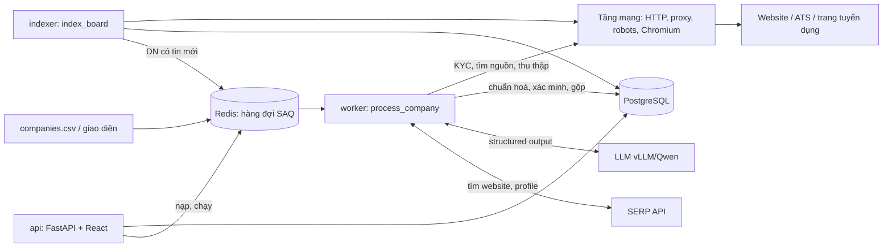
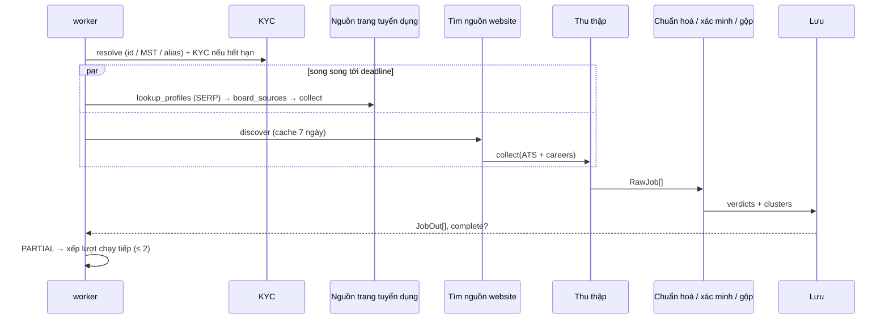
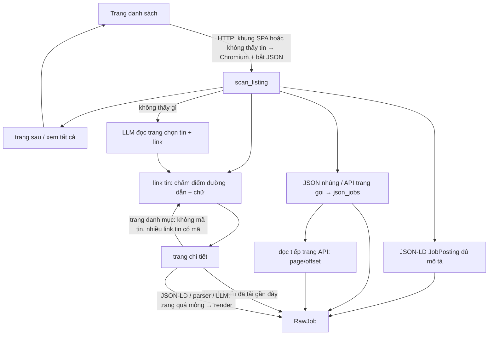
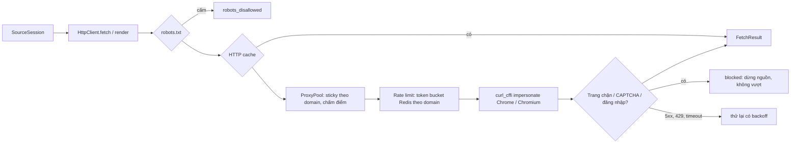
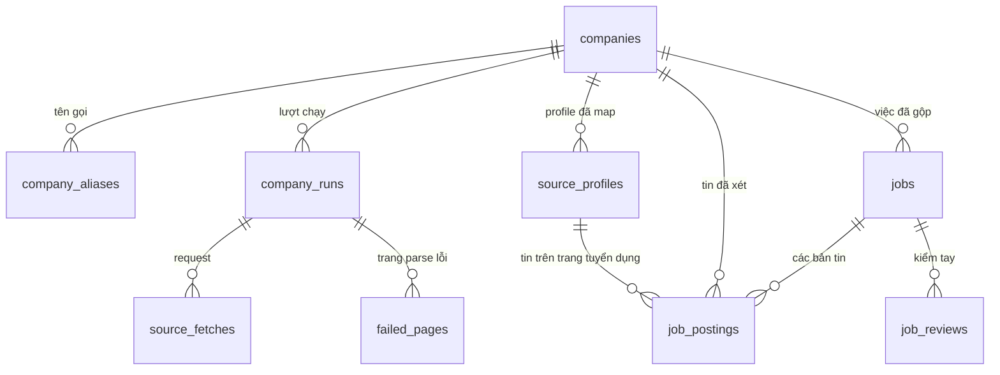

# Kiến trúc

Tài liệu này mô tả hệ thống chạy thế nào: các process, luồng dữ liệu, từng tầng trong mã nguồn và
các quyết định thiết kế quan trọng. Cách vận hành (dịch vụ, giới hạn đang đặt, bảo trì) xem
[OPERATIONS.md](OPERATIONS.md); đặc tả gốc xem [BUILD_PROMPT.md](BUILD_PROMPT.md).

## 1. Tổng quan

Đầu vào là danh sách doanh nghiệp (tên, MST, website — chủ yếu tại Việt Nam, quy mô ~10.000). Đầu
ra là các **việc làm đang mở** của từng doanh nghiệp: đã xác minh đúng nhà tuyển dụng, chuẩn hoá
trường (lương, tỉnh/thành, cấp bậc…), gộp trùng giữa các nguồn, lưu trong PostgreSQL và xem /
export qua giao diện web.

Tin được lấy từ ba loại nguồn:

| Nguồn | Ví dụ | Cách lấy |
|---|---|---|
| ATS có API công khai | Greenhouse, Lever, Workday… | adapter gọi API của ATS |
| Trang careers trên website doanh nghiệp | tuyendung.vietcombank.com.vn, careers.shopee.vn | parser chung: JSON-LD, link tin, JSON của trang SPA, LLM |
| Trang tuyển dụng (job board) | TopCV, VietnamWorks, ITviec… | index cả trang định kỳ, rồi gắn tin vào doanh nghiệp qua profile nhà tuyển dụng |



## 2. Các process

Mọi process dùng chung một image và một gói Python (`src/jobcrawler`), khác nhau ở lệnh chạy
(`docker-compose.yaml`).

| Dịch vụ | Lệnh | Việc |
|---|---|---|
| `postgres` | | dữ liệu |
| `redis` | | hàng đợi SAQ, rate limit, proxy pool, robots cache, HTTP cache, cache LLM/SERP/discovery, số liệu tổng quan |
| `migrate` | `jobcrawler db upgrade` | chạy Alembic mỗi lần `up` rồi thoát |
| `worker` × `WORKER_REPLICAS` (3) | `jobcrawler worker` | queue `jobcrawler`: job `process_company` (mỗi replica `WORKER_CONCURRENCY` = 10 doanh nghiệp song song); cron bảo trì mỗi giờ, cron số liệu tổng quan mỗi 5 phút |
| `indexer` × `INDEXER_REPLICAS` (1) | `jobcrawler worker --boards` | queue `jobcrawler-boards`: job `index_board` cho từng trang tuyển dụng; cron `BOARD_INDEX_CRON` (mỗi 5 giờ) |
| `api` | `jobcrawler ui` | API JSON `/api/...` + giao diện React đã build |

CLI (`jobcrawler …`, `entrypoints/cli.py`) dùng đúng các hàm của tầng `services/` như worker và
API: chạy một doanh nghiệp (`run`), KYC (`kyc`), thử một website (`site`), nạp/đưa vào queue
(`import`, `enqueue`), index (`index-boards`), export, thống kê, đánh giá (`eval`), DB (`db …`).

Mọi process mở tài nguyên qua `resources.open_resources()` → `Resources`: engine + sessionmaker
SQLAlchemy async, Redis, queue SAQ, `LLMClient`, `HttpClient` (kèm `ProxyPool`) và
`BrowserManager` (Chromium khởi động ở lần render đầu tiên). Log ghi cả ra Postgres qua sink nền.

## 3. Bản đồ mã nguồn

```
src/jobcrawler/
  config.py            Settings (pydantic-settings, đọc .env)
  resources.py         mở/đóng tài nguyên dùng chung của một process
  schemas.py           kiểu dữ liệu: CompanyIn, RawJob, JobOut, enum trạng thái…
  text.py              bỏ dấu, chuẩn hoá tên doanh nghiệp, khoá khớp profile
  pages.py             đọc HTML: link, nội dung chính, markdown, phân trang
  llm.py, serp.py      client LLM (structured output) và SERP
  prompts/             prompt + schema Pydantic cho từng lời gọi LLM
  net/                 HTTP client, proxy pool, rate limit, robots, nhận diện chặn, Chromium, KV
  sources/             nguồn tin: base, careers, json_jobs, jsonld, ats/*, boards/*
  pipeline/            KYC, tìm nguồn, thu thập, chuẩn hoá, xác minh, gộp, lưu, index board, map profile
  services/            nghiệp vụ dùng chung cho CLI / worker / API
  entrypoints/         cli.py, worker.py
  web/                 FastAPI (api.py, queries.py, actions.py) phục vụ frontend/
  db/                  models, migration Alembic, nén zstd, UUIDv7
frontend/              React + shadcn/ui + Tailwind (build vào src/jobcrawler/web/dist)
tests/                 unit (fake mạng/LLM), fixtures trang thật, integration (Postgres + Redis)
```

Quy ước phụ thuộc: `sources/` chỉ biết `SourceSession` (bọc `Fetcher` + `LLMClient`), không biết DB;
`pipeline/` là logic thuần hoặc nhận `AsyncSession`; `services/` ghép pipeline với `Resources`;
`entrypoints/` và `web/` chỉ gọi `services/`.

## 4. Một lượt `process_company`

`services/companies.py::process_company` xử lý một doanh nghiệp và luôn ghi một dòng
`company_runs` (kể cả khi lỗi hoặc bị huỷ). Thời gian: deadline mềm `COMPANY_DEADLINE_SECONDS`
(165 s) cho phần thu thập, timeout cứng của job SAQ `COMPANY_TIMEOUT_SECONDS` (180 s), 20 s cuối
dành để lưu.



1. **Xác định doanh nghiệp** (`resolve`): theo `company_id` của job, không có thì tra MST → alias
   khớp chính xác → trigram (chỉ doanh nghiệp đã `verified`); chưa có thì tạo mới.
2. **KYC** (`pipeline/kyc.py`, ≤ `KYC_TIMEOUT_SECONDS`): kết quả còn hạn (`KYC_CACHE_DAYS`) thì dùng
   luôn. Không thì lấy ứng viên từ SERP và website (chân trang, JSON-LD Organization: tên pháp
   lý, MST, địa chỉ), LLM chọn kèm trích đoạn, rule kiểm lại trích đoạn và tín hiệu khớp mạnh
   (cùng MST, cùng domain đầu vào, website ghi đúng tên…). Kết quả: `verified` / `ambiguous` /
   `not_found`, `primary_domain`, alias.
3. **Nguồn trang tuyển dụng** (chạy ngay, song song với bước 4): tìm thêm profile bằng SERP
   `"<tên>" site:…` cho trang chưa có profile, rồi `board_sources()` tạo một
   `BoardProfileSource` cho mỗi profile đã map, lọc theo KYC (mục 7).
4. **Tìm nguồn trên website** (`pipeline/discovery.py`, ≤ `DISCOVERY_TIMEOUT_SECONDS`): mở trang chủ
   (thử domain trần và `www.` cùng lúc), lấy link có từ khoá tuyển dụng (LLM chọn khi nhiều) →
   sitemap → subdomain `careers.`/`tuyendung.`/`jobs.` → đường dẫn phổ biến; mỗi ứng viên được mở
   để xác nhận (có tin, JSON-LD, JSON của trang, hoặc nhúng ATS), tối đa 3 bước nhảy. Kết quả:
   danh sách ATS + trang careers, cache Redis 7 ngày (không tìm thấy: 1 ngày).
5. **Thu thập** (`pipeline/collect.py`): mỗi nguồn một task, chạy tới deadline; nguồn chưa xong bị
   huỷ nhưng tin đã yield vẫn giữ. Trước đó nạp `KnownJobs` — tin website/ATS đã tải chi tiết trong
   `JOB_REUSE_DAYS` — để nguồn dùng lại thay vì tải lại.
6. **Chuẩn hoá → xác minh → gộp → phân loại → lưu** (mục 8).
7. **Kết thúc**: ghi `company_runs`, `source_fetches`, `failed_pages`, tóm tắt trên `companies`.
   Trạng thái `partial` khi có nguồn hết giờ / chạm giới hạn / lỗi tạm, tìm nguồn lỗi, hoặc tin
   chờ LLM; worker khi đó xếp lượt chạy tiếp (`COMPANY_MAX_CONTINUATIONS`, cách
   `COMPANY_CONTINUATION_DELAY_SECONDS`), lượt sau đi tiếp nhờ dùng lại chi tiết đã tải.

**"Lượt đủ" và đóng việc cũ.** Chỉ khi mọi nguồn xong trọn (không huỷ, không bị cắt, không lỗi,
không tin hoãn xác minh) thì việc đang mở mà lượt này không còn thấy mới bị đánh `removed`
(hoặc `expired` nếu quá hạn nộp). Lượt `partial` không đóng việc nào.

## 5. Nguồn tin (`sources/`)

Mọi nguồn cài `Source.jobs(session) -> AsyncIterator[RawJob]` và chỉ gọi mạng qua
`SourceSession`. Session ghi mỗi request thành `FetchRecord` (→ `source_fetches`), giữ trang parse
lỗi (→ `failed_pages`), dừng nguồn khi bị chặn (`SourceError`), và nhận lời báo
`truncate(reason)` khi nguồn phải dừng trước khi lấy hết tin. Giới hạn mỗi nguồn ở
`SourceLimits` (tin, trang chi tiết, trang danh sách, trang render, trang danh mục, trang API).

`RawJob` giữ giá trị thô của nguồn (HTML mô tả, chuỗi địa điểm, chuỗi lương…), kèm cách bóc
`ExtractionMethod` (`ats_api`, `jsonld`, `parser`, `heuristic`, `llm`) — quyết định độ tin cậy ban
đầu khi xác minh (0.95 → 0.75; tin do LLM bóc luôn phải được LLM xác nhận lại).

### 5.1 ATS (`sources/ats/`)

Greenhouse, Lever, Ashby, Workable, Workday, BambooHR, Recruitee, Teamtailor (SmartRecruiters
chỉ nhận diện: robots.txt cấm API). `ats.detect()` nhận ra ATS từ URL hoặc HTML (link, iframe,
script); `ats.match_url()` cho URL bảng tin người dùng đưa vào. Workday đọc danh sách phân trang
(lọc facet Việt Nam khi danh sách quá dài) rồi lấy chi tiết từng tin; các ATS khác một lời gọi.

### 5.2 Trang careers chung (`sources/careers.py`)



- **Đọc danh sách**: tối đa `SOURCE_MAX_LISTING_PAGES` trang (phân trang `?page=`, `/page/N`, link
  "xem tất cả vị trí"). HTML là khung SPA hoặc không thấy tin thì mở bằng Chromium, chờ mạng yên
  và giữ các phản hồi JSON trang gọi.
- **Link tin** (`job_links`): cùng site, chấm điểm theo đoạn đường dẫn (`/tuyen-dung/…`, `/jobs/…`,
  `recruitment-…`), slug có mã số, chữ trên link giống tên vị trí; loại trang chính sách, tìm
  kiếm, tin tức theo cụm từ ở đầu/cuối đoạn (không theo chuỗi con, để giữ "chuyên viên bảo mật").
- **JSON của trang SPA** (`sources/json_jobs.py`, thuần): tìm mảng phần tử giống tin (tên vị trí +
  thuộc tính tin như nơi làm, lương, hạn nộp, loại hình, phòng ban), chặn theo đường dẫn API /
  khoá JSON có từ về việc làm; đổi thành `RawJob` khi có mô tả, thành link khi chỉ có URL/slug.
  Nhận ra tham số phân trang (`page`/`pageSize`, `offset`/`limit`, trong query hoặc body JSON) và
  tổng số tin để đọc tiếp qua HTTP (chỉ header `Accept`, không cookie), tối đa
  `SOURCE_MAX_API_PAGES`. Nơi làm ghi bằng mã (`city_id`) được đọc tên từ danh mục trang tải kèm.
- **Trang chi tiết**: JSON-LD JobPosting → parser chung (tiêu đề khớp chữ trên link, nội dung chính,
  trường có nhãn như "Mức lương:", "Hạn nộp:") → trang không rõ là tin thì LLM quyết
  (`prompts/job_detail`). Trang quá mỏng (mô tả nạp bằng JavaScript) thì render lại. Trang không có
  mã tin mà dẫn tới nhiều tin có mã là **trang danh mục** (theo ngành, tỉnh): đi tiếp, không lưu
  thành tin, không tính vào giới hạn trang chi tiết.
- **LLM đọc danh sách** chỉ khi rule không thấy gì: đọc markdown từng đoạn, chọn tin và link trong
  danh sách link của trang (không được bịa link).
- Chạm giới hạn hoặc lỗi tạm thì `truncate` → lượt chạy `partial`.

### 5.3 Profile trên trang tuyển dụng (`sources/boards/profile_source.py`)

Một `BoardProfileSource` cho mỗi profile đã map:

- Index của profile **còn mới** (`indexed_at` trong `BOARD_STALE_HOURS`, chỉ được đặt khi lượt index
  đọc đủ danh sách và không còn tin chưa tải của profile đó) → lấy tin từ `job_postings`, không gọi
  mạng.
- Không thì **đọc danh sách tin trên trang profile** (`BoardAdapter.profile_listing`: đủ các trang;
  VietnamWorks dùng API tìm kiếm lọc `companyId`), gộp với index: tin đã index dùng luôn, tin chưa
  gắn profile lấy theo mã, chỉ tải chi tiết tin còn thiếu; bỏ tin của nhà tuyển dụng khác (khối
  "việc làm tương tự"). Adapter đã kiểm phân trang (`profile_listing_complete`) thì tin index không
  còn trên trang được coi là đã đóng. Không đọc được danh sách thì dùng tạm tin đã index.

## 6. Index trang tuyển dụng (`pipeline/board_index.py`)

Mỗi trang tuyển dụng là một `BoardAdapter` (`sources/boards/`): `SitemapBoard` (sitemap tin kèm
`lastmod` + JSON-LD ở trang chi tiết: TopCV, JobsGO, CareerViet, Glints, TopDev, ITviec),
`ListingBoard` (đọc trang danh sách mới nhất trước: CareerLink, Vieclam24h, 123job), hoặc tự cài
(VietnamWorks: API tìm kiếm của trang + payload React ở trang chi tiết). Adapter biết: liệt kê tin
(`entries`), bóc trang chi tiết thành tin + profile (`parse_job`), đọc trang profile
(`parse_profile`, `profile_listing`).

Một lượt `index_board` (khoá advisory Postgres: mỗi trang một process):

1. Đọc danh sách tin (có `lastmod`), cập nhật `last_seen_at` cho tin đã có.
2. Lập kế hoạch tải: tin mới → tin đổi (`lastmod` mới hơn, đã gỡ nay thấy lại) → tin lâu chưa tải
   (`BOARD_REFRESH_DAYS`, gửi kèm ETag/Last-Modified); cắt ở `BOARD_MAX_JOBS_PER_RUN` và
   `BOARD_INDEX_BUDGET_SECONDS`, phần còn lại để lượt sau.
3. Tải, bóc, upsert `job_postings` + `source_profiles` theo lô (giữ liên kết profile cũ nếu lần tải
   này không thấy link profile).
4. Danh sách đọc đủ: tin vắng 2 lượt liên tiếp → `removed` (có chốt chặn khi danh sách tụt bất
   thường); đánh dấu `indexed_at` cho profile đủ tin.
5. Map profile mới ↔ doanh nghiệp (mục 7).
6. Doanh nghiệp có profile vừa có tin mới (hoặc vừa map) được xếp chạy lại nếu lượt gần nhất cũ
   hơn `BOARD_RERUN_MIN_HOURS`.

## 7. Map profile ↔ doanh nghiệp (`pipeline/profiles.py`)

- Khoá so tên riêng `text.company_match_key()`: bỏ dấu, loại hình pháp lý, phần trong ngoặc, phần
  chi nhánh; mở rộng "TMCP"; bỏ đuôi chung ("Việt Nam", "Group") khi còn từ riêng. Lưu ở
  `source_profiles.name_norm`; doanh nghiệp có thêm alias `kind="match"` (không dùng cho KYC).
- Lọc ứng viên bằng pg_trgm (`PROFILE_MATCH_TRIGRAM`), rồi rule: cùng MST (1.0) → website trùng
  domain (0.95) → tên khớp đúng một doanh nghiệp (0.85 / 0.8); mâu thuẫn MST/website hoặc khác chi
  nhánh thì loại. Còn mơ hồ → LLM chọn kèm lý do (`prompts/profile_match`).
- Khi thu thập, profile được dùng theo KYC: `verified` → mọi profile; `not_found` → profile khớp
  MST/website hoặc khớp tên chặt và đủ riêng; `ambiguous` → chỉ MST/website.
- `index-boards --rematch` tính lại khoá và map lại toàn bộ (sau khi đổi luật so tên).

## 8. Chuẩn hoá, xác minh, gộp, lưu

**Chuẩn hoá** (`pipeline/normalize.py`, rule trước, LLM sau): HTML → markdown sạch (bỏ
boilerplate, ẩn SĐT/email cá nhân/tên người liên hệ); lương → min/max/tiền tệ/kỳ; địa điểm → 34
tỉnh/thành sau sáp nhập 2025 (`pipeline/provinces.py`, tên cũ → mới); ngày → UTC (hạn nộp dạng
khoảng ngày lấy ngày cuối); cấp bậc / loại hình / hình thức bằng rule, còn `unknown` thì
`classify_unclear` hỏi LLM sau khi gộp.

**Xác minh** (`pipeline/verify.py`): mỗi tin một `Verdict` có lý do.

- Rule loại: `EXPIRED`, `EMPTY_JD`, `NOT_A_JOB`, `EMPLOYER_MISMATCH`, `AGENCY_POSTING`,
  `SCAM_SIGNALS`, `SPAM_REPOST` (cùng nguồn đăng lại).
- Độ tin cậy ban đầu theo cách bóc; tin có điểm cần xem (tên nhà tuyển dụng khác, dấu hiệu tuyển
  hộ / lừa đảo nhẹ, bóc bằng LLM…) bị hạ dưới `VERIFY_MIN_CONFIDENCE` và phải được LLM xác nhận
  (`prompts/job_verify`, cache theo nội dung 7 ngày, tối đa `VERIFY_LLM_MAX_JOBS` lời gọi).
- LLM không kịp / vượt giới hạn / lỗi → **hoãn** (`DEFERRED`): không nhận, không loại, không ghi;
  việc cũ giữ nguyên, lượt sau chấm tiếp. Không cấu hình LLM → loại `LOW_CONFIDENCE`.

**Gộp trùng** (`pipeline/dedup.py`): hai tin là một việc khi tiêu đề giống (không lệch nhau ở từ
chỉ cấp bậc), có chung tỉnh/thành, và JD giống (MinHash ≥ 0.8) hoặc cùng nơi nộp hồ sơ. Bản chuẩn:
ATS/careers > trang tuyển dụng có JD đầy đủ > mới nhất. Dấu vân tay nội dung (tiêu đề + nơi làm +
JD) để nhận ra việc đã lưu khi doanh nghiệp đăng lại với mã mới.

**Lưu** (`pipeline/store.py`, một transaction): upsert mọi tin vào `job_postings` (kèm quyết định,
lý do; tin trang tuyển dụng chỉ cập nhật quyết định vì nội dung do index quản lý), mỗi cụm thành
một dòng `jobs` (khoá cụm ổn định qua các lượt, index duy nhất chặn hai việc đang mở y hệt), đóng
việc cũ khi lượt đủ, cập nhật `companies.active_jobs`. `fetched_at` chỉ đặt cho tin vừa tải thật
(làm mốc dùng lại).

## 9. Tầng mạng (`net/`)



- `HttpClient` (`net/http.py`): curl_cffi giả Chrome (TLS/HTTP2 fingerprint), header tiếng Việt;
  thử lại 5xx/429/timeout với backoff (tuỳ request: URL đoán không thử lại); `Retry-After` dài thì
  dừng. Cache GET 2xx trên Redis (`HTTP_CACHE_TTL_SECONDS`).
- `ProxyPool`: proxy gắn theo domain một thời gian, nghỉ sau 403/429, loại sau nhiều lỗi kết nối;
  trạng thái trên Redis dùng chung mọi worker. Không có proxy thì đi thẳng.
- `RedisRateLimiter`: token bucket theo domain bằng Lua (mặc định `RATE_LIMIT_PER_SECOND`, ghi đè
  theo host / adapter / `Crawl-delay`).
- `robots.py`: RFC 9309 (khớp dài nhất, wildcard), cache theo host.
- `blocking.py`: nhận diện Cloudflare challenge, CAPTCHA, trang bắt đăng nhập → `blocked`.
- `BrowserManager` (`net/browser.py`): một Chromium mỗi process, mỗi lần render một context riêng,
  chặn ảnh/font/media, tối đa `BROWSER_MAX_PAGES` trang cùng lúc; `capture_json` giữ phản hồi JSON
  của XHR/fetch (giới hạn số lượng và dung lượng).
- Giao diện `Fetcher` là ranh giới để test: nguồn dùng `FakeFetcher`, client dùng `FakeTransport` /
  `FakeRenderer` (`fakes.py`).

## 10. LLM và SERP

`LLMClient` (`llm.py`) gọi endpoint tương thích OpenAI (vLLM + Qwen) với structured output theo
schema Pydantic; JSON lỗi thì hỏi lại một lần, vẫn lỗi thì trả `unknown` (không ném lỗi). Giới hạn
đồng thời mỗi process và request/phút dùng chung qua Redis; câu trả lời cache theo nội dung. LLM
không cấu hình thì mọi bước dùng LLM tự tắt, pipeline dùng rule.

| Prompt (`prompts/`) | Dùng ở |
|---|---|
| `kyc_pick` | KYC: chọn ứng viên pháp nhân kèm trích đoạn |
| `careers_pick` | tìm nguồn: chọn link trang careers |
| `job_listing` | trang careers không có cấu trúc: chọn tin + link |
| `job_detail` | trang chi tiết không rõ là tin |
| `job_verify` | xác minh tin còn nghi ngờ |
| `job_fields` | phân loại cấp bậc / loại hình / hình thức còn `unknown` |
| `profile_match` | map profile mơ hồ |

`SerpClient` (`serp.py`, Serper hoặc Brave): tìm website / trang tra cứu MST cho KYC và profile
trên trang tuyển dụng (`site:`); cache 30 ngày. Thiếu `SERP_API_KEY` thì bỏ qua các bước này.

## 11. Dữ liệu (`db/`)



| Bảng | Nội dung |
|---|---|
| `companies` | doanh nghiệp đầu vào + KYC (tên pháp lý, MST, domain, bằng chứng) + tóm tắt lượt mới nhất, số việc đang mở |
| `company_aliases` | tên chuẩn hoá để tra cache (`input`, `legal`, `brand`…, `match` chỉ để map profile) |
| `source_profiles` | nhà tuyển dụng trên trang tuyển dụng; `company_id` khi đã map, `indexed_at` khi index đủ tin |
| `job_postings` | mỗi tin của mỗi nguồn (khoá `source + external_id`): nội dung thô nén, quyết định xác minh, trạng thái, mốc tải |
| `jobs` | việc đã gộp: trường đã chuẩn hoá, nguồn chuẩn, các URL nguồn, trạng thái `active` / `expired` / `removed` |
| `company_runs`, `source_fetches`, `failed_pages`, `logs` | lượt chạy, từng request, trang parse lỗi kèm HTML, log |
| `board_index_runs` | lịch sử index từng trang tuyển dụng |
| `job_reviews` | đánh giá đúng/sai thủ công (precision) |
| `compression_dicts` | từ điển zstd |

- Khoá chính UUIDv7 (sinh ở ứng dụng, tăng theo thời gian).
- Cột lớn (`job_postings.raw`, mô tả job, HTML trang lỗi) nén zstd kèm từ điển huấn luyện trên chính
  dữ liệu (`db/compress.py`); bảo trì huấn luyện lại và nén lại dần.
- Index theo đúng truy vấn của giao diện (xem OPERATIONS.md, mục chịu dữ liệu lớn); migration Alembic
  ở `db/alembic/versions`.

## 12. Hàng đợi và lịch

| Job SAQ | Queue | Khoá | Giới hạn |
|---|---|---|---|
| `process_company` | `jobcrawler` | `company:<tên chuẩn hoá>[:MST]`; lượt chạy tiếp `…:contN` | timeout 180 s, chạy lại tối đa `COMPANY_JOB_RETRIES` lần khi worker chết |
| `index_board` | `jobcrawler-boards` | `board:<trang>` | `BOARD_INDEX_BUDGET_SECONDS` + 15 phút |

Khoá job giúp một doanh nghiệp / một trang chỉ có một job đang chờ hoặc chạy. Cron (khoá duy nhất
theo hàm nên nhiều replica vẫn chạy một lần): `index_boards_cron` (mỗi 5 giờ, đưa từng trang vào
queue), `maintenance_cron` (mỗi giờ: lượt treo → `failed`, xoá dữ liệu cũ, gộp việc trùng còn sót,
nén), `overview_cron` (mỗi 5 phút: số liệu phân bố cho trang tổng quan, lưu Redis).

## 13. Giao diện web

FastAPI (`web/app.py`, `web/api.py`) phục vụ API `/api/...` (tài liệu `/api/docs`) và bản build
React. Nhóm endpoint: tổng quan / thống kê / bảo trì; doanh nghiệp (danh sách, chi tiết, việc, lượt
chạy, tin bị loại, nạp CSV, đưa vào queue); lượt chạy (request, log, trang lỗi); việc làm (lọc,
chi tiết, export CSV/JSONL); kiểm tay; golden set; trang tuyển dụng (lịch sử, index ngay); queue.
Danh sách phân trang ở server, đếm có giới hạn. Đăng nhập HTTP Basic khi đặt `UI_PASSWORD`; request
ghi từ site khác bị chặn. Giao diện chỉ hiện trạng thái, không hướng dẫn chạy lệnh.

## 14. Quan sát

- Log structlog có ngữ cảnh (`run_id`, `company`, `source`) ra terminal và bảng `logs`.
- `source_fetches`: mọi request của một lượt (nguồn, mã HTTP, proxy, thời gian, số tin bóc được,
  kết quả `ok` / `blocked` / `timeout` / `error` / `robots_disallowed`).
- `failed_pages`: HTML trang tải được mà không bóc được, để sửa parser.
- `company_runs.incomplete_sources`: nguồn chưa xong và lý do (`discovery:…`, `careers:…`, `verify`).
- `jobcrawler stats`, trang Tổng quan: queue, p50/p95 thời gian, tỉ lệ failed, nguồn, nén.
- `jobcrawler eval`: precision/recall trên golden set, theo doanh nghiệp và theo nguồn.

## 15. Kiểm thử

- **Unit** (`tests/test_*.py`): không gọi mạng; nguồn chạy trên `FakeFetcher` với HTML/JSON chụp
  từ trang thật (`tests/fixtures/`, dòng đầu file HTML ghi URL gốc; dữ liệu cá nhân đã che), LLM
  dùng `FakeChatClient`.
- **Integration** (`tests/integration/`, cần `TEST_DATABASE_URL` và Redis): migration khớp model,
  index trang tuyển dụng giả, `process_company` đầu-cuối, lưu/gộp/đóng việc, hàng đợi SAQ, Chromium
  thật trên server cục bộ, giao diện API.
- Kiểm tra mỗi thay đổi: `ruff format`, `ruff check`, `pyright`, `pytest`.
