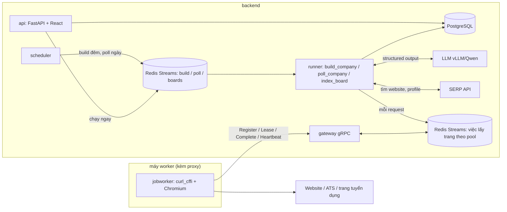
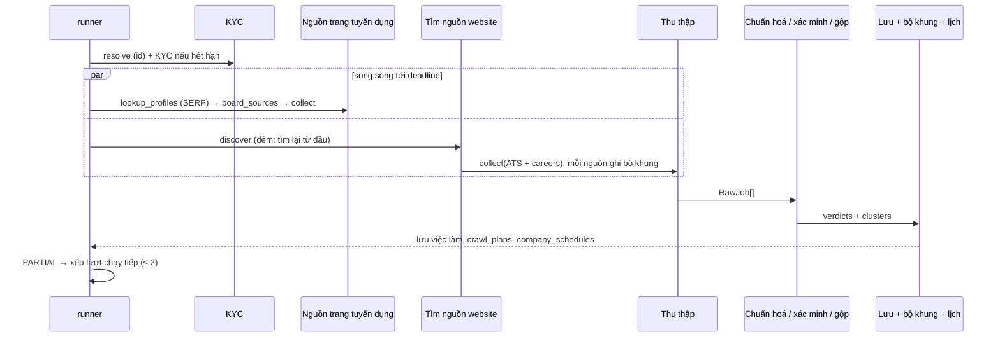
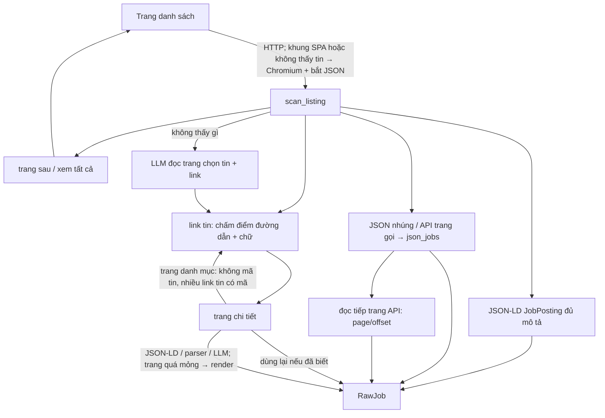
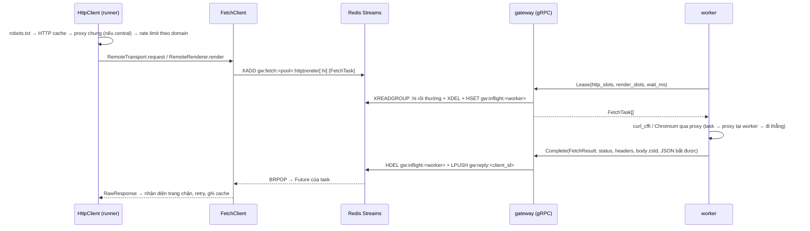
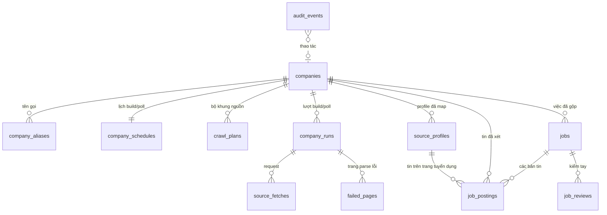

# Kiến trúc

Tài liệu này mô tả hệ thống chạy thế nào: các process, luồng dữ liệu, từng tầng trong mã nguồn và
các quyết định thiết kế quan trọng. Cách vận hành (dịch vụ, giới hạn đang đặt, bảo trì) xem
[OPERATIONS.md](OPERATIONS.md); triển khai và quy mô 10.000 doanh nghiệp xem
[DEPLOY.md](DEPLOY.md).

## 1. Tổng quan

Đầu vào là danh sách doanh nghiệp (tên, MST, website — chủ yếu tại Việt Nam, quy mô ~10.000). Đầu
ra là các **việc làm đang mở** của từng doanh nghiệp: đã xác minh đúng nhà tuyển dụng, chuẩn hoá
trường (lương, tỉnh/thành, cấp bậc…), gộp trùng giữa các nguồn, lưu trong PostgreSQL và xem /
export qua giao diện web. Mục tiêu độ tươi: **tin mới của một doanh nghiệp được thấy trong 3 phút
ở P95** (ban ngày).

Tin được lấy từ ba loại nguồn:

| Nguồn                                   | Ví dụ                                           | Cách lấy                                                                        |
| --------------------------------------- | ----------------------------------------------- | ------------------------------------------------------------------------------- |
| ATS có API công khai                    | Greenhouse, Lever, Workday…                     | adapter gọi API của ATS                                                         |
| Trang careers trên website doanh nghiệp | tuyendung.vietcombank.com.vn, careers.shopee.vn | parser chung: JSON-LD, link tin, JSON của trang SPA, LLM                        |
| Trang tuyển dụng (job board)            | TopCV, VietnamWorks, ITviec…                    | index cả trang định kỳ, rồi gắn tin vào doanh nghiệp qua profile nhà tuyển dụng |

Hai nhịp thu thập:

- **Build (ban đêm, `BUILD_WINDOW`)**: mỗi doanh nghiệp một lượt đủ — KYC (nếu hết hạn), tìm
  nguồn trên website từ đầu, đọc hết danh sách + trang chi tiết, xác minh, gộp, lưu — và ghi lại
  **bộ khung** của từng nguồn (`crawl_plans`): trang danh sách, trang phải mở bằng trình duyệt,
  API danh sách tin của trang SPA, trang danh mục, link không phải tin, mã các tin.
- **Poll (ban ngày, `POLL_WINDOW`, mỗi `POLL_INTERVAL_SECONDS` = 150 giây)**: chỉ đọc lại đúng các
  trang / API trong bộ khung (API gọi thẳng bằng HTTP thay cho mở trình duyệt), so tập mã tin với
  lượt trước, chỉ mở trang chi tiết của tin mới. Không tìm nguồn lại, không đi "từ trang chủ vào".
  Bộ khung hỏng (trang chính 404, API không còn trả tin, trang trống, lỗi lặp lại, mất tin hàng
  loạt) thì doanh nghiệp được **build lại ngay**.



## 2. Các process

Mỗi khối là một service riêng, tự đủ trong thư mục của nó (mã, dependency + lockfile, công cụ,
`Dockerfile`, `Taskfile.yml`, `.env`): `backend/` (gói `jobcrawler`, một image không có Chromium,
các process khác nhau ở lệnh), `worker/` (gói `jobworker`, image Playwright + Chromium),
`frontend/` (image `frontend`: nginx phục vụ bản build React, chuyển `/api/` tới `backend`). `proto/` (gói
`jobcrawler-proto`) là thư viện hợp đồng gRPC mà backend và worker cùng phụ thuộc theo đường dẫn
`../proto`; image của chúng nhận nó làm build context tên `proto`.

Compose chạy 5 container:

| Container  | Lệnh              | Việc                                                                                                   |
| ---------- | ----------------- | ------------------------------------------------------------------------------------------------------ |
| `postgres` |                   | dữ liệu                                                                                                |
| `redis`    |                   | ba hàng đợi job, hàng việc lấy trang của worker, rate limit, proxy pool, khoá, số đo độ trễ, phiên bản cài đặt, heartbeat, cache (AOF, `noeviction`) |
| `backend`  | `jobcrawler serve` | migration rồi bốn process con (dưới); một process thoát thì container thoát và Docker dựng lại        |
| `frontend` | nginx             | giao diện React; `/api/` chuyển tới `backend` (giữ Host, ghi đè `X-Forwarded-For` bằng IP người dùng); cache file tĩnh |
| `worker`   | `jobworker run`   | lấy trang: nhận việc qua gRPC, tải bằng curl_cffi / Chromium qua proxy của mình, trả kết quả           |

Process con của `backend` (mỗi process một event loop + watchdog; chạy riêng được bằng lệnh của nó):

| Process     | Lệnh                   | Việc                                                                                                   |
| ----------- | ---------------------- | ------------------------------------------------------------------------------------------------------ |
| api         | `jobcrawler api`       | API JSON `/api/...` (cổng 8000, chỉ trong mạng compose, sau `frontend`)                                |
| gateway     | `jobcrawler gateway`   | gRPC cho worker (cổng 50051): giao việc lấy trang từ Redis Streams, nhận kết quả                        |
| scheduler   | `jobcrawler scheduler` | mỗi giây xếp build đến hạn (đêm / doanh nghiệp mới / bộ khung hỏng) và poll đến hạn; giữ khoá Postgres  |
| runner      | `jobcrawler runner`    | cả ba queue: `poll_company` (`RUNNER_POLL_CONCURRENCY`, 0 = tự tính theo máy: 12 mỗi CPU), `build_company` (2,5 mỗi CPU) + cron bảo trì / số liệu tổng quan, `index_board` / `tail_board` (`--role poll\|build\|boards` để tách vai) |

CLI (`jobcrawler …`, `backend/jobcrawler/entrypoints/cli.py`) dùng đúng các hàm của tầng
`services/`: build / poll một doanh nghiệp (`build`, `poll`, `run`), KYC (`kyc`), thử một website
(`site`), nạp / xếp build (`import`, `enqueue`), index (`index-boards [--tail]`), export, thống kê,
đánh giá (`eval`), DB (`db …`), hàng đợi (`queue info`).

Mọi process backend mở tài nguyên qua `resources.open_resources()` → `Resources`: engine +
sessionmaker SQLAlchemy async, Redis, ba hàng đợi, `LLMClient`, `HttpClient` gửi request qua worker
(`fetch: FetchClient`), `api_http` gọi thẳng API bên ngoài (SERP), proxy pool chung. Cài đặt hiện
hành là env/`backend/.env` (chỉ kết nối, gateway, đăng nhập, log) cộng bảng `app_settings` (mọi
cài đặt khác, sửa ở trang Cài đặt), nạp lại khi đổi (`services/live_settings.py`). Cài đặt chỉ đọc
lúc khởi động (`live=False`): lưu thì tăng bộ đếm `<prefix>:settings:restart` trên Redis,
`jobcrawler serve` thấy thì khởi động lại các process con.

## 3. Bản đồ mã nguồn

```
backend/                       service backend: pyproject.toml + uv.lock, Dockerfile, Taskfile.yml, .env.example
  openapi.json                 hợp đồng HTTP (bản commit, scripts/export_openapi.py)
  scripts/                     export_openapi.py, loadtest/ (seed + bench dữ liệu lớn, site giả đo độ trễ)
  tests/                       unit + integration/
backend/jobcrawler/
  config.py            Settings (pydantic-settings, đọc .env trong thư mục chạy = backend/)
  resources.py         mở/đóng tài nguyên dùng chung của một process
  schemas.py           kiểu dữ liệu: CompanyIn, RawJob, JobOut, enum trạng thái, RunKind, PlanStatus…
  queues.py, streamqueue.py   ba hàng đợi trên Redis Streams (consumer group, khoá job, cron)
  gateway/             registry worker, FetchClient (gửi việc / chờ kết quả), RemoteTransport,
                       server gRPC
  net/                 HttpClient (robots, cache, proxy, rate limit, retry, nhận diện chặn),
                       DirectTransport (httpx, gọi API bên ngoài), proxy pool, KV
  sources/             nguồn tin: base, plan (bộ khung), careers, json_jobs, jsonld, ats/*, boards/*
  pipeline/            KYC, tìm nguồn, thu thập, chuẩn hoá, xác minh, gộp, lưu, index board, map profile
  services/            nghiệp vụ: companies (build), crawl (build/poll/xếp job), schedule, plans,
                       sla, app_settings, live_settings, boards, batch, stats, overview, maintenance…
  entrypoints/         cli.py, runner.py, scheduler.py, gateway.py
  web/                 FastAPI: chỉ API JSON (api.py, settings_api.py, queries.py, actions.py)
  db/                  models, migration Alembic (một migration 0001), nén zstd, UUIDv7
worker/                service worker: pyproject.toml + uv.lock, Dockerfile, Taskfile.yml, .env.example,
                       config/ (proxy mẫu), tests/
worker/jobworker/      config, client gRPC, fetch (curl_cffi), browser (Playwright), proxy tại worker
proto/                 thư viện hợp đồng: jcproto/v1/crawl.proto + mã sinh sẵn, scripts/gen.py, tests/
frontend/              service web: React + shadcn/ui + Tailwind (build vào frontend/dist), Dockerfile +
                       nginx/ (image `frontend`), client sinh từ ../backend/openapi.json (orval → src/lib/gen/)
```

Quy ước phụ thuộc: `sources/` chỉ biết `SourceSession` (bọc `Fetcher` + `LLMClient`), không biết
DB; `pipeline/` là logic thuần hoặc nhận `AsyncSession`; `services/` ghép pipeline với
`Resources`; `entrypoints/` và `web/` chỉ gọi `services/`. Gói `jobworker` không phụ thuộc
`jobcrawler` (chỉ `jcproto`).

## 4. Lượt build (`services/crawl.build_company` → `services/companies.process_company`)

Lượt build xử lý một doanh nghiệp đủ đường và luôn ghi một dòng `company_runs` (`kind=build`, kể
cả khi lỗi hoặc bị huỷ). Thời gian: deadline mềm `COMPANY_DEADLINE_SECONDS` (165 s) cho phần thu
thập, timeout cứng `COMPANY_TIMEOUT_SECONDS` (180 s), 20 s cuối dành để lưu. Build và poll cùng một
doanh nghiệp không chạy chồng nhau (khoá Redis theo doanh nghiệp).



1. **Xác định doanh nghiệp** theo id (đã nạp bằng `import` / giao diện).
2. **KYC** (`pipeline/kyc.py`, ≤ `KYC_TIMEOUT_SECONDS`): kết quả còn hạn (`KYC_CACHE_DAYS`) thì dùng
   luôn; không thì lấy ứng viên từ SERP và website (chân trang, JSON-LD Organization), LLM chọn kèm
   trích đoạn, rule kiểm lại. Kết quả: `verified` / `ambiguous` / `not_found`, `primary_domain`.
3. **Nguồn trang tuyển dụng** (song song với bước 4): tìm thêm profile bằng SERP `site:` cho trang
   chưa có profile, rồi mỗi profile đã map một `BoardProfileSource`, lọc theo KYC (mục 7).
4. **Tìm nguồn trên website** (`pipeline/discovery.py`, ≤ `DISCOVERY_TIMEOUT_SECONDS`): trang chủ
   (thử cùng lúc domain trần / `www.`, https / http, và gốc đúng như người dùng nhập), link có từ
   khoá tuyển dụng (LLM chọn khi nhiều) → sitemap → subdomain `careers.`/`tuyendung.`/`jobs.` →
   đường dẫn phổ biến; mỗi ứng viên được mở để xác nhận. Build đêm và build lại khi bộ khung hỏng
   tìm lại từ đầu (`BUILD_REFRESH_DISCOVERY`); lượt khác dùng cache 7 ngày.
5. **Thu thập** (`pipeline/collect.py`, chế độ `build`): mỗi nguồn một task, chạy tới deadline;
   nguồn chưa xong bị huỷ nhưng tin đã yield vẫn giữ. Tin website/ATS đã tải chi tiết trong
   `JOB_REUSE_DAYS` được dùng lại. Mỗi nguồn ghi bộ khung của mình (mục 5.4).
6. **Chuẩn hoá → xác minh → gộp → lưu** (mục 8).
7. **Kết thúc**: ghi `company_runs`, `source_fetches`, `failed_pages`; ghi bộ khung
   (`crawl_plans`, nguồn không còn thấy → `retired` khi tìm nguồn trọn vẹn) và lịch
   (`company_schedules`): có nguồn website/ATS thì `ready` + mốc poll đầu, không thì
   `no_sources`; mốc build đêm kế tiếp. Lượt `partial` tự xếp lượt chạy tiếp
   (`COMPANY_MAX_CONTINUATIONS`, cách `COMPANY_CONTINUATION_DELAY_SECONDS`).

**Lượt đủ và đóng việc cũ.** Chỉ khi mọi nguồn xong trọn (không huỷ, không bị cắt, không lỗi,
không tin hoãn xác minh) thì việc đang mở mà lượt này không còn thấy mới bị đánh `removed`
(hoặc `expired` nếu quá hạn nộp).

## 5. Nguồn tin (`sources/`)

Mọi nguồn cài `Source.jobs(session) -> AsyncIterator[RawJob]` và chỉ gọi mạng qua
`SourceSession`. Session ghi mỗi request thành `FetchRecord` (→ `source_fetches`), giữ trang parse
lỗi (→ `failed_pages`), dừng nguồn khi bị chặn (`SourceError`), và nhận lời báo
`truncate(reason)` khi nguồn phải dừng trước khi lấy hết tin. Giới hạn mỗi nguồn ở
`SourceLimits`. Phiên có chế độ `build` (đi đủ đường, ghi bộ khung vào `session.plan`) hoặc
`poll` (đi theo bộ khung đã lưu, không dùng HTTP cache, báo `mark_broken` khi bộ khung không còn
đúng).

`RawJob` giữ giá trị thô của nguồn (HTML mô tả, chuỗi địa điểm, chuỗi lương…), kèm cách bóc
`ExtractionMethod` (`ats_api`, `jsonld`, `parser`, `heuristic`, `llm`) — quyết định độ tin cậy ban
đầu khi xác minh (0.95 → 0.75; tin do LLM bóc luôn phải được LLM xác nhận lại).

### 5.1 ATS (`sources/ats/`)

Greenhouse, Lever, Ashby, Workable, Workday, BambooHR, Recruitee, Teamtailor (SmartRecruiters
chỉ nhận diện: robots.txt cấm API). `ats.detect()` nhận ra ATS từ URL hoặc HTML (link, iframe,
script). Bộ khung của nguồn ATS là chính bảng tin (`AtsRef`); poll gọi lại API của ATS (một lời
gọi, Workday thêm chi tiết của tin mới).

### 5.2 Trang careers chung (`sources/careers.py`)



- **Đọc danh sách**: tối đa `SOURCE_MAX_LISTING_PAGES` trang (phân trang `?page=`, `/page/N`, link
  "xem tất cả vị trí"). HTML là khung SPA hoặc không thấy tin thì mở bằng Chromium (trên worker),
  chờ mạng yên và giữ các phản hồi JSON trang gọi.
- **Link tin** (`job_links`): cùng site, chấm điểm theo đoạn đường dẫn, slug có mã số, chữ trên
  link giống tên vị trí; loại trang chính sách, tìm kiếm, tin tức.
- **JSON của trang SPA** (`sources/json_jobs.py`): tìm mảng phần tử giống tin, chặn theo đường dẫn
  API / khoá JSON có từ về việc làm; nhận ra tham số phân trang và tổng số tin để đọc tiếp qua HTTP
  (chỉ header `Accept`, không cookie), tối đa `SOURCE_MAX_API_PAGES`.
- **Trang chi tiết**: JSON-LD JobPosting → parser chung → trang không rõ là tin thì LLM quyết. Trang
  quá mỏng thì render lại. **Trang danh mục** (theo ngành, tỉnh) được đi tiếp, không lưu thành tin.
- **LLM đọc danh sách** chỉ khi rule không thấy gì (không được bịa link).

### 5.3 Profile trên trang tuyển dụng (`sources/boards/profile_source.py`)

Một `BoardProfileSource` cho mỗi profile đã map. Index của profile còn mới (`indexed_at` trong
`BOARD_STALE_HOURS`) → lấy tin từ `job_postings`, không gọi mạng; không thì (chỉ ở lượt build) đọc
danh sách tin trên trang profile và gộp với index. **Lượt poll không bao giờ gọi trang tuyển dụng
theo từng doanh nghiệp** (`board_sources(network=False)`): tin mới trên trang tuyển dụng đến qua
index đuôi (mục 6).

### 5.4 Bộ khung (`sources/plan.py`, bảng `crawl_plans`)

Lượt build ghi cho mỗi nguồn website/ATS:

| Trường       | Ý nghĩa                                                                                          |
| ------------ | ------------------------------------------------------------------------------------------------ |
| `listings`   | trang danh sách đã đọc (kể cả trang sau / "xem tất cả")                                          |
| `hubs`       | trang danh mục dẫn tới tin (poll mở như trang danh sách)                                         |
| `rendered`   | trang phải mở bằng trình duyệt                                                                   |
| `apis`       | API bắt được: có phân trang (đọc tiếp page/offset) hoặc feed không phân trang (gọi lại nguyên văn) |
| `api_only`   | trang mà mọi tin trên đó đều có trong API bắt được: poll gọi API, không mở trang                 |
| `ignored`    | link đã mở mà không phải tin: poll không mở lại                                                  |
| `indirect`   | mã tin chỉ tới được qua trang tin khác ("vị trí khác") hoặc chỉ có trong feed (có thể xoay vòng) |
| `names`      | danh mục mã → tên (thành phố…) trang tải kèm, để đọc tin từ API khi không mở trang               |
| `ats`        | bảng tin ATS                                                                                     |

Cùng với đó `crawl_plans.job_keys` là mã các tin nguồn trả về ở lượt đủ gần nhất.

## 6. Poll (`services/crawl.poll_company`)

1. Nạp bộ khung các nguồn `active` và (nguồn, mã, URL) các tin đã lưu — **không** đọc nội dung tin.
2. Thu thập chế độ `poll` (deadline `POLL_DEADLINE_SECONDS` = 60 s): careers đọc API trong bộ khung
   (HTTP thẳng), trang danh sách bằng HTTP (chỉ render khi HTML không có tin và lượt build đã phải
   render), tối đa `POLL_MAX_LISTING_PAGES` trang (0 = mọi trang); link đã biết dùng lại bản lưu,
   link trong `ignored` bỏ qua, chỉ mở tối đa `POLL_MAX_DETAIL_PAGES` (10) trang tin mới.
3. So với `job_keys`: **mới** = mã chưa có; **đã gỡ** = mã cũ vắng mặt, chỉ khi nguồn đọc trọn và
   mã không thuộc `indirect`.
4. Không đổi → chỉ cập nhật lịch (không ghi `company_runs`, không đụng `jobs`) — đa số lượt poll.
5. Có đổi → chỉ **tin mới** được chuẩn hoá → xác minh → gộp với việc đã có → lưu (chi phí theo số
   tin mới, không theo số tin của doanh nghiệp); tin đã gỡ được đánh `removed`, việc của nó đóng
   nếu không còn tin nào khác (tin trang tuyển dụng còn mở, hoặc tin website/ATS vẫn thấy). Ghi
   `company_runs` (`kind=poll`).
6. **Bộ khung hỏng → build lại ngay** (`REBUILD_ON_ERROR`): trang chính 404/410, API không còn JSON
   / không còn tin, trang danh sách mở được mà không còn tin nào trong khi bộ khung có tin, lỗi tạm
   lặp lại `POLL_MAX_FAILURES` (3) lượt. **Chốt chặn đóng nhầm**: mất từ 30% tin (≥ 3 tin, nguồn
   ≥ 5 tin) trong một lượt → không đóng việc, đếm như lỗi; lặp đủ 3 lượt thì build lại, lượt build
   đọc đủ mới đóng đúng việc đã gỡ.
7. Số đo: mỗi lượt ghi vào histogram Redis theo phút (`services/sla.py`) thời gian một lượt và
   **cửa sổ phát hiện** = lúc xong − lúc bắt đầu lượt poll đủ trước (độ trễ xấu nhất của một tin
   đăng ngay sau lượt trước); trang Tổng quan hiện P50/P95, % trong 3 phút, độ tươi hiện tại.

## 7. Lịch (`services/schedule.py`, bảng `company_schedules`)

- Mỗi doanh nghiệp có pha cố định trong [0, 1) (hash của id) để rải đều: build đêm ở
  `đầu BUILD_WINDOW + pha × độ dài khung` (10.000 doanh nghiệp / 6 giờ ≈ 0,46 lượt/giây), poll đầu
  ngày ở `đầu POLL_WINDOW + pha × chu kỳ`.
- Scheduler mỗi `SCHEDULER_TICK_SECONDS`, chỉ một replica làm việc: replica giữ khoá leader
  (lease Redis `<prefix>:lock:scheduler`, `locks.RedisLease`, hạn 30 s, gia hạn mỗi nhịp; chết thì
  replica khác thay khi khoá hết hạn, dừng thì nhả ngay). Không giữ phiên Postgres nên chạy được sau
  PgBouncer chế độ transaction. Lượt bảo trì cũng giữ lease Redis (tự gia hạn khi chạy); cron xếp
  job có khoá duy nhất `cron:<hàm>` nên nhiều runner cũng chỉ một job mỗi mốc. Mỗi nhịp:
  tạo lịch cho doanh nghiệp mới (`new` → build ngay, bất kể khung giờ); lấy dòng đến hạn bằng
  `FOR UPDATE SKIP LOCKED`, dời mốc kế tiếp, xếp job (khoá theo doanh nghiệp nên không trùng).
  Hàng đợi còn quá `BUILD_QUEUE_MAX_BACKLOG` / `POLL_QUEUE_MAX_BACKLOG` việc chờ thì không xếp thêm.
- Mốc poll kế tiếp tính từ lúc xếp (± `POLL_JITTER_SECONDS`) nên chu kỳ giữ đều dù lượt poll dài
  ngắn. Trạng thái: `new`, `ready`, `no_sources`, `broken` (đã xếp build lại; build lại vẫn hỏng
  thì thử lại sau 2 giờ), `paused`.
- Cron theo `CRAWL_TIMEZONE`: bảo trì mỗi giờ, số liệu tổng quan 5 phút, index trang tuyển dụng đủ
  `BOARD_INDEX_CRON` (00:30), đuôi `BOARD_TAIL_CRON` (mỗi 2 phút, 6h–23h).

## 8. Index trang tuyển dụng (`pipeline/board_index.py`)

Mỗi trang tuyển dụng là một `BoardAdapter` (`sources/boards/`): `SitemapBoard` (TopCV, JobsGO,
CareerViet, Glints, TopDev, ITviec), `ListingBoard` (CareerLink, Vieclam24h, 123job), hoặc tự cài
(VietnamWorks). Hai kiểu lượt (khoá advisory Postgres: mỗi trang một lượt tại một thời điểm):

- **Đủ (đêm)**: đọc toàn bộ danh sách (`entries()`, có `lastmod`), tải tin mới / đổi / lâu chưa tải
  (cắt ở `BOARD_MAX_JOBS_PER_RUN`, `BOARD_INDEX_BUDGET_SECONDS`), upsert theo lô; danh sách đọc đủ
  thì tin vắng 2 lượt → `removed`, đánh `indexed_at` cho profile đủ tin; map profile mới.
- **Đuôi (ngày)**: `recent()` chỉ đọc phần mới nhất (1–4 request mỗi trang: sitemap mới nhất, trang
  đầu danh sách mới nhất, API tìm kiếm theo ngày duyệt), tải tin chưa từng thấy (≤
  `BOARD_TAIL_MAX_JOBS`, `BOARD_TAIL_BUDGET_SECONDS`), không đánh dấu gỡ, không đặt `indexed_at`;
  khoá đang bận (lượt đủ đang chạy) thì bỏ qua ngay.
- Sau mỗi lượt: doanh nghiệp có profile vừa có tin mới (hoặc vừa map) được **poll ngay**
  (`BOARD_POLL_COMPANIES`). Độ tươi của nguồn này giới hạn bởi tần suất trang tự làm mới danh sách
  (vd. sitemap TopCV ~1 giờ).

## 9. Map profile ↔ doanh nghiệp (`pipeline/profiles.py`)

- Khoá so tên riêng `text.company_match_key()`: bỏ dấu, loại hình pháp lý, phần trong ngoặc, phần
  chi nhánh; mở rộng "TMCP"; bỏ đuôi chung ("Việt Nam", "Group") khi còn từ riêng.
- Lọc ứng viên bằng pg_trgm (`PROFILE_MATCH_TRIGRAM`), rồi rule: cùng MST (1.0) → website trùng
  domain (0.95) → tên khớp đúng một doanh nghiệp (0.85 / 0.8); mâu thuẫn MST/website hoặc khác chi
  nhánh thì loại. Còn mơ hồ → LLM chọn kèm lý do (`prompts/profile_match`).
- Profile được dùng theo KYC: `verified` → mọi profile; `not_found` → profile khớp MST/website
  hoặc khớp tên chặt và đủ riêng; `ambiguous` → chỉ MST/website.

## 10. Chuẩn hoá, xác minh, gộp, lưu

**Chuẩn hoá** (`pipeline/normalize.py`, rule trước, LLM sau): HTML → markdown sạch (bỏ
boilerplate, ẩn SĐT/email cá nhân/tên người liên hệ); lương → min/max/tiền tệ/kỳ; địa điểm → 34
tỉnh/thành sau sáp nhập 2025; ngày → UTC; cấp bậc / loại hình / hình thức bằng rule, còn `unknown`
thì `classify_unclear` hỏi LLM sau khi gộp.

**Xác minh** (`pipeline/verify.py`): mỗi tin một `Verdict` có lý do. Rule loại: `EXPIRED`,
`EMPTY_JD`, `NOT_A_JOB`, `EMPLOYER_MISMATCH`, `AGENCY_POSTING`, `SCAM_SIGNALS`, `SPAM_REPOST`. Tin
có điểm cần xem bị hạ dưới `VERIFY_MIN_CONFIDENCE` và phải được LLM xác nhận (cache theo nội dung 7
ngày). LLM không kịp / lỗi → **hoãn** (`DEFERRED`): không nhận, không loại, việc cũ giữ nguyên.

**Gộp trùng** (`pipeline/dedup.py`): cùng tiêu đề (không lệch cấp bậc), chung tỉnh/thành, JD giống
(MinHash ≥ 0.8) hoặc cùng nơi nộp. Bản chuẩn: ATS/careers > trang tuyển dụng có JD đầy đủ > mới
nhất. Tin mới được gắn vào việc đang mở cùng dấu vân tay / khớp mờ thay vì tạo việc mới.

**Lưu** (`pipeline/store.py`, một transaction): upsert tin vào `job_postings`, mỗi cụm một dòng
`jobs` (khoá cụm ổn định qua các lượt, index duy nhất chặn hai việc đang mở y hệt), đóng việc cũ
khi lượt đủ (build) hoặc đóng đúng tin đã gỡ (`close_postings`, poll), cập nhật
`companies.active_jobs`.

## 11. Lấy trang qua worker (`gateway/`, `worker/`)



- **Một việc = một request** (HTTP hoặc mở trang). Mọi logic (robots, rate limit, retry, nhận diện
  chặn, parse) nằm ở backend; worker không giữ trạng thái, chỉ tải và trả nguyên văn.
- `task_id = <client_id>.<seq>`: gateway biết trả kết quả về process nào mà không cần nhớ gì, nên
  chạy nhiều replica sau load balancer (trạng thái chung nằm ở Redis).
- **Ưu tiên poll**: lượt poll đặt `fetch_priority` (`priority_fetches()` trong `dispatch.py`),
  việc của nó vào stream `…:hi`; Lease đọc `:hi` trước. Ban ngày build (doanh nghiệp mới, bộ khung
  hỏng) không làm chậm poll.
- **Việc đang giữ**: Lease ghi `gw:inflight:<worker>` (task → hạn); Complete chỉ nhận kết quả của
  việc worker đó đang giữ. Worker `Leave` hoặc quá hạn báo sống → gateway trả `ERROR_KIND_WORKER_LOST`
  cho các việc còn giữ; backend gửi lại ngay một lần rồi để `HttpClient` thử lại (không đổ lỗi
  cho proxy).
- **Chờ hàng**: backend chờ từng khung `timeout + FETCH_QUEUE_GRACE_SECONDS`; hết khung mà bộ đếm
  `gw:progress:<pool>:<kind>` (Lease tăng) vẫn nhích — hàng chỉ đông — thì chờ tiếp, tổng tối đa
  `timeout + FETCH_QUEUE_MAX_WAIT_SECONDS` (cũng là `deadline_ms` của việc). Thôi chờ thì xoá việc
  của mình khỏi stream để worker không tải trang không ai đợi.
- **Pool**: worker khai `WORKER_POOL`; `FETCH_ROUTES` định tuyến domain → pool (vd. trang tuyển dụng
  qua pool proxy dân cư); pool không có worker sống thì về `default`; không có worker nào thì lỗi
  ngay (`no_worker`).
- **Proxy** (`PROXY_MODE`): `worker` (mặc định — mỗi worker dùng proxy của mình, gắn theo domain,
  nghỉ khi lỗi), `central` (backend chọn từ danh sách chung, giữ sức khoẻ proxy trên Redis), `off`.
- **Đăng ký / sống / dừng**: `Register` trả `WorkerConfig` (slot — là mức trần, worker lấy số nhỏ
  hơn với cấu hình của mình —, impersonate, heartbeat… sửa ở trang Cài đặt, đẩy xuống qua
  `config_version`); `Heartbeat` mỗi 5 s kèm số liệu (cả lý do render đang tạm tắt: Chromium
  lỗi thì worker lùi 30 s → 10 phút rồi thử lại); gateway quên
  worker (khởi động lại) → `NOT_FOUND` → worker đăng ký lại; trang Workers yêu cầu "dừng nhận việc"
  (drain) → worker làm nốt rồi `Leave`. TLS tuỳ chọn.
- Xác thực (`gateway/worker_auth.py`, bật khi đặt GATEWAY_TOKEN): `Register` bằng khoá tham gia —
  GATEWAY_TOKEN (cố định) hoặc khoá dùng một lần tạo ở trang Workers (TTL 5 phút trên Redis, `GETDEL`
  khi dùng) — nhận `worker_token` riêng; Lease / Complete / Heartbeat / Leave phải dùng token đó và
  đúng `worker_id` của nó. Token chỉ nằm trên Redis (băm SHA-256, hạn trượt 7 ngày, Heartbeat gia
  hạn), không lưu DB; worker lưu token ở WORKER_TOKEN_FILE, bị từ chối thì vào lại bằng khoá tham gia.
- Slot của worker (`jobworker/sysres.py`): WORKER_HTTP_SLOTS / WORKER_RENDER_SLOTS trống = tự tính
  theo CPU / RAM (cgroup của container) — HTTP 8 mỗi CPU trong [8, 64], render 1 mỗi 768 MiB RAM trong
  [1, 8]; worker báo slot khi Register, trang Workers hiện đang dùng / tổng.

## 12. Hàng đợi (Redis Streams, `streamqueue.py`)

| Job             | Queue               | Khoá                  | Giới hạn                                                    |
| --------------- | ------------------- | --------------------- | ----------------------------------------------------------- |
| `build_company` | `jobcrawler-build`  | `build:<id>[:contN]`  | timeout 180 s, chạy tối đa `COMPANY_JOB_RETRIES` lần        |
| `poll_company`  | `jobcrawler-poll`   | `poll:<id>`           | timeout `POLL_TIMEOUT_SECONDS` (90 s)                        |
| `index_board`   | `jobcrawler-boards` | `board:<trang>`       | `BOARD_INDEX_BUDGET_SECONDS` + 15 phút                      |
| `tail_board`    | `jobcrawler-boards` | `board:<trang>`       | `BOARD_TAIL_BUDGET_SECONDS` + 2 phút                        |

Mỗi queue là một stream với consumer group `workers`; mỗi runner là một consumer, chỉ đọc khi còn
slot rảnh. Khoá job (hash trạng thái + Lua) bảo đảm một doanh nghiệp / một trang chỉ có một job
đang chờ hoặc chạy. Job hẹn giờ nằm ở sorted set và vào stream khi tới giờ. Runner chết: entry
im quá `QUEUE_RECLAIM_SECONDS` bị runner khác thu hồi (`XAUTOCLAIM`) và chạy lại.

## 13. Dữ liệu (`db/`)



| Bảng                                                     | Nội dung                                                                                                   |
| -------------------------------------------------------- | ---------------------------------------------------------------------------------------------------------- |
| `companies`                                              | doanh nghiệp đầu vào + KYC + tóm tắt lượt mới nhất, số việc đang mở                                        |
| `company_schedules`                                      | trạng thái lịch, mốc build/poll kế tiếp, lượt poll đủ gần nhất (độ tươi), số lỗi; fillfactor 70            |
| `crawl_plans`                                            | bộ khung từng nguồn website/ATS (`spec`), trạng thái `active`/`broken`/`retired`, `job_keys`, lỗi          |
| `company_aliases`                                        | tên chuẩn hoá để tra cache (`input`, `legal`, `brand`…, `match` chỉ để map profile)                        |
| `source_profiles`                                        | nhà tuyển dụng trên trang tuyển dụng; `company_id` khi đã map, `indexed_at` khi index đủ tin               |
| `job_postings`                                           | mỗi tin của mỗi nguồn (khoá `source + external_id`): nội dung thô nén, quyết định xác minh, trạng thái     |
| `jobs`                                                   | việc đã gộp: trường chuẩn hoá, nguồn chuẩn, URL nguồn, trạng thái `active` / `expired` / `removed`         |
| `company_runs`                                           | lượt build / poll (`kind`, `trigger`, tin mới / việc đóng); poll không đổi gì thì không ghi                |
| `source_fetches`, `failed_pages`, `logs`                 | từng request, trang parse lỗi kèm HTML, log                                                                 |
| `board_index_runs`                                       | lịch sử index từng trang tuyển dụng (`stats.mode`: `full` / `tail`)                                        |
| `job_reviews`, `app_settings`, `compression_dicts`       | kiểm tay; cài đặt sửa ở giao diện; từ điển zstd                                                             |
| `audit_events`                                           | nhật ký thao tác của người vận hành (ai, lúc nào, làm gì, trước → sau); chỉ ghi thêm, bảo trì không dọn    |

- Migration: `0001_initial_schema` (extension `pg_trgm`, `unaccent`, hàm `uuid_v7()`, mọi bảng,
  ràng buộc đặt tên theo `NAMING_CONVENTION`, cột nén `STORAGE EXTERNAL`), `0002_audit_events`.
  Đổi schema chỉ bằng revision mới (`jobcrawler db revision`), không sửa revision đã chạy.
- Khoá chính UUIDv7 (sinh ở ứng dụng, tăng theo thời gian). Cột lớn nén zstd kèm từ điển huấn luyện
  trên chính dữ liệu (`db/compress.py`).

## 14. Giao diện web

Container `frontend` (nginx không root, cổng 8080) phục vụ bản build React và chuyển `/api/` tới
API của `backend` — FastAPI (`web/app.py`, `web/api.py`, `web/settings_api.py`) chỉ phục
vụ API `/api/...` (tài liệu `/api/docs`). Trình duyệt chỉ thấy một origin nên cookie đăng nhập
và kiểm tra chống CSRF giữ nguyên (nginx giữ `Host`). Trang đăng nhập `/login` nằm ngoài khung ứng
dụng; Cài đặt là popup mở trên trang đang xem (`?settings=<nhóm>`, `components/settings-dialog.tsx`). Trang: Tổng quan (độ trễ phát hiện tin mới, độ tươi, lượt chạy,
request), Hàng đợi (build / poll / trang tuyển dụng), Trang tuyển dụng (lượt đủ / đuôi), Doanh
nghiệp (thêm tay `POST /api/companies`, nạp CSV, tải CSV mẫu; tab "Bộ khung & lịch": nguồn,
trang/API trong bộ khung, mốc poll/build, nút Poll ngay / Build lại), Việc làm, Kiểm tay, Golden set, **Workers** (worker đang kết nối, slot, proxy, dừng nhận
việc), **Cài đặt** (10 nhóm chia mục con; mục cần khởi động lại được backend tự áp dụng; chép giá trị
đặt bằng biến môi trường vào DB; bảng proxy chung kèm trạng thái xoay vòng và kiểm tra qua worker), **Nhật ký thao tác**
(`/api/audit`). Giao diện chỉ hiện trạng thái, không hướng dẫn chạy lệnh.

Middleware, từ ngoài vào:

- `RequestIdMiddleware`: nhận `X-Request-Id` của client nếu là UUID, không thì sinh UUIDv7; gắn
  vào contextvars của structlog (mọi log của request kèm `request_id`) và trả lại ở header; log
  `http.request` cho `/api/*` (method, path, status, thời gian, người dùng); lỗi chưa xử lý →
  500 `{"detail", "request_id"}`.
- `GuardMiddleware` (`web/auth.py`): đặt `UI_PASSWORD` thì cần JWT (HS256, ký bằng JWT_SECRET —
  trống thì khoá ngẫu nhiên trên Redis) của `POST /api/auth/login` trong cookie httpOnly `jc_token`
  hoặc header `Authorization: Bearer`; token mang dấu của mật khẩu (đổi mật khẩu = token cũ hết
  dùng), đăng xuất thu hồi `jti` trên Redis tới khi token hết hạn. Thiếu / sai → 401 kèm
  `WWW-Authenticate: Bearer` (giao diện chuyển tới `/login`). Đăng nhập sai 20 lần trong 5 phút từ
  một IP → 429 kèm `Retry-After` (đếm trên Redis, Redis lỗi thì cho qua). Request ghi từ site khác
  bị chặn. Mọi lỗi cùng dạng JSON `{"detail": ...}`.
- (nginx của `frontend`) File trong `/assets` (tên có hash) cache một năm; `index.html` không cache;
  `X-Forwarded-For` ghi đè bằng IP người dùng (api tin header này để chặn đoán mật khẩu theo IP).

Mọi thao tác thay đổi trạng thái (lưu cài đặt, thêm doanh nghiệp, build / poll ngay, xếp build,
import, kiểm tay, index trang tuyển dụng, bảo trì, chấm golden set, dừng worker) ghi một dòng `audit_events`
(`services/audit.py`): lưu cài đặt và kiểm tay ghi trong cùng transaction với thay đổi; các thao
tác còn lại ghi sau khi thành công, ghi nhật ký lỗi không làm hỏng request. Cài đặt bí mật và mật
khẩu proxy luôn bị che.

Đăng nhập SSO (tuỳ chọn): proxy SSO (vd. oauth2-proxy) đứng trước `frontend` và gửi
`X-Forwarded-User` / `X-Forwarded-Email`; khi đặt `AUTH_PROXY_USER_HEADER`, `GuardMiddleware`
lấy người dùng từ header đó thay cho trang đăng nhập, `/api/me` trả `auth: "proxy"` và `logout_url`.

Trường nhạy cảm trong DB (`secretbox.py`): khoá API LLM / SERP và danh sách proxy của bảng
`app_settings` lưu dạng `enc:v1:<kid>:<…>` (AES-256-GCM, AAD = tên trường) với khoá từ
ENCRYPTION_KEYS (nhiều khoá: khoá cuối mã hoá, khoá trước chỉ giải mã) — trống thì khoá ngẫu nhiên
trên Redis; `jobcrawler serve` mã hoá lại dòng cũ / dòng dùng khoá cũ lúc khởi động
(`app_settings.seal_stored`). Khoá không bao giờ nằm trong Postgres.

Frontend: React data router (`router.tsx`) — trang lỗi trong khung ứng dụng, nhận ra chunk cũ sau
khi triển khai bản mới (mời tải lại); toast lỗi mặc định cho mọi mutation (`lib/query-client.ts`);
bộ lọc trên URL qua `useUrlFilters`; query / mutation qua hook orval sinh (khoá query sinh cùng).

Hợp đồng API ↔ giao diện có kiểu từ đầu tới cuối:

- Mỗi endpoint JSON trả một mô hình Pydantic (`...Out`, gốc `ApiOut`; `JobOut`, `CompanyEntity`,
  `WorkerStatus` dùng thẳng): FastAPI kiểm và tuần tự hoá theo mô hình, spec `/api/openapi.json`
  tả đúng JSON trả về. Trường có mặc định vẫn luôn có trong JSON nên spec ghi là bắt buộc
  (`json_schema_serialization_defaults_required`). `operationId` = tên hàm xử lý.
- Giá trị không có ràng buộc ở DB (trigger của job trong queue, `mode` của lượt index, giá trị cài
  đặt, JSON tự do như `kyc_evidence`, `changes`) không bị kiểm chặt: spec liệt kê các giá trị có
  thể có, giá trị lạ vẫn trả nguyên văn. Payload trang tổng quan là JSON cache trong Redis (mốc thời
  gian ghi bằng `str()`): mô hình giữ nguyên chuỗi đó.
- `backend/openapi.json` là bản commit của spec — backend sở hữu hợp đồng HTTP của mình
  (`backend/scripts/export_openapi.py`, khoá sắp xếp, dựng app không cần Postgres / Redis). Như
  console/ của open-asm, **orval** (`frontend/orval.config.ts` đọc `../backend/openapi.json`,
  `npm run gen:api`) sinh `src/lib/gen/queries.ts` từ spec: kiểu của mọi schema, hàm gọi từng
  endpoint (`getJobs(params)`, `postEnqueue(body)`, tên theo `operationId`), hook React Query
  (`useGetJobs`, `usePostEnqueue`), khoá query (`getGetJobsQueryKey()` — gọi không tham số là tiền
  tố để invalidate mọi trang) và query options (`getGetRunLogsQueryOptions`, `PagedList` dùng).
  Kiểu trong `src/lib/types.ts` là alias tới đó. `task api` làm cả hai bước; đổi mô hình trả về mà
  quên thì pytest (`tests/test_openapi.py`) hoặc Vitest (`src/lib/gen.test.ts`, chạy orval vào
  thư mục tạm rồi so) đỏ.
- Hàm sinh ra gọi qua `apiClient` (`src/lib/api.ts`, `mutator` của orval; `httpClient: "axios"`
  chỉ để chọn dạng sinh, gọi thật bằng fetch, không có axios): cùng origin kèm đăng nhập của trình
  duyệt, query bỏ giá trị rỗng như `qs()`, body JSON hoặc FormData (tải file), lỗi HTTP ném
  `ApiError` đọc `detail` của FastAPI. orval **không mã hoá tham số path**: id tự do (worker) phải
  `encodeURIComponent` ở chỗ gọi. File tải về (CSV, trang gốc) dùng liên kết thường. JSON tự do
  (`kyc_evidence`, `changes`) thu hẹp sang kiểu viết tay trong types.ts (`select` / `as`).

## 15. Quan sát

- Log structlog có ngữ cảnh (`request_id`, `run_id`, `company`, `source`, `poll`) ra terminal và
  bảng `logs`; `poll.done` mỗi lượt poll (số request, mới / gỡ, cửa sổ phát hiện, thời gian).
  Trước khi ghi, log được che bí mật (mật khẩu trong URL, `Bearer …`, khoá tên `*token*`,
  `*password*`, `*api_key*`…), traceback in gọn không kèm biến cục bộ (backend và worker).
- `audit_events` / trang Nhật ký thao tác: ai đổi gì, lúc nào, kèm `request_id` để tìm log.
- `source_fetches`: mọi request của một lượt build / poll có thay đổi (nguồn, mã HTTP, proxy — kể cả
  proxy tại worker `w:…`, thời gian, số tin, kết quả).
- `crawl_plans.last_error`, `company_schedules.last_error`: vì sao bộ khung hỏng / poll lỗi.
- `/api/crawl/status`: P50/P95 thời gian poll và cửa sổ phát hiện, % trong 3 phút, độ tươi.
- Heartbeat (`heartbeat.py`): scheduler / runner ghi `<prefix>:health:<thành phần>:<hostname>`
  mỗi 5 s ngay trong vòng lặp chính; `jobcrawler health scheduler runner` (cùng `/healthz` và
  `gateway-health`) là healthcheck của container `backend`.
  Worker ghi file trạng thái, `jobworker health` đọc.
- `/api/workers`: worker sống, slot đang dùng, việc xong / lỗi.
- `jobcrawler stats`, `jobcrawler queue info`, `jobcrawler eval`.

## 16. Kiểm thử

- **Unit** (`backend/tests/test_*.py`, `worker/tests/`, `proto/tests/`): không gọi mạng; nguồn chạy
  trên `FakeFetcher` với HTML/JSON chụp từ trang thật; worker test với gateway giả + server HTTP cục
  bộ (+ Chromium thật nếu có).
- **Integration** (`backend/tests/integration/`, cần `TEST_DATABASE_URL` và Redis): migration khớp
  model, vòng đời build → poll (không đổi / tin mới / tin gỡ / trang hỏng / mất tin hàng loạt),
  gateway gRPC đầu-cuối với worker giả, index trang tuyển dụng (đủ, đuôi), API, cài đặt; payload
  các service dựng sẵn (tổng quan, độ trễ phát hiện, Cài đặt) không có trường ngoài mô hình trả về
  (`test_api_contract_db.py`).
- **Hợp đồng API** (`backend/tests/test_openapi.py`): `backend/openapi.json` khớp mã, mọi endpoint
  JSON có
  mô hình trả về, mô hình chép từ dataclass của services không thiếu / thừa trường.
- **Đo thật**: `backend/scripts/loadtest/sla_site.py` + `sla_report.py` (độ trễ đầu-cuối trên site
  giả),
  `fake_sites.py` (hàng trăm site giả để thử tải poll).
- **E2E** (`frontend/e2e/`, Playwright): đi qua mọi trang trên stack compose đang chạy, không
  lỗi console, điện thoại không cuộn ngang; chạy ở máy (`task frontend:e2e`), không chạy ở CI.
- **Hợp đồng gRPC**: `buf lint` + `buf breaking` (PR: so với nhánh đích; push: so với commit trước)
  trên `proto/`.
- **Frontend**: Vitest (`frontend/src/**/*.test.ts(x)`): hàm thuần (định dạng, mô hình trang Cài
  đặt, API client, bộ lọc URL, nhật ký), trang lỗi, mã orval sinh khớp `openapi.json`.
- `TEST_DATABASE_URL` phải là DB tên kết thúc bằng `_test` (schema bị xoá và dựng lại); khi
  `CI` được đặt mà thiếu DB thì test tích hợp báo lỗi thay vì bỏ qua.
- Mỗi service kiểm riêng trong thư mục của nó (`task <service>:check`: ruff format/check, pyright,
  pytest; proto thêm mã sinh khớp; backend thêm spec API; frontend typecheck + client sinh + test +
  build); `task check` chạy cả bốn — cũng là việc CI (`.github/workflows/ci.yml`, một job mỗi
  service + build 3 image) chạy cho mỗi pull request và mỗi lần push lên `main`; push `main` / tag
  `vX.Y.Z` còn đẩy 3 image lên GHCR khi mọi kiểm tra xanh.
