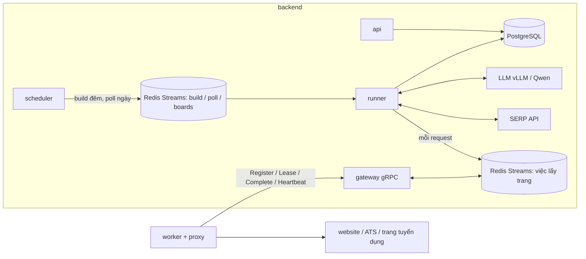
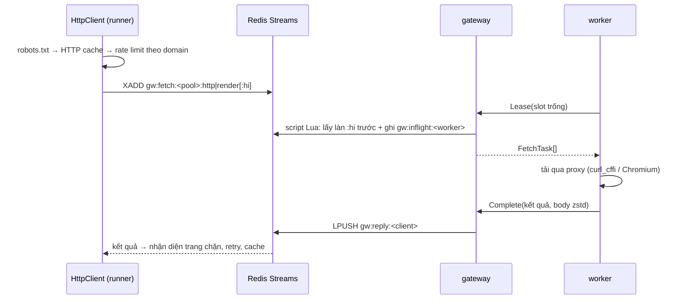

# Kiến trúc

Hệ thống chạy thế nào và vì sao. Vận hành hằng ngày: [OPERATIONS.md](OPERATIONS.md). Triển khai và
quy mô: [DEPLOY.md](DEPLOY.md).

## 1. Mục tiêu

Đầu vào: danh sách doanh nghiệp (tên, MST, website). Đầu ra: **việc làm đang mở** của từng doanh
nghiệp — đúng nhà tuyển dụng, trường đã chuẩn hoá (lương, tỉnh/thành, cấp bậc…), gộp trùng giữa
các nguồn — trong PostgreSQL, xem / export qua giao diện web.

| Yêu cầu                                                 | Cách đạt                                                                                                                            |
| ------------------------------------------------------- | ----------------------------------------------------------------------------------------------------------------------------------- |
| Tin mới thấy trong **≤ 3 phút ở P95** (ban ngày)        | poll mỗi doanh nghiệp mỗi 150 s; một lượt poll ≤ ~20 s → cửa sổ phát hiện ≤ ~170 s                                                  |
| **Đêm**: dựng bộ khung mỗi doanh nghiệp, **3–10 trang** | build 00:00–06:00 đọc đủ site, ghi các trang / API cần theo dõi, chia ≤ 10 trang / doanh nghiệp, mỗi nguồn ≥ 3 trang khi site có đủ |
| **Ngày**: chỉ gọi theo bộ khung, lỗi mới build lại      | poll 06:00–24:00 chỉ đọc trang / API trong bộ khung, mở trang chi tiết của tin mới; bộ khung hỏng → build lại ngay                  |
| **Proxy**: worker tải danh sách về, xoay dần            | gateway gửi danh sách proxy chung xuống worker; worker giữ một proxy mỗi domain 10 phút rồi chuyển proxy kế tiếp                    |

Ba loại nguồn:

| Nguồn                          | Ví dụ                                   | Cách lấy                                                                           |
| ------------------------------ | --------------------------------------- | ---------------------------------------------------------------------------------- |
| ATS có API công khai           | Greenhouse, Lever, Workday…             | adapter gọi API của ATS                                                            |
| Trang careers của doanh nghiệp | careers.shopee.vn, tuyendung.vcb.com.vn | parser chung: JSON-LD, link tin, JSON / API của trang SPA, sitemap, LLM khi rule không thấy |
| Trang tuyển dụng (job board)   | TopCV, VietnamWorks, ITviec…            | index cả trang, gắn tin vào doanh nghiệp qua profile nhà tuyển dụng                |

## 2. Service và process

Mỗi thư mục là một service tự đủ (mã, lockfile, `Dockerfile`, `Taskfile.yml`, `.env`):
`backend/` (gói `jobcrawler`), `worker/` (gói `jobworker`, có Chromium), `frontend/` (React, nginx).
`proto/` là hợp đồng gRPC dùng chung (backend và worker phụ thuộc theo đường dẫn `../proto`).

| Container  | Lệnh               | Việc                                                                                            |
| ---------- | ------------------ | ----------------------------------------------------------------------------------------------- |
| `postgres` |                    | dữ liệu                                                                                         |
| `redis`    |                    | hàng đợi, việc lấy trang, khoá, rate limit, số đo, phiên bản cài đặt, cache (AOF, `noeviction`) |
| `backend`  | `jobcrawler serve` | migration rồi các process con dưới đây; một process thoát → container thoát, Docker dựng lại    |
| `frontend` | nginx              | bản build React; `/api/` chuyển tới `backend`                                                   |
| `worker`   | `jobworker run`    | nhận việc qua gRPC, tải bằng curl_cffi / Chromium qua proxy, trả kết quả                        |

| Process   | Lệnh                   | Việc                                                                   |
| --------- | ---------------------- | ---------------------------------------------------------------------- |
| api       | `jobcrawler api`       | API JSON `/api/...` (chỉ trong mạng nội bộ, sau `frontend`)            |
| gateway   | `jobcrawler gateway`   | gRPC cho worker (cổng 50051): giao việc từ Redis Streams, nhận kết quả |
| scheduler | `jobcrawler scheduler` | mỗi giây xếp build / poll đến hạn; một bản giữ lease leader trên Redis; leader kiểm và gửi cảnh báo; song song: relay sự kiện việc làm cho hệ thống ngoài (lease riêng, mục 12) |
| runner    | `jobcrawler runner`    | chạy job của 3 hàng đợi (`--role poll\|build\|boards` để tách vai)     |

Máy ≥ 4 CPU thì `serve` chạy mỗi vai runner một process: `runner-build` (máy ≥ 8 CPU:
`runner-build-1..n`, một process mỗi 4 CPU, tối đa 4), `runner-boards` và `runner-poll-1..n` (ít nhất
hai) cùng đọc hàng đợi của vai đó; máy nhỏ hơn thì một `runner` đủ ba vai. Runner là Python một
luồng: một process cho cả ba vai thì phần parse HTML / markdown của build và hàng trăm lượt poll
dùng hết một nhân, mọi lần chờ mạng chậm theo (10/2026: lấy một trang 0,7 s nhưng trong lượt poll
thành 7,5 s, lượt poll chạm hạn 60 s, hàng đợi poll tồn hơn 2 phút).

Mỗi process có event loop và watchdog riêng (vòng lặp đứng quá `WATCHDOG_SECONDS` → thoát mã 70).
Cài đặt = `backend/.env` (chỉ kết nối, bí mật hạ tầng, gateway, đăng nhập, log) + bảng `app_settings`
(mọi thứ khác, sửa ở trang Cài đặt, nạp lại ≤ 5 s). Cài đặt chỉ đọc lúc khởi động (`live=False`)
thì `jobcrawler serve` tự khởi động lại các process con khi chúng đổi.

Mã nguồn backend (`backend/jobcrawler/`) chia như `core-api/src` của open-asm:

| Thư mục                | Nội dung                                                                        |
| ---------------------- | ------------------------------------------------------------------------------- |
| `bootstrap/`           | điểm vào process: CLI `jobcrawler` (`cli.py`), `serve`, ứng dụng FastAPI (`app.py`: middleware, ghép router), `gateway`, `runner`, `scheduler` |
| `modules/<tính năng>/` | mỗi file đặt tên `<tên>_<loại>.py`: `<module>_router.py` (API `/api/...`), `<module>_schema.py` (mô hình `...Out` / `...In`), `<module>_service.py` (truy vấn cho giao diện + thao tác của API + nghiệp vụ chính), `<tên>_service.py` cho phần nghiệp vụ tách riêng (vd. `crawl/plan_service.py`, `crawl/sla_service.py`): `companies/`, `crawl/` (build, poll, bộ khung, lịch, độ trễ phát hiện), `jobs/`, `runs/`, `boards/`, `queue/`, `overview/`, `maintenance/`, `evaluate/`, `audit/`, `auth/`, `meta/`, `settings/`, `proxies/`, `gateway/` (gRPC cho worker + API Workers), `live/` (SSE), `integration/` (API + feed + webhook cho hệ thống ngoài) |
| `pipeline/`            | logic: KYC, tìm nguồn, thu thập, chuẩn hoá, xác minh, gộp, lưu                  |
| `sources/`             | nguồn tin (ATS, careers, trang tuyển dụng), chỉ biết `SourceSession`, không biết DB |
| `services/`            | hạ tầng dùng chung: `resources.py` (`Resources`), `redis/` (hàng đợi Streams, khoá, heartbeat), `net/` (HttpClient, proxy pool, rate limit, robots), LLM, SERP, mã hoá, fake cho test |
| `database/`            | model, phiên, migration Alembic, ID, nén zstd, fencing token                    |
| `common/`              | cấu hình, log, DTO dùng chung, phần chung của API (`api.py`, `pagination.py`), tiện ích văn bản / HTML / URL |
| `prompts/`             | prompt LLM (mỗi prompt một file, kèm schema output)                             |

Chiều gọi: `sources/` → `pipeline/` → service trong `modules/` (ghép pipeline với `Resources`) →
`<module>_router.py` và `bootstrap/`; router chỉ gọi `*_service.py` của module.

Mã nguồn worker (`worker/jobworker/`) chia cùng kiểu:

| Thư mục            | Nội dung                                                                            |
| ------------------ | ----------------------------------------------------------------------------------- |
| `bootstrap/`       | điểm vào: CLI `jobworker` (`cli.py`), process `jobworker run` (`run.py`: dựng `Worker`, tín hiệu dừng) |
| `modules/gateway/` | vòng làm việc với gateway (`worker_service.py`): Register → Lease → chạy việc → Complete, Heartbeat, drain, Leave; `RuntimeConfig` (`runtime_service.py`: cấu hình worker kết hợp `WorkerConfig`) |
| `modules/fetch/`   | chạy một việc: kiểm việc, chọn proxy, curl_cffi / Chromium (`executor_service.py`, `http_service.py`, `browser_service.py`), tắt / tạm tắt render khi Chromium lỗi (`render_service.py`), dựng `FetchResult` (`results_service.py`) |
| `modules/health/`  | file trạng thái cho healthcheck (`status_service.py`, `jobworker health`), kiểm tra kết nối (`probe_service.py`, `jobworker check`) |
| `services/`        | kênh gRPC tới gateway (`channel.py`), khoá tham gia / token riêng (`credentials.py`), proxy tại worker (`proxies.py`) |
| `common/`          | cấu hình, log, tài nguyên máy (slot tự động), watchdog, backoff                     |

Chiều gọi: `bootstrap/` → `modules/` → `services/` → `common/`; `modules/gateway/` dùng
`modules/fetch/` và `modules/health/`, `fetch/` không biết gì về gateway.

## 3. Build đêm (`modules/crawl/crawl_service.build_company`)

Mỗi doanh nghiệp một lượt trong `BUILD_WINDOW` (00:00–06:00, `CRAWL_TIMEZONE`), rải đều theo pha
cố định (hash của id). Doanh nghiệp mới và bộ khung hỏng thì build ngay, bất kể giờ. Deadline mềm
`COMPANY_DEADLINE_SECONDS` (165 s) nhưng luôn chừa 30 s (tối đa 1/6 timeout) trước timeout cứng
180 s để lưu — mặc định thu thập và LLM dừng ở 150 s; lúc tải cao lưu một doanh nghiệp mất tới ~20 s,
lượt chạm timeout cứng bị huỷ và mất hết tin. Phân loại thêm trường bằng LLM dùng tối đa 20 s mỗi
lượt. Lượt chưa xong tự xếp lượt nối tiếp (≤ 2).

1. **KYC** (`pipeline/kyc.py`): còn hạn thì dùng lại; không thì SERP + website (chân trang, JSON-LD)
   → LLM chọn kèm trích đoạn → rule kiểm lại. Kết quả `verified` / `ambiguous` / `not_found`.
2. **Nguồn trang tuyển dụng** (song song bước 3): profile chưa map có tên gần alias của doanh nghiệp
   (index gặp trước khi KYC thêm alias khớp, profile thêm từ danh bạ nhà tuyển dụng) được map ngay
   bằng rule (`boards_service.map_company_profiles`; còn mơ hồ thì để lượt index đủ xét) → profile
   đã map → tin từ index chung, profile chưa đủ tin trong index thì đọc trang profile (tối đa 5
   profile mỗi trang tuyển dụng mỗi doanh nghiệp, profile đang có tin trong index trước — doanh
   nghiệp lớn có hàng chục profile chi nhánh / bản trùng; phần còn lại chỉ dùng tin đã index).
3. **Tìm nguồn trên website** (`pipeline/discovery.py`): trang chủ → link tuyển dụng (LLM chọn khi
   nhiều hơn 3 ứng viên, chờ tối đa 10 s rồi chọn theo điểm; link tới một tin được thay bằng trang
   danh sách cha) → sitemap (cả sitemap khai trong robots.txt) → subdomain `careers.` / `tuyendung.` /
   `jobs.` / `career.` / `vieclam.` / `recruitment.` / `job.` (thử tên ngẫu nhiên trước để nhận ra
   DNS wildcard) → đường dẫn phổ biến. Link tuyển dụng có thể ở domain khác mang tên thương hiệu
   (job.matbao.com của matbao.net, tuyendung.ivy.com.vn của ivymoda.com), ở domain khác mà chữ trên
   link đúng là "Tuyển dụng" (trừ mạng xã hội, trang tuyển dụng chung), hay trong mục tin tức
   (`/tin-tuc/tuyen-dung`, `/category/tuyen-dung`). URL đoán bị chặn (WAF) chỉ bỏ URL đó; trang chủ
   bị chặn / không mở được thì vẫn thử subdomain. Sitemap / đường dẫn đoán theo scheme của trang chủ
   (site chỉ có http). Trang tin của nhiều nhà tuyển dụng không phải trang careers: trang trên chính
   sàn tuyển dụng (`job_board_host`: topcv.vn, itviec.com… — công ty sở hữu sàn lấy tin qua trang
   công ty của nó trên sàn), hay trang có link tới ≥ 3 hồ sơ nhà tuyển dụng mang tên pháp nhân khác
   nhau (`multi_employer_page`: `/nha-tuyen-dung/công-ty-…`, chuyên trang việc làm của báo, gốc nền
   tảng tuyển dụng). Nguồn careers cũng bỏ các trang đó khi đi theo link (build và poll) cùng link
   tin dẫn vào chúng (`PlanSpec.boards`); trang chính của nguồn là trang như vậy, hay mọi link tin
   của nó dẫn vào đó, thì nguồn báo `job_board_page`: không ghi bộ khung, không tính là nguồn lỗi.
   Lượt build bỏ bộ khung careers cũ trên chính sàn / vừa thấy là trang sàn (cả khi tìm nguồn chưa
   trọn) rồi gỡ tin nó đã ghi (`plan_service._retire_job_board_plans`). Kết quả cache 7 ngày; build
   đêm tìm lại.
4. **Thu thập** (`pipeline/collect.py`): mỗi nguồn một task, đọc **đủ** site (≤ 10 trang danh sách,
   ≤ 20 trang API, ≤ 80 trang chi tiết mỗi nguồn); tin đã tải trong `JOB_REUSE_DAYS` dùng lại (tin
   đã nhận, và tin chỉ bị loại vì đăng lại: nội dung đủ, lượt sau xác minh lại cùng các tin kia).
   Nguồn careers (`sources/careers.py`) nhận link tin theo đường dẫn (trang con của trang danh
   sách, đoạn `tuyen-dung` / `job`…), mã tin trong slug và chữ trên link; ≥ 3 thẻ tin
   `/<slug>-<mã>` cùng thư mục cha trên một trang cũng là link tin dù đường dẫn không có từ khoá
   tuyển dụng (tuyendung.frt.vn), cũng như ≥ 3 link cùng thư mục cha mà chữ là tên vị trí ("Chuyên
   viên kế toán", "Senior Backend Engineer"). Bài tuyển dụng một vị trí trong mục tin tức
   (`/tin-tuc/tuyen-dung-brand-marketing`, `/thong-bao-tuyen-dung-quan-ly-nha-an`) là link tin;
   thông báo chung (`tuyen-dung-thang-10`) và trang giới thiệu thì không; link phân trang không bao
   giờ là tin; đuôi ngày trong slug (`-28072026`) không phải mã tin. Trang careers chỉ giới thiệu thì
   đi tiếp cả cổng tuyển dụng trên subdomain của site (careers.mbbank.com.vn). Trang chi tiết gần
   như không có dấu hiệu JD (≤ 1 nhóm) mà tiêu đề không phải tên vị trí thì bỏ luôn, không hỏi LLM.
   Bước tìm nguồn không nhận trang lỗi trả mã 200 ("Không tìm thấy trang") và trang chuyển về trang
   chủ. Sau trang danh sách / danh mục, nó đọc **sitemap** của site
   (`/sitemap.xml`, không có thì `/sitemap_index.xml`) và lấy URL cùng **khuôn** (host + thư mục cha
   của link tin có mã đã thấy, ≥ 3 link; bỏ `lastmod` > 180 ngày, ≤ 500 link): đủ tin khi trang
   danh sách chỉ hiện một phần (phần còn lại nạp bằng XHR / cuộn vô hạn). Nội dung chính bỏ
   `<form>` ít chữ (tìm kiếm, đăng nhập) nhưng giữ form bọc nội dung (ASP.NET WebForms, mô tả công
   việc nằm trong form "Ứng tuyển"). Mô tả của trang tin là **khối nhỏ nhất chứa các tiêu đề mục
   JD** (mô tả / yêu cầu / quyền lợi, cùng bảng từ khoá với `normalize.split_sections`), không lấy
   menu, cột bên, tin liên quan, chân trang, khung chat; trường có nhãn vẫn đọc cả nội dung chính
   (kể cả nhãn đứng riêng một dòng không có dấu ":"), phần chữ còn lại gửi kèm tin
   (`extra.page_context`) để normalize bù lương / kinh nghiệm / học vấn. Trang không có nhãn địa
   điểm thì lấy tỉnh trên thẻ tin trỏ về chính trang (khối "tin liên quan"; thẻ "Tất cả" thì bỏ).
   Khối `aria-hidden` nhiều chữ (cửa sổ bật lên, khối thu gọn, tab đang đóng — JD từng vị trí trên
   trang danh sách) được giữ, khối ít chữ / toàn link và bản sao của slider thì bỏ. JSON-LD chỉ ghi
   tóm tắt (< 200 ký tự) thì mô tả là khối JD trong HTML. Tiêu đề chỉ là "Thông báo tuyển dụng" /
   "<Thương hiệu> - Tuyển dụng" thì lấy nhãn "Vị trí tuyển dụng:". Nhãn có số thứ tự ("7. Hạn nhận
   hồ sơ:") vẫn nhận; dòng là link (thẻ tin khác) và mọi thứ từ khối "Việc làm liên quan" bị bỏ;
   tin ghi nhiều hạn nộp thì lấy ngày muộn nhất. Ngày giữ chỗ trước năm 2000 ("01-01-1970") coi như
   không ghi. Vị trí không có trang riêng (LLM đọc trang danh sách) lấy **mô tả là phần của nó trên
   trang danh sách** (từ dòng ghi tên vị trí tới dòng ghi tên vị trí khác, lần có nhiều chữ nhất),
   trường có nhãn trong phần đó và cột của dòng bảng tóm tắt chứa tên vị trí ("Ngày hết hạn",
   "Số lượng") — trước đây chỉ có tên nên luôn bị loại `EMPTY_JD`.
5. **Chuẩn hoá → xác minh → gộp → lưu** (mục 6). Lượt đọc đủ mọi nguồn mới đóng việc không còn thấy
   (trang lỗi tạm — timeout, 5xx, 429, robots.txt không tải được — làm nguồn chưa đủ).
6. **Ghi bộ khung** (`crawl_plans`) và lịch (`company_schedules`).

### Bộ khung (`sources/plan.py`, bảng `crawl_plans`)

Mỗi nguồn website / ATS một dòng: trang / API cần đọc lại và mã các tin lượt build thấy.

| Trường (`spec`)        | Ý nghĩa                                                                      |
| ---------------------- | ---------------------------------------------------------------------------- |
| `listings`             | trang danh sách đã đọc (kể cả trang sau, "xem tất cả")                       |
| `hubs`                 | trang danh mục / theo tỉnh dẫn tới tin                                       |
| `apis`                 | API danh sách tin của trang SPA (cách phân trang, tổng số tin)               |
| `sitemaps`             | sitemap có link tin và khuôn URL tin (host + thư mục cha) để lọc link        |
| `rendered`, `api_only` | trang phải mở bằng trình duyệt (chỉ khi bản render thêm tin / link / chữ so với HTML, `careers.render_adds`); trang mà API thay được (poll chỉ gọi API) |
| `ignored`, `indirect`  | link không phải tin (poll không mở lại); tin chỉ tới được qua trang tin khác |
| `boards`               | host của trang tin nhiều nhà tuyển dụng gặp ở lượt build: poll bỏ link tin dẫn vào đó |
| `ats`                  | bảng tin ATS                                                                 |
| `pages`                | **số trang một lượt poll được đọc ở nguồn này**                              |

**Chia trang** (`modules/crawl/plan_service.allocate_pages`): mỗi doanh nghiệp có `PLAN_MAX_PAGES` (10)
trang mỗi lượt poll. Nhu cầu của một nguồn = trang danh sách + danh mục (bỏ trang có API thay) +
sitemap + số trang API (tổng tin / cỡ trang); bảng tin ATS = 1 (Workday: 20 tin / trang). Chia theo
thứ tự: mỗi nguồn tới `min(nhu cầu, PLAN_MIN_PAGES)` (3) → chia vòng tới đủ nhu cầu → trang dư cho
nguồn careers (site thêm trang sau vẫn đọc trọn). Site 1–2 trang thì bộ khung đúng 1–2 trang.

## 4. Poll ngày (`modules/crawl/crawl_service.poll_company`)

Trong `POLL_WINDOW` (06:00–24:00), mỗi doanh nghiệp mỗi `POLL_INTERVAL_SECONDS` (150 s) ±
`POLL_JITTER_SECONDS` (10 s). Ngoài khung không poll: tin đăng ban đêm được lượt build đêm hoặc lượt
poll đầu tiên lúc 06:00 thấy.

1. Nạp bộ khung các nguồn `active` và (nguồn, mã, URL) các tin đã lưu — không đọc nội dung tin.
2. Mỗi nguồn đọc tối đa `pages` trang: **API trước** (gọi thẳng bằng HTTP, không mở trình duyệt),
   rồi sitemap, rồi trang danh sách / danh mục bằng HTTP (chỉ render khi HTML trống mà lượt build đã
   phải render). Không đi ra ngoài phần trang của mình. Link tới trang danh sách / danh mục vừa đọc
   không bị mở lại như trang chi tiết. Bản ngôn ngữ khác của cùng trang (`/career`, `/ja/career`,
   `/ko/career`) chỉ đọc bản đầu.
3. So với mã tin lượt trước: **mới** = mã chưa có → chỉ mở trang chi tiết của tin mới (≤
   `POLL_MAX_DETAIL_PAGES` = 10 mỗi nguồn, còn lại lượt sau). **Đã gỡ** = mã cũ vắng mặt, chỉ khi
   nguồn đọc trọn (không bị cắt vì hết trang / deadline, không lỗi). Lượt poll chờ một lời gọi LLM
   (bóc trang tin ít dấu hiệu JD, đọc trang danh sách bằng LLM) tối đa 15 s: quá thì trang trông như
   tin được bóc bằng rule, không thì để lượt sau (nguồn bị cắt, không phải hỏng). Hết hạn 60 s khi
   đã đọc xong danh sách (chỉ còn trang chi tiết của tin mới) thì như nguồn bị cắt: không tính là
   lỗi bộ khung.
4. Không đổi gì → chỉ cập nhật lịch (đa số lượt, không ghi `company_runs`). Có tin mới → chuẩn hoá →
   xác minh → gộp với việc đã có → lưu (việc đã lưu được gộp lại cùng các tin khác của nó mà lượt
   poll không đọc, nên không bị ghi đè bằng phần tin lượt poll thấy: [DEDUP.md](DEDUP.md) mục 8);
   tin đã gỡ → đóng việc nếu không còn bản tin nào khác.
5. **Bộ khung hỏng → build lại ngay** (`REBUILD_ON_ERROR`): trang chính 404/410, API không còn JSON /
   không còn tin, sitemap 4xx / không còn là XML / không còn URL cùng khuôn, trang danh sách hết
   sạch tin, lỗi tạm lặp `POLL_MAX_FAILURES` (3) lượt. Build lại vẫn hỏng → thử lại sau 2 giờ
   (trạng thái "Bộ khung hỏng"). Tắt `REBUILD_ON_ERROR`: nguồn hỏng chờ lượt build đêm, doanh
   nghiệp vẫn `ready`, các nguồn khác vẫn được poll. Doanh nghiệp `paused` không bao giờ bị lượt
   poll đổi trạng thái: lượt theo lịch / `board` bỏ qua, chỉ lượt bấm tay chạy
   (và không xếp build lại).
6. **Chốt chặn đóng nhầm**: mất ≥ 30% tin (≥ 3 tin, nguồn ≥ 5 tin) trong một lượt → không đóng, đếm
   như lỗi; lặp 3 lượt → build lại, lượt build đọc đủ mới đóng đúng.

Tab "Bộ khung & lịch" của doanh nghiệp (`GET /api/companies/{id}/crawl`, `modules/crawl/crawl_service.py:
plan_view`) vẽ đường này cho từng nguồn: các API, sitemap và trang theo thứ tự lượt poll đọc, số mã tin, phần
trang của nguồn, và **kết quả lượt poll gần nhất** (`last_poll`). Vì lượt không đổi không ghi
`company_runs`, kết quả này suy từ cột của `crawl_plans`: `retired` / `broken` theo `status`; chưa poll
khi `polled_at` trống hoặc trước `built_at`; lỗi tạm khi `failures` > 0; có thay đổi khi `changed_at ≥
polled_at` (lượt có tin mới / tin gỡ ghi `changed_at` lúc xong); còn lại là không đổi.

Trang "Bản đồ bộ khung" (`/plans/:id`, `GET /api/crawl/plans/{id}`, `crawl_service.plan_detail`) vẽ một
bộ khung dạng cây: nguồn → trang danh sách / danh mục (trang sau gom dưới trang đầu theo URL bỏ số
trang) → API mà trang đó gọi (`ApiSpec.listing`). Kèm các mã tin `job_keys` ghép với tin đã lưu
(`job_postings` cùng loại nguồn + `external_id`, tiêu đề lấy từ việc đã gộp), link bỏ qua, danh mục
mã → tên và `spec` nguyên văn. Bộ khung không chứa selector: trang chỉ cho thấy đường đi.

Build và poll của cùng doanh nghiệp không chạy chồng (`crawl_service.company_lock`):

- Khoá Redis `<prefix>:lock:company:<id>` (`locks.RedisLease`, 60 s, tự gia hạn mỗi 20 s). Poll gặp
  khoá thì bỏ lượt; build chờ tối đa `POLL_TIMEOUT_SECONDS` + 15 s, vẫn không giữ được (lượt build
  khác đang chạy) thì bỏ lượt (`skipped`, scheduler xếp lại khi còn cần) — không chạy chồng. Thời
  gian chờ trừ vào hạn của lượt build (`COMPANY_DEADLINE_SECONDS` tính từ lúc job bắt đầu, như
  timeout cứng `COMPANY_TIMEOUT_SECONDS`): chờ lâu thì lượt build `partial` và chạy tiếp, không bị
  huỷ giữa lúc lưu.
- Mất khoá giữa chừng (process đứng quá 60 s, Redis mất) → lượt bị huỷ ở lần gia hạn kế tiếp
  (`LeaseLost`).
- **Fencing token** (`database/fencing.py`, bảng `company_fences`): mỗi lần giữ khoá, token của doanh
  nghiệp tăng một trong Postgres; mọi commit trong lượt kiểm `fence = token` (`SELECT … FOR SHARE`)
  ngay trước commit. Lượt cũ đã mất khoá mà vẫn chạy tiếp (GC, máy ngủ) bị từ chối (`FencedOut`,
  rollback) từ lúc lượt mới lấy token — không ghi đè được dữ liệu mới hơn.

Lượt poll đi làn ưu tiên ở hàng việc lấy trang, nên build ban ngày không làm chậm poll.

**Độ trễ phát hiện** (`modules/crawl/sla_service.py`): mỗi lượt poll đủ ghi **cửa sổ phát hiện** = lúc xong
− lúc bắt đầu lượt poll đủ trước (độ trễ xấu nhất của tin đăng ngay sau lượt trước) vào histogram
Redis theo phút. P95 ≈ 0,95 × T + thời gian một lượt ≈ 142 + 10–20 s. Trang Tổng quan hiện P50 /
P95, % trong 3 phút, độ tươi (tuổi lượt poll đủ gần nhất của từng doanh nghiệp).

## 5. Lịch và scheduler (`modules/crawl/schedule_service.py`)

- Mỗi doanh nghiệp có pha cố định trong [0, 1): build đêm lúc `đầu BUILD_WINDOW + pha × độ dài`
  (10.000 doanh nghiệp / 6 giờ ≈ 0,46 lượt / giây), poll đầu ngày lúc `đầu POLL_WINDOW + pha × T`.
- Scheduler mỗi giây: tạo lịch cho doanh nghiệp mới (`new` → build ngay; lượt build không xong thì
  thử lại sau 30 phút); lấy dòng đến hạn bằng `FOR UPDATE SKIP LOCKED`, dời mốc kế tiếp, xếp job rồi
  mới commit (Redis lỗi / process chết giữa chừng → rollback, nhịp sau lấy lại đúng các dòng đó; job
  có khoá theo doanh nghiệp nên không xếp trùng). Phần build lỗi không làm mất lượt poll của nhịp.
  Hàng đợi còn quá
  `BUILD_QUEUE_MAX_BACKLOG` / `POLL_QUEUE_MAX_BACKLOG` việc chờ thì không xếp thêm. Cùng nhịp, ghi
  các dòng nhật ký thao tác gateway để lại trên Redis vào `audit_events` (mục 10).
- Chỉ một scheduler làm việc: lease Redis `<prefix>:lock:scheduler` (`locks.RedisLease`, 30 s, gia
  hạn mỗi nhịp; hai scheduler chồng nhau trong chốc lát vô hại vì job có khoá duy nhất). Bảo trì giữ
  lease bằng `hold()`: mất lease thì lượt bảo trì bị huỷ. Index một trang tuyển dụng (đủ hay đuôi)
  giữ `<prefix>:lock:board-index:<trang>` cũng bằng `hold()` (60 s): lượt khác của cùng trang gặp
  khoá thì bỏ qua, mất lease thì lượt bị huỷ. Không dùng khoá advisory theo phiên Postgres (hỏng sau
  PgBouncer chế độ transaction).
- Trạng thái lịch: `new`, `ready`, `no_sources`, `broken`, `paused`.
- Cron (theo `CRAWL_TIMEZONE`): bảo trì mỗi giờ, số liệu tổng quan 5 phút, index trang tuyển dụng
  đủ 00:30, đuôi mỗi 2 phút (6h–23h).

## 6. Trang tuyển dụng và xử lý tin

**Index trang tuyển dụng** (`pipeline/board_index.py`, mỗi trang một `BoardAdapter`):

- **Đủ** (đêm): đọc toàn bộ danh sách, tải tin mới / đổi, tin vắng 2 lượt → gỡ; map profile mới.
  Trước đó đọc **danh bạ nhà tuyển dụng** của trang (`BoardAdapter.company_sitemaps`,
  `pipeline/board_directory.py`: TopCV ~49 nghìn, JobsGO ~184 nghìn, ITviec ~12 nghìn, vieclam24h
  ~7 nghìn, CareerViet 1 nghìn profile, 10/2026): profile có khoá tên trong slug URL
  (`company_match_key`) trùng khoá tên một doanh nghiệp được thêm vào `source_profiles` (tên tạm từ
  slug, index gặp tin thì ghi tên thật) — doanh nghiệp chưa có tin nào trong index vẫn có profile
  để map, không cần SERP. Chỉ thêm profile khớp tên: bảng không phình theo mọi nhà tuyển dụng.
- **Đuôi** (ngày, mỗi 2 phút): 1–4 request tới phần mới nhất, tải tin chưa từng thấy.
- Doanh nghiệp có profile vừa có tin mới → **poll ngay** (lượt `board`: đọc thêm tin của doanh nghiệp
  trong index). Lượt poll không gọi trang tuyển dụng theo từng doanh nghiệp. Job poll có một khoá
  `poll:<id>` cho mọi lý do, nên xếp lượt `board` luôn đặt cờ Redis `<prefix>:poll:board_pending:<id>`
  (một ngày): lượt poll đang chờ lấy cờ và đọc index như lượt `board`; cờ đặt trong lúc lượt build /
  poll đang chạy thì lượt đó xếp thêm một lượt `board` khi xong — tin không phải chờ tới build đêm.
- Map profile ↔ doanh nghiệp (`pipeline/profiles.py`): cùng MST → website trùng domain → tên khớp
  đúng một doanh nghiệp; còn mơ hồ thì LLM chọn kèm lý do. Khớp tên chỉ tính khi hai tên không mâu
  thuẫn loại hình pháp lý (`text.same_legal_entity_form`: "Công ty TNHH Hòa Phát" ≠ "Công ty Cổ phần
  Tập đoàn Hòa Phát", "Công ty TNHH Thương mại Hà Nội" ≠ "Tổng Công ty Thương mại Hà Nội"); khác
  loại hình thì chờ website / MST trên trang profile hay LLM.

**Chuẩn hoá** (`pipeline/normalize.py`, rule trước, LLM sau): HTML → markdown sạch (ẩn SĐT / email cá
nhân); lương → min / max / tiền tệ / kỳ ("tối thiểu", "trở lên", "15tr+" là mức sàn; lương theo
ngày / tuần để trống kỳ vì `SalaryPeriod` chỉ có tháng / năm / giờ); địa điểm → 34 tỉnh/thành sau
sáp nhập 2025 (ô chỉ ghi danh sách tỉnh "Hà Nội, Hồ Chí Minh" → mỗi tỉnh một địa điểm; tên đường trùng
tên tỉnh như "72 Nguyễn Huệ", "Xa lộ Hà Nội" không tính; địa chỉ không nêu tỉnh mà tiêu đề nêu đúng
một tỉnh thì lấy tỉnh đó); cấp bậc / loại hình / hình thức (LLM chỉ hỏi
trường việc **đã gộp** còn `unknown`, sau bước gộp); học vấn tối thiểu (trường nguồn ghi, không có
thì câu "tốt nghiệp …" / "… degree" trong JD, bỏ mức chỉ là ưu tiên: "thạc sĩ là lợi thế", "MBA
preferred"); số lượng tuyển. Hai nguồn trả cùng một tin `(source, external_id)` trong một lượt thì chỉ
giữ một bản (nội dung dài hơn, `normalize.unique_raws`).

**Ngành nghề** (`pipeline/categories.py`): một danh mục chung ~25 nhóm bám nhóm gốc của TopCV, mỗi
việc ≤ 3 nhóm (nhóm chính trước). Thứ tự tin cậy: đường danh mục của nguồn (TopCV "Danh mục Nghề
liên quan" gốc → nhánh → lá: nhóm của gốc, thu hẹp theo cấp dưới), rồi tiêu đề (cụm từ khớp sớm
nhất), rồi nhãn ngành phẳng (JSON-LD `industry` / `occupationalCategory`, phòng ban của ATS — có
khi là ngành của doanh nghiệp nên đứng sau tiêu đề). Không đọc JD. Từ viết tắt trùng chữ tiếng Việt
khi bỏ dấu chỉ nhận đúng cách viết ("ít" / IT, "sắp" / SAP, "ủi" / UI, "ai" / AI, "thuê" / thuế).
Trang tuyển dụng ghi phần này
ngoài JSON-LD thì adapter đọc thêm ở `BoardAdapter.enrich_job` (TopCV: học vấn, số lượng tuyển, hình
thức làm việc, danh mục nghề).

**Xác minh** (`pipeline/verify.py`): mỗi tin một quyết định có lý do (`EXPIRED`, `EMPTY_JD`,
`NOT_A_JOB`, `EMPLOYER_MISMATCH`, `AGENCY_POSTING`, `SCAM_SIGNALS`, `SPAM_REPOST`). Tin đáng ngờ phải
được LLM xác nhận (cache 7 ngày theo prompt + model: đổi `LLM_MODEL` thì hỏi lại); LLM lỗi → hoãn (không nhận, không loại, việc cũ giữ nguyên).
Tin trang tuyển dụng và trang careers không ghi hạn nộp mà đăng quá `VERIFY_BOARD_MAX_AGE_DAYS`
(180 ngày) thì `EXPIRED` (trang careers hay để lại bài tuyển dụng 2020–2023 trong mục tin tức).
Tiêu đề / slug ghi doanh nghiệp khác là bên tuyển ("MITEK VIỆT NAM TUYỂN DỤNG NHÂN VIÊN",
`/tuyen-dung/cong-ty-tnhh-mitek-...` trên trang hợp tác doanh nghiệp của trường đại học) thì
`EMPLOYER_MISMATCH` khi tên có loại hình pháp lý, không thì là điểm cần LLM xem; tiêu đề là nhóm
nghề ("Corporate Social Responsibility Jobs") là trang danh sách (`NOT_A_JOB`).

**Thứ tự lời gọi LLM** (`Prompt.priority`, `services/llm.PrioritySemaphore`): LLM dùng chung có giới
hạn request/phút; khi quá tải, lời gọi chờ được xếp theo ưu tiên trong mỗi process — tìm nguồn / bóc
tin (KYC, chọn trang careers, đọc danh sách, trang chi tiết, map profile) trước, rồi xác minh, cuối
cùng phân loại thêm trường (`job_fields`, chỉ dùng phần còn dư). Trước đây hàng chục lời gọi phân loại
của một doanh nghiệp chiếm hết lượt, KYC / tìm nguồn của doanh nghiệp khác hết giờ.

**Số lời gọi LLM đồng thời của cả cụm** (`services/redis/semaphore.RedisSemaphore`,
`LLM_CLUSTER_CONCURRENCY`, mặc định 16): endpoint giới hạn số lời gọi đồng thời theo khoá, tính chung
mọi process (429 `key_concurrency_limit`, nhà cung cấp đổi lúc nào không báo). Mỗi process tự giới
hạn thì nhiều process runner cộng lại vượt giới hạn, lời gọi bị 429 liên tục rồi hết giờ chờ (đo
được: 6 process × 8 = 48 lời gọi cùng lúc, ~50% lỗi `rate_limited`). Nên mỗi lần gửi tới endpoint
trước hết lấy một chỗ trong hàng chờ chung trên Redis chính (`<REDIS_PREFIX>:sem:llm:*`): hết chỗ thì
xếp hàng theo `Prompt.priority` (cùng mức thì ai đến trước vào trước), chờ tối đa
`LLM_QUEUE_WAIT_SECONDS` (300 s) rồi bỏ với lỗi `rate_limited`. Có chỗ rồi mới chờ token
request/phút (`LLM_REQUESTS_PER_MINUTE`, tối đa `LLM_TIMEOUT_SECONDS`) và gửi: chỉ người giữ chỗ
tranh token — nếu ngược lại, hàng trăm lời gọi cùng chờ bucket và phần lớn hết 30 s (đo được: 253 /
278 lời gọi trong 3 phút). Chờ `retry_after` sau 429 thì trả chỗ, gửi lại thì xếp hàng lại. Mọi thao
tác là script Lua dùng `TIME` của Redis; process chết thì chỗ đang giữ tự trả sau
`LLM_TIMEOUT_SECONDS` × 2 + 30 s, người chờ thôi hỏi lại quá 5 s bị gỡ khỏi hàng. Số chỗ co giãn
trong [1, `LLM_CLUSTER_CONCURRENCY`] cho cả cụm: 429 vì đồng thời bớt một chỗ (nhiều 429 trong 1 giây
— các lời gọi đã vào trước khi bớt — chỉ bớt một, để số chỗ không tụt thẳng về 1), số chỗ × 4 lời
gọi thành công liên tiếp thì thêm một — tự dò ra giới hạn thật của khoá. Khoá LLM dùng chung với nơi
khác thì 429 vẫn có ở cả 1 chỗ: số chỗ nằm sát 1, lời gọi chờ trong hàng thay vì lỗi.
`LLM_CLUSTER_CONCURRENCY` = 0 thì như cũ: mỗi process tự giới hạn trong [1, `LLM_MAX_CONCURRENCY`]
với cùng cách co giãn.

**Số đo LLM** (`services/llm_metrics.py`): mỗi lời gọi (kể cả câu trả lời dùng lại từ cache; LLM chưa
cấu hình thì không tính) cộng vào hash `<REDIS_PREFIX>:llm:h:<giờ>` trên Redis chính, giữ 31 ngày: số
lời gọi, thành công, cache, lỗi theo loại (phần trước dấu `:` của `LLMResult.error`), số lần 429, số
lần gửi, token vào / ra, histogram thời gian; cùng các số đó theo prompt. Tab LLM của trang Tổng quan
đọc theo khoảng đã chọn (làm tròn xuống đầu giờ, tối đa 30 ngày) kèm biểu đồ lời gọi / token 24 giờ
và mốc hết tạm dừng chung (từ PTTL `<REDIS_PREFIX>:rl:pause:llm`; là mốc giờ vì số liệu tổng quan cache
60 giây). Ghi số đo lỗi chỉ log, không làm hỏng lời gọi.

**Gộp** (`pipeline/dedup.py`): cùng tiêu đề, chung tỉnh/thành, JD giống (MinHash ≥ 0,8) hoặc cùng nơi
nộp → một việc. Bản chuẩn: ATS / careers > trang tuyển dụng đủ JD > mới nhất. Index duy nhất trong DB
chặn hai việc đang mở y hệt. Chỉ so các cặp ứng viên tìm bằng băng LSH trên chữ ký MinHash (cùng kết
quả như so mọi cặp), chữ ký lưu Redis cache, phần CPU chạy trong thread; tin đăng lại của việc vừa
đóng (≤ 30 ngày) mở lại việc cũ. Chi tiết: [DEDUP.md](DEDUP.md).

## 7. Lấy trang qua worker (`modules/gateway/`, `worker/`)

- **Chứng chỉ TLS không kiểm được** (curl lỗi 60 — thường là site thiếu chứng chỉ trung gian, trình
  duyệt tự tải bù nên người xem không thấy lỗi): worker đọc lại một lần không kiểm chứng chỉ (chỉ đọc
  trang công khai, không gửi gì bí mật). Trước đây robots.txt lỗi làm cả site bị coi như cấm
  (viglacera.com.vn, becamex.com.vn). Tên miền không phân giải được (subdomain đoán mò không tồn tại)
  thì `HttpClient` không thử lại.
- **Một việc = một request.** Mọi logic (robots, rate limit, retry, nhận diện chặn, parse) ở
  backend; worker không giữ trạng thái. Gateway không nhớ gì ngoài Redis → chạy nhiều bản sau load
  balancer.
- **Ưu tiên poll**: việc của lượt poll vào làn `:hi`, Lease đọc trước.
- **Giao việc nguyên tử**: một script Lua lấy entry khỏi stream (XRANGE + XDEL) và ghi
  `gw:inflight:<worker>` (task_id → hạn + mốc giao) cùng lúc, nên gateway chết giữa chừng không làm
  mất việc. Chưa có việc thì Lease chờ bằng XREAD BLOCK (chỉ để thức dậy). Mỗi việc giao tối đa một
  lần (at-most-once); mất thì backend gửi lại.
- **Worker rời / quá hạn báo sống** → gateway trả `worker_lost` cho việc nó đang giữ, backend gửi lại
  (sau 0,5–1 s, một lần; sau đó là retry của `HttpClient`). Prune từng worker trong Lua và chỉ khi nó
  vẫn quá hạn: worker vừa đăng ký lại không bị trả oan việc mới.
- **Đối soát qua Heartbeat**: worker kể mọi việc còn nợ kết quả (`task_ids`). Việc đã giao quá 60 s
  mà worker không kể (lời trả Lease không tới worker) → `worker_lost`; việc worker kể mà gateway đã
  thu hồi → `revoked_task_ids`, worker huỷ ngay. Worker cũ không kể việc thì không đối soát.
- **Đồng hồ**: hạn báo sống, mốc giao việc, hạn của việc (`deadline_ms`, backend tính từ `TIME`
  lúc gửi) ở backend / gateway theo `TIME` của Redis, không theo đồng hồ từng máy. Worker so
  `deadline_ms` với đồng hồ máy nó (bỏ việc quá hạn, rút ngắn timeout): máy worker lệch giờ thì bỏ
  việc oan (nhanh) hoặc tải việc backend đã thôi chờ (chậm) — máy worker cần NTP.
  `GATEWAY_WORKER_TTL_SECONDS` phải ≥ 3 × `GATEWAY_HEARTBEAT_SECONDS`.
- **Pool**: worker khai `WORKER_POOL`; `FETCH_ROUTES` định tuyến domain → pool (vd. trang tuyển dụng qua
  proxy dân cư); pool không có worker thì về `default`; không có worker nào → lỗi `no_worker` ngay.
- **Đăng ký**: `Register` trả `WorkerConfig` (slot trần, impersonate, heartbeat, danh sách proxy
  chung). Lease / Heartbeat chỉ trả `config_version`; đổi phiên bản → worker đăng ký lại ngay (không
  chờ slot trống) và vẫn Heartbeat trong lúc đó. `worker_id` / pool sai dạng → `INVALID_ARGUMENT`,
  worker thoát (lỗi cấu hình).
- **Xác thực** (bật khi đặt `GATEWAY_TOKEN`): `Register` bằng khoá tham gia (`GATEWAY_TOKEN` hoặc khoá
  dùng một lần, TTL 15 phút) → nhận `worker_token` riêng (chỉ trên Redis, băm SHA-256, hạn trượt 7
  ngày); mọi RPC sau phải dùng token đó và đúng `worker_id` (token đang gắn với id khác →
  `PERMISSION_DENIED`, worker `Register` lại bằng chính token đó để gắn lại; mỗi process một
  `WORKER_TOKEN_FILE`). Một `worker_id` đang sống chỉ thuộc một token (`gw:owner:<id>`): Register
  bằng khoá / token khác với id đó → `ALREADY_EXISTS` (worker giữ token, thử lại tới khi bản cũ hết
  hạn báo sống), nên worker khác không Leave / Complete thay được. Kiểm khoá, giành id, dùng khoá
  tham gia, ghi token là một script Lua (lỗi Redis giữa chừng không làm mất khoá tham gia); khoá đã
  dùng thì không huỷ được. Dùng khoá tham gia thì ghi nhật ký
  thao tác `worker.joined` qua hàng chờ Redis (mục 10). "Thêm worker" ghép lệnh `docker run`
  từ khoá + `GATEWAY_PUBLIC_URL` (trống = địa chỉ trang web) + `GATEWAY_WORKER_IMAGE`, kèm pool và
  slot nhập trong hộp thoại.
- **Slot** (số việc cùng lúc tối đa của từng worker, như `WORKER_MAX_CONCURRENCY` của open-asm):
  `WORKER_HTTP_SLOTS` / `WORKER_RENDER_SLOTS` đặt ở worker, trống = tự tính theo máy (HTTP 8 / CPU
  trong [8, 64], render 1 / 768 MiB trong [1, 8]). Cấu hình riêng của worker (slot,
  `WORKER_IMPERSONATE`, proxy riêng) chỉ nằm trong lệnh khởi tạo, không ở trang Cài đặt: gateway gửi
  0 / rỗng cho các trường đó của `WorkerConfig` (worker giữ cấu hình của nó); trang Cài đặt chỉ đẩy
  phần của backend (chu kỳ báo sống, thời gian chờ việc, dung lượng trang, proxy chung).
  Worker kéo việc theo slot còn trống (`LeaseRequest.http_slots` / `render_slots`), runner nhận job
  theo tổng slot HTTP của worker đang sống (mục 8).

### Proxy (`PROXY_MODE`)

| Chế độ                               | Ai chọn proxy         | Cách xoay                                                                                                                                                                                                                                                                                                                             |
| ------------------------------------ | --------------------- | ------------------------------------------------------------------------------------------------------------------------------------------------------------------------------------------------------------------------------------------------------------------------------------------------------------------------------------- |
| `worker` "Worker tự xoay" (mặc định) | worker                | danh sách: proxy riêng của máy (`WORKER_PROXIES`) nếu có, không thì **danh sách chung** gateway gửi xuống. Mỗi domain giữ một proxy `WORKER_PROXY_STICKY_SECONDS` (600 s) rồi sang proxy kế tiếp (vòng tròn, mỗi worker bắt đầu ở vị trí riêng); 403/407/429 → proxy nghỉ với domain đó 120 s; 5 lỗi kết nối liên tiếp → loại 10 phút |
| `central` "Backend chọn"             | backend, từng request | chọn theo điểm (thành công +1, bị chặn −5, lỗi −10), giữ theo domain 30 phút, trạng thái trên Redis; worker dùng đúng proxy được chỉ định                                                                                                                                                                                             |
| `off`                                | không                 | đi thẳng                                                                                                                                                                                                                                                                                                                              |

Danh sách chung = bảng proxy ở trang Cài đặt (lưu mã hoá) + `PROXIES_FILE`. Gateway gửi kèm mã băm
của danh sách trong phiên bản cấu hình: đổi danh sách → worker nhận bản mới trong khoảng 15 s và giữ
sức khoẻ của các proxy còn lại. Proxy chung giữ đúng id của backend nên `source_fetches.proxy_id` khớp
bảng proxy.

## 8. Hàng đợi (Redis Streams, `services/redis/streamqueue.py`)

| Job                         | Hàng đợi            | Khoá                 | Giới hạn                                 |
| --------------------------- | ------------------- | -------------------- | ---------------------------------------- |
| `build_company`             | `jobcrawler-build`  | `build:<id>[:contN]` | timeout 180 s, `COMPANY_JOB_RETRIES` lần |
| `poll_company`              | `jobcrawler-poll`   | `poll:<id>`          | `POLL_TIMEOUT_SECONDS` (90 s)            |
| `index_board`, `tail_board` | `jobcrawler-boards` | `board:<trang>`      | ngân sách thời gian của lượt             |

Mỗi hàng đợi một stream, consumer group `workers`, mỗi runner một consumer chỉ đọc khi còn slot. Khoá
job bảo đảm mỗi doanh nghiệp chỉ một build và một poll đang chờ / chạy.

- **Báo sống / thu hồi**: runner báo sống mỗi `QUEUE_RECLAIM_SECONDS` / 6 (hạn theo `TIME` của Redis)
  và làm mới idle của entry đang chạy; entry im quá `QUEUE_RECLAIM_SECONDS` (60 s) bị runner khác thu
  hồi, chạy lại nếu còn lượt. Id entry đổi mỗi lần xếp lại và mọi chuyển trạng thái so id đó (Lua),
  nên lượt cũ không ghi đè trạng thái job.
- **Lượt bị thu hồi tự dừng**: lần báo sống chỉ làm mới entry mà hash job còn ghi đúng entry + runner;
  entry không còn là của mình thì runner huỷ lượt đó (`queue.job_revoked`).
- **Runner đứng tự thoát trước khi bị thu hồi**: watchdog của runner dùng min(`WATCHDOG_SECONDS`,
  `QUEUE_RECLAIM_SECONDS` / 2).

Số job song song mỗi runner **đi theo năng lực worker**, trong mức tối đa `RUNNER_*_CONCURRENCY`
mỗi process (mặc định 25 build / 60 poll / 4 trang tuyển dụng — số thật, không có 0 = tự tính),
như open-asm (thông lượng = tổng năng lực các worker đang kết nối): runner chỉ điều phối, việc lấy
trang nằm ở worker, nên mỗi `RESIZE_SECONDS` (15 s) runner đọc tổng slot HTTP của worker còn sống
(`registry_service.live_http_slots`) và đặt lại số job (`StreamWorker.resize`,
`sysres.scaled_concurrency`): 0,35 lượt build / 0,7 lượt poll mỗi slot (một lượt giữ trung bình ~1
request đang chạy ở worker), không dưới mức theo máy (poll 12 / CPU trong [20, 100], build 2,5 / CPU
và ≤ 2 / GiB trong [4, 20] — cũng là mức khi chưa có worker), không quá `RUNNER_*_CONCURRENCY` mỗi
process và 4 build / GiB RAM. Thêm worker là runner nhận thêm job ngay; bớt worker thì job đang chạy
làm nốt, nhận ít đi. Trang tuyển dụng chỉ theo máy (1 / CPU, tối thiểu 2), không quá cài đặt. Trang
Cài đặt hiện cạnh mỗi ô số đang chạy lúc này trên cả máy.

## 9. Dữ liệu (`database/`)

| Bảng                                                     | Nội dung                                                                                    |
| -------------------------------------------------------- | ------------------------------------------------------------------------------------------- |
| `companies`, `company_aliases`                           | doanh nghiệp đầu vào + KYC + tóm tắt; tên chuẩn hoá để tra                                  |
| `company_schedules`                                      | trạng thái lịch, mốc build / poll, lượt poll đủ gần nhất; fillfactor 70 (ghi mỗi lượt poll) |
| `crawl_plans`                                            | bộ khung từng nguồn, `active` / `broken` / `retired`, mã tin, lỗi                           |
| `source_profiles`, `job_postings`                        | profile trên trang tuyển dụng; mỗi tin của mỗi nguồn (nội dung thô nén zstd)                |
| `jobs`, `job_reviews`                                    | việc đã gộp (`active` / `expired` / `removed`, ngành nghề GIN); kiểm tay                    |
| `company_runs`, `source_fetches`, `failed_pages`, `logs` | lượt build / poll có thay đổi, từng request, trang parse lỗi, log                           |
| `company_fences`                                         | fencing token của khoá theo doanh nghiệp (tăng mỗi lượt build / poll giữ khoá)              |
| `board_index_runs`                                       | lịch sử index trang tuyển dụng                                                              |
| `job_events`, `job_event_counter`                        | sự kiện việc làm cho hệ thống ngoài (`seq` gán sau commit); seq cuối / đã dọn (mục 12)      |
| `api_clients`, `api_keys`, `company_refs`                | hệ thống ngoài + webhook; khoá API (chỉ sha256); mã doanh nghiệp bên ngoài (mục 12)         |
| `app_settings`, `audit_events`, `compression_dicts`      | cài đặt (trường bí mật mã hoá AES-256-GCM); nhật ký thao tác (chỉ ghi thêm); từ điển zstd   |

Khoá chính UUIDv7. Schema chỉ đổi bằng revision Alembic mới. Danh sách luôn phân trang ở server,
đếm có giới hạn; index theo đúng truy vấn (trigram cho tên, BRIN theo thời gian).

**Việc đang mở khi đọc** (`modules/jobs/status_service.py`): việc `active` đã quá hạn nộp
(`expires_at` < bây giờ; hạn nộp chỉ có ngày hoặc ghi đúng nửa đêm tính hết ngày đó) được hiện,
lọc (`status=active` / `expired`), đếm (Tổng quan, Kiểm tay, tab việc của doanh nghiệp) và export
(giao diện lẫn `jobcrawler export`) là `expired`; cột `status` chỉ đổi khi tin được chạy lại. Riêng
`companies.active_jobs` (cột ghi sẵn cho danh sách doanh nghiệp) vẫn đếm theo cột `status`. Lọc
"lương từ" và sắp theo lương dùng lương tháng VND (`models.JOB_SALARY_MONTH_SQL`: lương năm chia
12; lương theo giờ / ngày / tuần / ca và ngoại tệ không khớp bộ lọc, xếp cuối), index
`ix_jobs_status_salary` theo đúng biểu thức đó (revision 0006). Export CSV thêm `'`
trước ô bắt đầu bằng `=` `+` `-` `@` (Excel không hiểu thành công thức); JSONL giữ nguyên.

**Phân trang như open-asm** (`common/pagination.py`): mọi endpoint danh sách nhận `GetManyQuery`
(`search`, `page` từ 1, `limit` 1–100 mặc định 10, `sortOrder` `ASC` / `DESC`) cộng `sortBy` là
`Literal` các cột được phép của endpoint (giá trị khác → 422, không bao giờ thành tên cột tuỳ ý) và
bộ lọc riêng; trả `PageOut` `{data, total, page, limit, pageCount, hasNextPage, exact}` (`exact =
false`: đếm chạm `COUNT_CAP` 10.000). `ordering()` thêm cột phá hoà cùng chiều và chỉ ghi `NULLS
LAST` cho cột có NULL, để cột NOT NULL vẫn khớp index khi quét ngược. Giao diện giữ trạng thái như
console của open-asm: trang danh sách chính ghi `search`, `page`, `pageSize`, `sortBy`, `sortOrder`
lên URL; danh sách con (`PagedList`) giữ trong component; bấm tiêu đề cột: cột khác → tăng dần, cùng
cột → đảo chiều. Ngoại lệ: nhật ký thao tác phân trang theo con trỏ (`before`), hàng đợi theo trang
của Redis.

## 10. Web và API

- `frontend` (nginx) phục vụ bản build React và chuyển `/api/` tới API (FastAPI, ghép router
  `modules/*/*_router.py` ở `bootstrap/app.py`). Một origin nên cookie và chống CSRF giữ nguyên.
  Cùng cổng đó nhận gRPC của worker (`http2 on`, `/jobcrawler.crawl.v1.CrawlGateway/` →
  `GATEWAY_UPSTREAM`): hệ thống chỉ mở một cổng.
- **Đăng nhập** (`modules/auth/auth_service.py`): đặt `UI_PASSWORD` → trang `/login`, JWT HS256 trong cookie
  httpOnly `jc_token` (hoặc `Authorization: Bearer`); đăng xuất thu hồi trên Redis; sai 20 lần / IP
  / 5 phút → 429. SSO: proxy (vd. oauth2-proxy) gửi `X-Forwarded-User`, đặt
  `AUTH_PROXY_USER_HEADER`.
- **Hợp đồng có kiểu**: mỗi endpoint trả một mô hình `...Out`; `backend/openapi.json` là bản commit
  của spec; orval sinh `frontend/src/lib/gen/queries.ts` (hàm, hook React Query, kiểu). `task api` làm
  cả hai; lệch thì test đỏ.
- **Cập nhật trực tiếp** (`modules/live/live_service.py`, `frontend/src/lib/live.ts`): Server-Sent Events ở
  `GET /api/events?topic=…`, một kết nối mỗi tab cho mọi chủ đề — `workers` (trang Workers),
  `queue` (trang Hàng đợi, thanh bên, thẻ Hàng đợi ở Tổng quan), `run` (trang lượt build / poll khi lượt
  build đang chạy: trạng thái, số log / request, danh sách log; lượt poll chỉ ghi khi xong). Mỗi
  process API một task đọc chung mỗi chủ đề mỗi 2 s (Redis / Postgres, dùng lại hàm của endpoint
  JSON), chỉ đẩy khi nội dung đổi (băm JSON) hoặc 30 s chưa gửi; nhiều replica tự đọc nên không cần
  pub/sub hay sticky session. Sự kiện là `LiveOut` (trong spec,
  orval bỏ endpoint, chỉ sinh kiểu); giao diện ghi vào cache React Query đúng khoá của hook orval.
  `id` của sự kiện là dấu từng chủ đề: nối lại kèm `Last-Event-ID` thì chủ đề chưa đổi không gửi
  lại; `retry: 3000`; `: ping` mỗi 15 s. Đăng nhập như mọi endpoint (cookie `jc_token`), luồng tự
  dừng khi JWT hết hạn / bị thu hồi. Mất SSE (lỗi HTTP, API khởi động lại, hoặc 45 s không có sự
  kiện nào — kết nối chết mà trình duyệt không báo) thì trang poll như cũ (Workers / Hàng đợi 5 s,
  thanh bên 15 s) và thử nối lại 2 → 30 s; tab ẩn quá 60 s thì đóng kết nối.
  Phần còn poll (đổi chậm hoặc số liệu tính sẵn): Tổng quan và độ trễ phát hiện 30 s, bộ khung
  doanh nghiệp 15 s, trang tuyển dụng 30 s, proxy trong Cài đặt 15 s.
- Mọi thao tác thay đổi trạng thái ghi `audit_events` (bí mật bị che), cùng đăng nhập / đăng nhập sai
  (kèm số lần sai, có bị khoá không) / đăng xuất, xuất dữ liệu việc làm (định dạng + bộ lọc), kiểm
  tra proxy, nạp cài đặt từ `.env`. Mỗi dòng ghi nguồn request: IP (sau reverse proxy tin cậy là IP
  thật) và User-Agent (`GuardMiddleware` → `audit_service.bind_request`), cùng `request_id` để nối
  với log. `GET /api/audit` trả thêm tên hiện của đối tượng (`resource_label`: tên doanh nghiệp,
  tiêu đề việc làm), tra theo lô lúc đọc chứ không lưu vào dòng. Worker vào bằng khoá tham gia ghi
  `worker.joined` (người thực hiện `worker`, đối tượng là worker; metadata `join_id`, máy, nhóm,
  phiên bản; IP của worker): gateway không nối Postgres để ghi, nên đẩy dòng vào list
  `<prefix>:audit:pending` trên Redis chính (`audit_service.queue_pending`, id UUIDv7 và thời điểm
  lấy lúc xảy ra) và scheduler leader ghi vào bảng mỗi nhịp (`flush_pending`: LPOP theo lô, Postgres
  lỗi thì trả lô về hàng chờ, trùng id thì bỏ). Register lại bằng `worker_token` hay vào bằng
  `GATEWAY_TOKEN` không ghi. IP là địa chỉ kết nối gRPC, hoặc `X-Forwarded-For` (nginx của
  `frontend` ghi đè) khi kết nối tới từ `FORWARDED_ALLOW_IPS` như API. Lọc nhật ký theo một khoá
  tham gia kèm dòng `worker.joined` của worker đã dùng khoá; trang Nhật ký link worker / khoá tới
  nhật ký của chính nó. Giao diện chỉ hiện trạng thái và cài đặt, không hiện lệnh vận hành.

## 11. Quan sát và kiểm thử

- Log structlog có ngữ cảnh (`request_id`, `run_id`, `company`, `source`), che bí mật trước khi ghi;
  `poll.done` mỗi lượt (request, mới / gỡ, cửa sổ phát hiện; thời gian từng phần: `lock_ms` khoá,
  `load_ms` khoá + đọc DB trước khi lấy trang, `collect_ms` lấy trang, phần còn lại của `ms` là xử lý
  + lưu).
- `/api/crawl/status`: P50 / P95 thời gian poll và cửa sổ phát hiện, độ tươi. `/api/workers`: worker,
  slot, việc xong / lỗi. Heartbeat Redis của scheduler / runner là healthcheck của `backend`.
- **Cảnh báo chủ động** (`modules/alerts/alert_service.py`): leader scheduler mỗi
  `ALERT_CHECK_SECONDS` đọc chính các số đo trên (P95 cửa sổ phát hiện 30 phút trong khung poll, hàng
  đợi build sau khung build, số worker còn kết nối, slot HTTP đang dùng, tỉ lệ lỗi LLM giờ qua) và gửi
  tin tới webhook (`ALERT_WEBHOOK_URL`, trang Cài đặt → Cảnh báo) khi bắt đầu lỗi, nhắc lại sau
  `ALERT_REPEAT_MINUTES`, và khi đã ổn. Trạng thái từng loại trên Redis chính (`<prefix>:alerts:*`);
  webhook gọi thẳng từ backend (`api_http`) như SERP.
- **Test**: unit không gọi mạng (`FakeFetcher` với HTML / JSON chụp từ trang thật, `FakeChatClient`,
  gateway giả); tích hợp trên Postgres + Redis thật (`TEST_DATABASE_URL` tên kết thúc `_test`,
  chạy ở máy bằng `task backend:test`, không chạy ở CI); hợp
  đồng API (`test_openapi.py`) và gRPC (`buf breaking`); Vitest cho giao diện; Playwright E2E chạy ở
  máy trên stack đang chạy. `task check` = đúng những gì CI chạy.

## 12. Tích hợp hệ thống ngoài (`modules/integration/`)

Hệ thống ngoài (backend của đối tác) đẩy doanh nghiệp vào và nhận việc làm mới; hướng dẫn cho bên đó:
[INTEGRATION.md](INTEGRATION.md).

**Sự kiện việc làm (outbox `job_events`)**. Mọi chỗ đổi `jobs` ghi một dòng sự kiện trong cùng
transaction (`store.emit_job_events`; lượt mất khoá bị rollback thì sự kiện mất cùng):

| Đường ghi                                                       | Sự kiện                                                                  |
| --------------------------------------------------------------- | ------------------------------------------------------------------------ |
| `store.save_company_jobs` (build / poll)                        | `created` (job chưa có), `reopened` (job đã đóng), `updated` (hash đổi)  |
| đóng job không còn thấy, `store.close_postings`                 | `closed`                                                                 |
| `kyc.merge_companies`                                           | `updated` (job chuyển doanh nghiệp), `deleted` (job trùng bị xoá cùng)   |
| bảo trì: gộp job trùng / làm sạch lại / phân loại lại           | `closed` / `updated`                                                     |

`jobs.content_hash` (`store.content_hash`) gồm các trường nội dung (tiêu đề, phân loại, nơi làm,
lương, kinh nghiệm, ba phần mô tả, kỹ năng, link ứng tuyển, ngày hạn nộp), không gồm mốc thấy, độ
tin cậy, nguồn, ngày đăng: lượt build đêm ghi lại mọi job mà không phát `updated`. Hash NULL (dữ
liệu trước revision 0007, vừa làm sạch / phân loại lại — đã phát `updated` ở đó) là chưa có mốc:
lượt sau chỉ ghi mốc. Việc quá hạn nộp mà dòng còn `active` không phát gì; payload tính `status`
`expired` như danh sách việc làm.

**Thứ tự** (`feed_service.sequence`): id sự kiện cấp lúc INSERT nên transaction commit lệch thứ tự
id; relay (một bản trên cụm) mỗi giây khoá dòng `job_event_counter`, gán `seq` liên tục
(`last + 1…`) theo id cho các dòng **đã commit**, tăng `last`, commit. Các lượt gán nối tiếp và mỗi
lượt hiện ra cùng lúc nên người đọc `seq > cursor` không bao giờ thấy seq lớn mà thiếu seq nhỏ hơn.
Khoá dòng (không advisory) nên chạy được sau PgBouncer chế độ transaction; hai relay chồng nhau chỉ
chờ nhau. Payload là trạng thái **hiện tại** của việc lúc đọc (`job` null khi đã xoá): bên nhận
upsert theo `job.id`, khử trùng theo `seq` (giao ít nhất một lần).

**Đọc** (`feed_service.changes` / `snapshot`): feed quét tối đa 5.000 seq mỗi lần, lọc theo doanh
nghiệp có mã của client (`company_refs`, EXISTS) trừ client `all_companies`, `next_cursor` luôn
tiến tới cuối đoạn đã quét. Snapshot theo id tăng dần (keyset, không offset / đếm), trang đầu kèm
`feed_cursor` = `last` đọc trước khi đọc việc. Bảo trì giờ dọn đầu feed quá
`JOB_EVENTS_RETENTION_DAYS` (14 ngày; chỉ dòng đã có seq, một đoạn liên tục) và ghi `pruned`:
cursor < `pruned` hoặc > `last` (DB khôi phục) → `ResyncRequired` (HTTP 410, đồng bộ lại bằng
snapshot).
