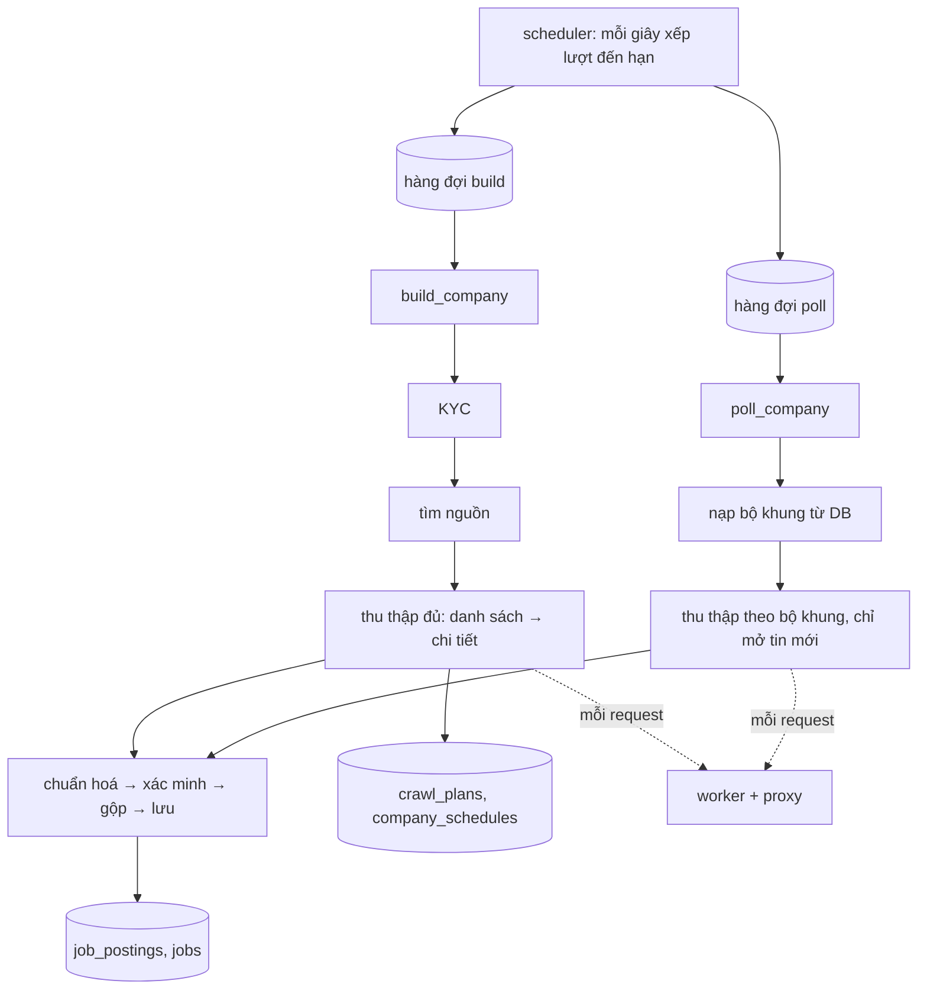

# Luồng crawl: từ lịch tới việc làm trong DB

Tài liệu này theo chân một doanh nghiệp, từ lúc tới lượt crawl cho tới khi việc làm của nó nằm trong
Postgres, và giải thích lý do của từng lựa chọn. Chi tiết từng phần: [ARCHITECTURE.md](ARCHITECTURE.md)
(process, hàng đợi, worker, proxy), [DEDUP.md](DEDUP.md) (gộp tin), [OPERATIONS.md](OPERATIONS.md)
(vận hành).

## Ý chính

- **Có hai loại lượt.** _Build_ chạy ban đêm, đọc đủ cả site nên đắt, và ghi lại **bộ khung**.
  _Poll_ chạy cả ngày (kể cả lúc build đêm), mỗi 150 s, chỉ đọc theo bộ khung nên rẻ.
- **Bộ khung ghi "đi tới đâu", không ghi "bóc thế nào".** Nó gồm URL các trang danh sách, các API
  và cách phân trang của chúng, cùng mã các tin đã thấy. Bộ khung không chứa xpath, selector hay HTML.
- **Dữ liệu được bóc bằng rule chung cho mọi site**, chạy lại ở mỗi lượt. LLM chỉ là bước cuối khi
  rule không chắc, và có giới hạn số lần gọi lẫn cache.
- **Tìm tin mới chỉ cần mã hoặc URL của tin.** Chỉ tin mới mới phải mở trang chi tiết; tin đã biết
  thì dùng nội dung đã lưu.
- **Mọi request tới website đều đi qua worker** (gateway gRPC + Redis Streams). Backend không tự
  tải trang; chỉ SERP và LLM được gọi thẳng từ backend.

## 1. Toàn cảnh

## 2. Lấy một trang (dùng chung cho build và poll)

Mã nguồn gọi `SourceSession.fetch`, request đi qua `HttpClient` (`services/net/http.py`) theo thứ tự:

1. Kiểm tra robots.txt của domain.
2. Tra cache HTTP trên Redis (`HTTP_CACHE_TTL_SECONDS`, mặc định 1 giờ). Cache này chỉ để lượt build
   không tải một URL hai lần. **Lượt poll bỏ qua cache** vì poll phải thấy đúng trang ở thời điểm hiện tại.
3. Áp rate limit theo domain.
4. Đẩy việc vào Redis Streams. Việc của lượt poll vào làn ưu tiên `:hi`.
5. Worker lấy việc qua gateway (`Lease`), tải bằng curl_cffi (HTTP) hoặc Chromium (render) qua proxy,
   rồi trả kết quả (`Complete`).
6. Backend nhận diện trang bị chặn, retry nếu cần, và ghi một dòng `source_fetches` cho mỗi request.

**Khi nào phải mở trình duyệt:** khi HTML chỉ là khung SPA, hoặc khi đọc bằng HTTP không thấy tin
nào. Lúc đó Chromium mở trang, chờ mạng yên (`networkidle`) và **bắt lại các phản hồi JSON** mà trang
gọi. Đây là cách hệ thống tìm ra API danh sách tin của trang SPA để về sau gọi thẳng.

Bộ khung chỉ ghi trang là `rendered` (lượt poll mở lại bằng trình duyệt) khi trình duyệt thật sự
thêm nội dung: HTML là khung SPA, hoặc bản render có tin / link tin / API, thêm ≥ 3 link, hay nhiều
chữ hơn hẳn (≥ 1,25 lần + 200 ký tự; danh sách tin chỉ có chữ). Trang tĩnh hiện không có tin thì
lượt poll chỉ đọc HTTP (`careers.render_adds`): mỗi lần render tốn vài giây CPU của worker, và hàng
render đầy là lý do chính của lượt poll quá hạn. Đánh đổi: trang mà JavaScript chỉ nạp danh sách khi
có tin (lúc build không có tin nào) được thấy ở lượt build đêm sau.

## 3. Lịch

|                              | Build                                                    | Poll                                                       |
| ---------------------------- | -------------------------------------------------------- | ---------------------------------------------------------- |
| Khung giờ (`CRAWL_TIMEZONE`) | 00:00–06:00 (`BUILD_WINDOW`)                             | 00:00–24:00 (`POLL_WINDOW`)                                |
| Nhịp                         | mỗi đêm một lượt, rải đều theo pha cố định (hash của id) | mỗi 150 s ± 10 s                                           |
| Chạy ngay, ngoài nhịp thường | doanh nghiệp mới; bộ khung hỏng                          | trang tuyển dụng vừa có tin mới của doanh nghiệp (`board`) |
| Người dùng bấm               | "Build…" / "Build ngay" (trang Doanh nghiệp), "Build lại bộ khung" (một doanh nghiệp) | "Poll ngay" (trang một doanh nghiệp)                        |
| Thời hạn                     | mềm 165 s (chừa 30 s để lưu: dừng ở 150 s), cứng 180 s  | mềm 60 s, cứng 90 s                                        |

- Giao diện và API ghi rõ build hay poll: nút "Build…" của trang Doanh nghiệp xếp lượt build
  (`POST /api/enqueue`); lọc "lâu chưa build" và cột "Build gần nhất" (`companies.last_run_*`) chỉ
  tính lượt build — lượt poll chỉ đọc lại bộ khung. Danh sách lượt lẫn cả hai loại ghi "build /
  poll" và mỗi dòng có nhãn Build / Poll.
- Build người dùng bấm (nút Build, thêm / nạp doanh nghiệp) tìm nguồn lại và đọc trang mới, không
  dùng HTTP cache (`SourceSession.fresh`, như build đêm); lượt build tiếp thì dùng cache. Hộp thoại
  "Build…" đếm trước số doanh nghiệp khớp (`GET /api/enqueue/preview`): ngay sau build đêm, mọi
  doanh nghiệp đều vừa build nên lựa chọn "lâu chưa build 24 giờ" khớp 0. Lượt build xong mà KYC
  chưa rõ có trạng thái `ambiguous`, giao diện ghi "Xong · KYC chưa rõ".
- Chỉ một scheduler giữ lease leader. Mỗi giây, nó lấy các dòng `company_schedules` đến hạn
  (`FOR UPDATE SKIP LOCKED`), dời mốc kế tiếp và xếp job vào Redis Streams. Khoá job
  `build:<id>` / `poll:<id>` bảo đảm mỗi doanh nghiệp chỉ có một build và một poll đang chờ hoặc
  đang chạy.
- Build và poll của cùng doanh nghiệp không chạy chồng lên nhau. Việc này dựa vào khoá Redis theo
  doanh nghiệp cộng fencing token trong `company_fences`, nên một lượt cũ đã mất khoá không ghi đè
  được dữ liệu của lượt mới.

## 4. Build đêm

Điểm vào: `modules/crawl/crawl_service.build_company` → `company_service.process_company`.

### 4.1 Mở lượt

Thêm một dòng `company_runs` (`kind=build`, `status=running`) và ghi `companies.last_run_*` (cột "Build gần
nhất" của trang Doanh nghiệp: chỉ lượt build ghi các cột này, bảo trì đối chiếu lại cũng chỉ theo lượt build).

### 4.2 KYC: doanh nghiệp này là ai, website là gì

Code ở `pipeline/kyc.py`. Kết quả cũ còn hạn (`KYC_CACHE_DAYS`, 30 ngày) thì dùng lại. Nếu không, các
bước là:

1. Tìm qua SERP và đọc website (chân trang, JSON-LD).
2. LLM chọn ứng viên, kèm trích đoạn làm bằng chứng.
3. Rule kiểm lại lựa chọn đó.
4. Kết luận `verified`, `ambiguous` hoặc `not_found`.

Kết quả lưu vào `companies` (domain, tên pháp lý, MST, bằng chứng) và `company_aliases`. Nếu MST đã
thuộc một doanh nghiệp khác thì hai bản ghi được gộp lại. KYC lỗi hoặc hết giờ thì không lưu gì.

Website dùng để thu thập là website người dùng nhập; không có thì lấy domain mà KYC khớp mạnh.

### 4.3 Tìm nguồn trên website

Code ở `pipeline/discovery.py`. Kết quả được cache 7 ngày trên Redis. Build đêm và lượt build lại khi
bộ khung hỏng thì tìm lại từ đầu (`BUILD_REFRESH_DISCOVERY`); lượt nối tiếp dùng cache của lượt đầu.

Thứ tự tìm: link trên trang chủ có từ khoá tuyển dụng → sitemap (cả sitemap khai trong robots.txt) →
subdomain `careers.` / `tuyendung.` / `jobs.` / `career.` / `vieclam.` / `recruitment.` / `job.` → các
đường dẫn phổ biến. Hơn 3 link ứng viên thì LLM chọn (chỉ trả về số thứ tự; chờ tối đa 10 s rồi chọn
theo điểm), 3 link trở xuống thì mở hết. Mỗi ứng viên được mở ra để xác nhận: có tin, có JSON-LD, có
JSON của trang SPA, hoặc có nhúng ATS. Kết quả là các nguồn:

- **careers**: trang danh sách đầu tiên;
- **ATS**: Greenhouse, Lever, Workday…

Những chỗ trang tuyển dụng hay nằm mà rule phải nhận ra:

- domain khác mang tên thương hiệu: job.matbao.com (site matbao.net), tuyendung.ivy.com.vn (site
  ivymoda.com), bvbank.talent.vn;
- domain khác mà chữ trên link đúng là "Tuyển dụng" (trang tuyển dụng của tập đoàn mẹ), trừ mạng xã
  hội và trang tuyển dụng chung;
- mục tuyển dụng trong mục tin tức / blog: `/tin-tuc/tuyen-dung`, `/category/tuyen-dung`,
  `/tin-tuc/tin-tuyen-dung-2` (bài viết `/tin-tuc/chi-tiet/...-tuyen-dung-...` thì không);
- site chỉ có http: sitemap và đường dẫn đoán theo scheme của trang chủ.

Trang tin của nhiều nhà tuyển dụng thì bỏ, dù chữ trên link là "Tuyển dụng" / "Việc làm": trang trên
chính sàn tuyển dụng (công ty sở hữu sàn như JobsGO, ITviec lấy tin qua trang công ty của nó trên
sàn), và trang có link tới ≥ 3 hồ sơ nhà tuyển dụng (`/nha-tuyen-dung/...`) mang tên pháp nhân khác
nhau (chuyên trang việc làm của báo, trang gốc của nền tảng tuyển dụng). Đọc các trang đó thì tin của
doanh nghiệp khác bị gán cho doanh nghiệp này, và lượt poll chậm vì sàn nhiều trang. Luật này áp cả
khi nguồn careers đi theo link (bài báo nhắc "tuyển dụng" dẫn sang chuyên trang việc làm); bộ khung
careers cũ trên chính sàn bị bỏ ở lượt build sau, tin nó đã ghi bị gỡ.

URL đoán bị chặn (WAF chặn `sitemap.xml`, một subdomain) chỉ bỏ URL đó; trang chủ bị chặn hay không
mở được thì vẫn thử subdomain. Subdomain trả cùng một trang với tên ngẫu nhiên (DNS wildcard) thì bỏ.

Song song với bước này, hệ thống tìm profile của doanh nghiệp trên các trang tuyển dụng (TopCV,
ITviec…). Profile có sẵn từ lượt index (tin đã tải) hoặc từ **danh bạ nhà tuyển dụng** của trang
(sitemap profile, đọc ở lượt index đủ ban đêm: profile có tên trùng tên một doanh nghiệp được thêm
vào `source_profiles`). Profile chưa map mà tên gần alias của doanh nghiệp được map ngay trong lượt
build bằng rule; vẫn chưa có thì tìm bằng SERP `site:` (khi có `SERP_API_KEY`).

### 4.4 Thu thập một nguồn careers

Code ở `sources/careers.py`, hàm `_build`:

1. **Trang danh sách** (≤ 10 trang): đọc bằng HTTP, cần thì render. `scan_listing` lấy ra:
   - JobPosting JSON-LD đủ nội dung: đây đã là tin hoàn chỉnh, khỏi mở trang chi tiết;
   - link tin, chấm điểm theo đường dẫn và chữ trên link:
     - là trang con của trang danh sách;
     - có đoạn `tuyen-dung-` / `job-`;
     - có slug kèm số hoặc `?id=`;
     - chữ trên link trông giống tên vị trí;
     - là một trong ≥ 3 thẻ tin `/<slug>-<mã>` cùng thư mục cha trên trang (tuyendung.frt.vn đặt tin
       ở gốc site, đường dẫn không có từ khoá tuyển dụng);
   - tin trong JSON nhúng (`__NEXT_DATA__`…) hoặc trong JSON trang gọi lúc render: tìm mảng có ≥ 60%
     phần tử giống tin, rồi đoán trường theo tên khoá (`title`, `salary` / `luong`, `deadline` /
     `hannop`…);
   - link tới trang sau và link "xem tất cả".

   Trong lúc đọc, hệ thống ghi luôn vào bộ khung: `listings`, `rendered`, `apis` (cách phân trang),
   `api_only`, `names`.

2. **Các trang sau của API** (≤ 20 trang): tự tăng tham số trang hoặc offset.
3. **Rule không thấy gì:** LLM đọc trang theo từng đoạn và chọn link trong danh sách link có sẵn trên
   trang (không được bịa link). Khi đó bộ khung ghi `llm_listing = true`. Vị trí không có trang riêng
   (cả JD nằm trên trang danh sách: từng mục, khối thu gọn, cửa sổ bật lên) lấy mô tả là phần của nó
   trên trang (từ dòng ghi tên vị trí tới dòng ghi tên vị trí khác), trường có nhãn trong phần đó, và
   cột của dòng bảng tóm tắt chứa tên vị trí ("Ngày hết hạn", "Số lượng").
4. **Trang chi tiết** (≤ 80 trang):
   - Tin đã tải trong `JOB_REUSE_DAYS` (3 ngày) thì dùng lại, không mở: tin đã nhận, và tin chỉ bị
     loại vì đăng lại (site đăng một vị trí cho từng cửa hàng; mở lại chúng mỗi lượt thì hết phần
     trang chi tiết trước khi tới tin chưa tải).
   - Các trang còn lại được mở và bóc như mục 6.
   - Trang hoá ra là danh mục: ghi vào `hubs`.
   - Trang không phải tin: ghi vào `ignored`.
   - Tin chỉ tới được qua mục "vị trí khác" của một tin khác: ghi vào `indirect`.
5. **Sitemap** (sau khi mở các trang danh mục): đọc `/sitemap.xml` của site (không có thì
   `/sitemap_index.xml`, file con tên giống tin tuyển dụng trước) và lấy URL cùng **khuôn** với link tin
   đã thấy (host + thư mục cha của ≥ 3 link tin có mã), bỏ URL có `lastmod` quá 180 ngày, tối đa 500
   link. Các link này mở như bước 4 trong phần trang chi tiết còn lại. Dùng cho site mà trang danh
   sách chỉ hiện vài tin, phần còn lại nạp bằng XHR khi cuộn (tuyendung.frt.vn: 11 tin trên trang chủ,
   223 tin trong sitemap). Có link thì bộ khung ghi `sitemaps` (URL + khuôn).

Với nguồn ATS, hệ thống gọi API công khai của ATS; dữ liệu trả về đã có cấu trúc sẵn.

### 4.5 Xử lý tin

Tin thu được đi tiếp vào mục 7. Chỉ lượt build **đọc đủ mọi nguồn** mới được đóng những việc không
còn thấy trên site.

### 4.6 Ghi bộ khung và lịch

Phần này ghi ở cuối lượt, trong một transaction:

- `crawl_plans`: mỗi nguồn một dòng, gồm `spec`, `job_keys` (mã các tin vừa thấy) và trạng thái
  `active` hoặc `broken`. Nguồn không còn thấy chuyển `retired`.
- Chia trang (`plan_service.allocate_pages`): mỗi doanh nghiệp được tối đa 10 trang cho một lượt poll,
  mỗi nguồn ít nhất `min(nhu cầu, 3)` trang.
- `company_schedules`: trạng thái `ready` (có nguồn để poll) hoặc `no_sources`, cùng `next_poll_at` và
  `next_build_at`.
- Kết quả trong `company_runs`, cùng `source_fetches` và `failed_pages` (HTML của các trang parse lỗi,
  giữ lại để debug).

### 4.7 Khi hết giờ

Lượt chưa xong được đánh `partial` và tự xếp một lượt nối tiếp (tối đa 2 lượt). Lượt nối tiếp dùng lại
phần đã tải và đi tiếp.

## 5. Bộ khung lưu gì, và không lưu gì

Bộ khung nằm ở `crawl_plans.spec`, cột JSONB trong Postgres (mô hình `sources/plan.py: PlanSpec`).
Lượt poll nào cũng nạp lại từ DB. Giữa hai lượt, process không giữ gì trong RAM: runner nào cũng chạy
được lượt poll, và runner khởi động lại cũng không mất gì.

| Trường                 | Ý nghĩa                                                                                    |
| ---------------------- | ------------------------------------------------------------------------------------------ |
| `listings`             | URL các trang danh sách đã đọc, theo thứ tự đọc (kể cả trang sau, "xem tất cả")            |
| `hubs`                 | trang danh mục hoặc trang theo tỉnh dẫn tới tin                                            |
| `apis`                 | API danh sách tin của trang SPA: URL, method, body, cách phân trang, cỡ trang, tổng số tin |
| `sitemaps`             | sitemap có link tin, kèm khuôn URL tin (host + thư mục cha) dùng để lọc link              |
| `rendered`, `api_only` | trang phải mở bằng trình duyệt; trang mà API đã thay được (poll chỉ gọi API)               |
| `ignored`, `indirect`  | link đã mở mà không phải tin; tin chỉ tới được qua trang tin khác                          |
| `boards`               | host của trang tin nhiều nhà tuyển dụng (sàn) gặp ở lượt build: link tin dẫn vào đó bị bỏ |
| `llm_listing`          | danh sách chỉ đọc được bằng LLM                                                            |
| `names`                | bảng mã → tên (vd. `city 33 → Hà Nội`), vì gọi thẳng API thì không có danh mục đi kèm      |
| `ats`                  | bảng tin ATS                                                                               |
| `pages`                | số trang một lượt poll được đọc ở nguồn này                                                |

Ngoài `spec`, dòng `crawl_plans` còn có `job_keys`: mã các tin đã thấy, dùng để so ở lượt poll sau.

**Phân trang được lưu theo hai kiểu:**

- **Trang HTML:** lưu **nguyên URL từng trang** (`/tuyen-dung`, `/tuyen-dung?page=2`…). Nếu lúc poll
  gặp link tới một trang sau chưa có trong bộ khung (site vừa thêm trang), poll vẫn đi theo, miễn còn
  trong phần trang của nguồn. Tuy vậy, poll không ghi URL đó vào bộ khung; chỉ build mới ghi `spec`.
- **API:** chỉ lưu **cách phân trang** (`ApiSpec`: tên tham số `key`, kiểu `page` / `offset`, `size`,
  `total`). Poll tự dựng request cho trang 2, 3…; tổng số tin thì đọc lại từ phản hồi của chính lượt poll.

**Những thứ không lưu:**

| Không lưu                                | Vì sao                                                                                              |
| ---------------------------------------- | --------------------------------------------------------------------------------------------------- |
| xpath / CSS selector                     | một bộ rule chung chạy được cho hàng nghìn site; site đổi giao diện không làm selector hỏng âm thầm |
| HTML trang danh sách                     | poll cần trang ở thời điểm hiện tại nên luôn tải lại; HTML được parse trong RAM rồi bỏ đi           |
| ETag / Last-Modified của trang danh sách | poll không hỏi "trang có đổi không" mà luôn tải lại trang                                           |

Ngoại lệ: các trang tuyển dụng lớn (TopCV, ITviec, CareerLink, 123job, Vieclam24h) có parser viết tay
riêng dùng CSS selector. Các selector này nằm trong code `sources/boards/`, không nằm trong DB.

## 6. Bóc trang chi tiết

Code ở `sources/careers.py: _detail_page / _parse_detail`, dùng chung cho build và poll:

1. **JSON-LD `JobPosting`:** nếu trang có, lấy luôn các trường có cấu trúc. Mô tả ngắn hơn 200 ký tự
   (JSON-LD chỉ ghi tóm tắt một dòng) thì lấy khối JD trong HTML; không có thì mở lại trang bằng
   trình duyệt.
2. **Trang hoá ra là danh mục** (nhiều link tin, URL không có mã tin): không coi là tin, chỉ lấy các
   link tin trên đó.
3. **Parser chung:**
   - Lấy vùng nội dung chính (`main_node`) và đổi sang markdown. Dưới 400 ký tự thì mở lại bằng
     trình duyệt. `main_node` bỏ menu, footer, script và `<form>` ít chữ (tìm kiếm, đăng nhập), nhưng
     giữ form bọc nội dung: trang ASP.NET WebForms bọc cả trang trong một form, trang tin của
     tuyendung.frt.vn bọc cả mô tả công việc trong form "Ứng tuyển".
   - Mô tả là **khối nhỏ nhất chứa các tiêu đề mục JD** (`jd_block`: "Mô tả / Chi tiết công việc",
     "Yêu cầu", "Quyền lợi"…, cùng bảng từ khoá `normalize.JD_SECTION_KEYS` dùng để tách mục), khi
     trang có từ hai loại mục trở lên. Site không có thẻ `main` / `article` thì nhờ vậy mô tả không
     lẫn menu, cột giới thiệu công ty, "tin liên quan", chân trang, khung chat, bảng liên hệ. Tiêu đề
     mục nằm cả trong menu thì giữ cả nội dung chính như cũ. Phần chữ còn lại (thanh thông tin, cột
     tóm tắt) gửi kèm tin (`extra.page_context`, ≤ 4.000 ký tự): normalize chỉ dùng để bù lương,
     kinh nghiệm, học vấn khi các mục của tin không ghi.
   - Tiêu đề: chọn giữa chữ trên link, `h1` / `h2`, `og:title` và slug của URL. Tiêu đề chỉ là
     thông báo chung ("THÔNG BÁO TUYỂN DỤNG", "VietABank - Tuyển dụng") thì lấy nhãn "Vị trí tuyển
     dụng:" trong bài.
   - Khối `aria-hidden` nhiều chữ (cửa sổ bật lên, khối thu gọn, tab đang đóng) được giữ; khối ít
     chữ, toàn link (menu ẩn) và bản sao của slider thì bỏ.
   - Trường có nhãn (`labeled_fields`, đọc cả nội dung chính): "Mức lương:", "Địa điểm làm việc:",
     "Hạn nộp:", "Kinh nghiệm:", "Hình thức làm việc:", "Cấp bậc:", "Số lượng cần tuyển:", "Trình
     độ:"… Nhãn đứng riêng một dòng (có hoặc không có dấu ":") thì lấy giá trị ở dòng ngay sau, trừ
     khi dòng đó là nhãn khác hay tiêu đề mục. Nhãn có số thứ tự ("7. Hạn nhận hồ sơ:") vẫn nhận;
     dòng là link (thẻ tin khác) và mọi thứ từ khối "Việc làm liên quan" bị bỏ; tin ghi nhiều hạn
     nộp thì lấy ngày muộn nhất; ngày đăng lấy từ nhãn "Ngày đăng:" hay `article:published_time`.
   - Nơi làm: không có nhãn địa điểm thì lấy tỉnh ghi trên thẻ tin trỏ về chính trang (khối "tin
     liên quan" hay liệt kê cả tin đang xem kèm nơi làm); thẻ "Tất cả" / "toàn quốc" thì không kê.
4. **Kiểm tra có phải tin tuyển dụng không:** đếm 8 nhóm dấu hiệu (mô tả công việc, yêu cầu, quyền
   lợi, trách nhiệm, hạn nộp / ứng tuyển, lương, địa điểm, kinh nghiệm).
   - Trang có **≥ 4 nhóm** thì chắc chắn là tin, **không gọi LLM**.
   - Ít hơn 4 nhóm thì hỏi LLM (`prompts/job_detail.py`) xem có phải tin không, đồng thời nhờ nó bóc
     các trường. Câu trả lời được cache 7 ngày theo URL + tiêu đề + nội dung. LLM tắt thì bỏ trang.

Kết quả là một `RawJob`: tiêu đề, mô tả markdown, nơi làm, lương thô, hạn nộp thô… Trang danh sách
cũng theo đúng thứ tự ưu tiên này: JSON-LD trước, rồi rule, LLM sau cùng.

## 7. Từ tin thô tới việc làm

Code ở `company_service.process_jobs`:

| Bước      | Module                       | Rule                                                                                                                                                                      | LLM                                                                                               |
| --------- | ---------------------------- | ------------------------------------------------------------------------------------------------------------------------------------------------------------------------- | ------------------------------------------------------------------------------------------------- |
| Chuẩn hoá | `pipeline/normalize.py`      | HTML → markdown sạch (ẩn SĐT / email cá nhân); lương "15–20 triệu" → min / max / tiền tệ / kỳ; ngày; 34 tỉnh/thành; học vấn; số lượng tuyển; ngành nghề (`categories.py`) | —                                                                                                 |
| Xác minh  | `pipeline/verify.py`         | mỗi tin một quyết định kèm lý do: hết hạn, JD trống, không phải tin, sai nhà tuyển dụng, tin môi giới, dấu hiệu lừa đảo, đăng lặp                                         | chỉ chấm tin còn nghi ngờ, ≤ 40 tin / lượt, cache 7 ngày; LLM lỗi → hoãn (không nhận, không loại) |
| Gộp       | `pipeline/dedup.py`          | cùng tiêu đề, chung tỉnh, JD giống (MinHash ≥ 0,8) hoặc cùng nơi nộp → một việc; bản chuẩn: ATS / careers > trang tuyển dụng                                              | —                                                                                                 |
| Phân loại | `normalize.classify_unclear` | cấp bậc / loại hình / hình thức làm việc theo rule                                                                                                                        | chỉ hỏi trường của việc đã gộp còn `unknown`, ≤ 40 việc, cache 30 ngày                            |
| Lưu       | `pipeline/store.py`          | `job_postings`: mỗi tin của mỗi nguồn một dòng, `raw` nén zstd. `jobs`: việc đã gộp, upsert theo cụm                                                                      | —                                                                                                 |

**"Trích xuất thành công"** nghĩa là việc làm nằm trong `jobs` với `status=active`, nối với các bản tin
nguồn của nó trong `job_postings`.

**Đóng việc:** chỉ xảy ra khi một lượt đọc trọn nguồn mà không còn thấy tin. Khi đó tin chuyển
`removed`, và việc được đóng nếu không còn bản tin nào khác đang mở.

## 8. Poll

Điểm vào: `crawl_service.poll_company` → `sources/careers.py: _poll`.

1. **Nạp từ DB:** bộ khung của các nguồn `active`, cùng (nguồn, mã, URL) của các tin đã lưu. Bước này
   không đọc nội dung tin.
2. **Đọc mỗi nguồn**, tối đa `pages` trang:
   1. **API trong `spec.apis`:** gọi thẳng bằng HTTP, không mở trình duyệt.
   2. **Sitemap trong `spec.sitemaps`:** một request, lấy URL cùng khuôn đã ghi.
   3. **`listings` + `hubs`:** đọc bằng HTTP, bỏ qua trang `api_only` đã lấy được tin qua API.
      - Trang trong `rendered` chỉ render lại khi HTML không có tin (trang mà trình duyệt không thêm
        gì thì không có trong `rendered`, xem mục 2).
      - Trang có JSON nhúng thì đọc tin trong JSON đó và các trang sau của nó.
   4. **LLM:** chỉ dùng ở nguồn `llm_listing` khi rule không thấy tin nào; câu trả lời cache theo nội dung.
3. **So mã với `job_keys`:**
   - mã chưa có là tin **mới**;
   - mã cũ vắng mặt là tin **đã gỡ**, nhưng chỉ khi nguồn được đọc trọn (không hết phần trang, không lỗi).
4. **Mở trang chi tiết chỉ cho tin mới:** tối đa 10 trang mỗi nguồn, phần còn lại để lượt sau; link
   trong `ignored` và link tới trang danh sách / danh mục vừa đọc thì bỏ qua. Cách bóc như mục 6.
5. **Ghi:**
   - Không có gì đổi (phần lớn các lượt): chỉ cập nhật `crawl_plans.polled_at` và `company_schedules`,
     không ghi `company_runs`.
   - Có tin mới: chạy mục 7 cho riêng các tin mới, rồi cập nhật `job_keys`.
   - Có tin gỡ: đóng việc tương ứng.
6. **Bộ khung hỏng thì build lại ngay**, khi gặp một trong các trường hợp:
   - trang chính trả 404 / 410;
   - API trả 4xx, không còn là JSON hoặc không còn tin;
   - sitemap trả 4xx, không còn là XML hoặc không còn URL cùng khuôn;
   - trang danh sách hết sạch tin;
   - lỗi tạm lặp lại 3 lượt.

   Ngoài ra có chốt chặn đóng nhầm: một lượt mất ≥ 30% tin (nguồn có ≥ 5 tin) thì không đóng việc nào
   mà coi như lỗi; lặp lại 3 lượt thì build lại.

Các loại nguồn khác:

- **ATS:** gọi API của ATS.
- **Trang tuyển dụng:** poll **không gọi mạng**, chỉ đọc index chung. Lượt index "đuôi" chạy mỗi 2 phút;
  khi thấy tin mới của một doanh nghiệp có profile, nó xếp poll cho doanh nghiệp đó ngay (lượt `board`).

## 9. Vì sao poll nhanh dù không lưu selector

Thời gian của một lượt crawl nằm ở **request mạng, trình duyệt và LLM**, không nằm ở bước parse.
Parse một trang và chấm điểm link chỉ tốn vài mili giây CPU. Một request qua worker và proxy mất từ vài
trăm ms tới vài giây, còn render bằng Chromium mất nhiều giây. Có lưu selector thì cũng chỉ bớt được
mấy mili giây parse; bộ khung bớt được phần đắt hơn nhiều.

|                       | Build                              | Poll                                                 |
| --------------------- | ---------------------------------- | ---------------------------------------------------- |
| KYC (SERP + LLM)      | có, khi kết quả cũ hết hạn         | không                                                |
| Tìm nguồn             | có                                 | không, URL đã có trong bộ khung                      |
| Trang danh sách / API | ≤ 10 + ≤ 20 trang **mỗi nguồn**    | ≤ 10 trang **cho cả doanh nghiệp**                   |
| Trình duyệt           | mở khi trang là SPA                | gọi thẳng API đã bắt được; chỉ render khi HTML trống |
| Trang chi tiết        | ≤ 80 mỗi nguồn                     | **chỉ tin mới**, thường là 0                         |
| LLM                   | xác minh, phân loại, đọc trang khó | chỉ khi có tin mới, và đã cache theo nội dung        |
| Ghi DB                | lượt build + tin + bộ khung + lịch | không có gì đổi thì chỉ cập nhật mốc poll và lịch    |
| Thời hạn              | 165 s / 180 s                      | 60 s / 90 s                                          |

Lượt poll đi làn ưu tiên `:hi` ở hàng việc lấy trang, nên build chạy ban ngày không làm poll chậm đi.
Mục tiêu "tin mới thấy trong ≤ 3 phút ở P95" đạt được nhờ chu kỳ 150 s cộng thời gian của một lượt poll.

## 10. Ví dụ

Lấy một doanh nghiệp giả định: Công ty A, trang tuyển dụng `a.vn/tuyen-dung` gồm 2 trang, 15 tin, HTML
có sẵn tin (không phải SPA).

**Build lúc 02:13** (pha của A trong khung đêm):

1. KYC còn hạn, dùng lại.
2. Tìm nguồn: trang chủ có link "Tuyển dụng" trỏ tới `a.vn/tuyen-dung`; mở trang để xác nhận, thấy có
   link tin.
3. Thu thập:
   - đọc `/tuyen-dung` và `/tuyen-dung?page=2` (2 request), thấy 15 link tin;
   - 12 tin đã tải trong 3 ngày qua nên dùng lại;
   - mở 3 trang chi tiết.
4. Bộ khung: `listings = [/tuyen-dung, /tuyen-dung?page=2]`, `job_keys` gồm 15 mã, `pages = 2`.

**Poll lúc 09:00:**

1. 2 request HTTP tới hai trang danh sách, thu được 15 mã, khớp hết với `job_keys`.
2. Không có gì đổi: chỉ cập nhật `polled_at` và lịch.

**Poll lúc 09:02:30:**

1. Trang 1 có link mới `/tuyen-dung/ke-toan-tong-hop-123`, mã này chưa có trong `job_keys` nên là tin mới.
2. Mở trang chi tiết (1 request). Trang không có JSON-LD, nên chạy parser chung:
   - trang có 6/8 nhóm dấu hiệu, tức ≥ 4, nên **không gọi LLM**;
   - nhãn "Mức lương: 15 - 20 triệu" và "Hạn nộp: 30/11/2026" bóc ra thành `RawJob`.
3. Chuẩn hoá thành 15–20 triệu VND / tháng, hạn nộp cuối ngày 30/11/2026.
4. Xác minh đạt, không trùng việc nào nên không gộp.
5. Ghi `job_postings` + `jobs`; `job_keys` lên 16 mã.

## 11. Dữ liệu nằm ở đâu

| Dữ liệu                                              | Nơi lưu                                                  |
| ---------------------------------------------------- | -------------------------------------------------------- |
| Bộ khung, mã các tin đã thấy                         | `crawl_plans` (Postgres)                                 |
| Lịch build / poll                                    | `company_schedules`                                      |
| Tin đã bóc (`RawJob`, nén zstd)                      | `job_postings.raw`                                       |
| Việc làm đã gộp                                      | `jobs`                                                   |
| KYC, tên khác, profile trên trang tuyển dụng         | `companies`, `company_aliases`, `source_profiles`        |
| Lượt build / poll, từng request, trang parse lỗi (HTML), log | `company_runs`, `source_fetches`, `failed_pages`, `logs` |
| Kết quả tìm nguồn (7 ngày)                           | Redis cache (mất được)                                   |
| Cache HTTP 1 giờ (chỉ build dùng)                    | Redis cache (mất được)                                   |
| Câu trả lời LLM, kết quả SERP                        | Redis cache (mất được)                                   |

## Mã nguồn

Đường dẫn tính từ `backend/jobcrawler/`.

| Phần                                     | File                                                                                    |
| ---------------------------------------- | --------------------------------------------------------------------------------------- |
| Build, poll, khoá doanh nghiệp           | `modules/crawl/crawl_service.py`                                                        |
| Một lượt build, ghi lượt build và lịch   | `modules/crawl/company_service.py`                                                      |
| Chia trang, ghi bộ khung                 | `modules/crawl/plan_service.py`                                                         |
| Lịch                                     | `modules/crawl/schedule_service.py`                                                     |
| Mô hình bộ khung                         | `sources/plan.py`                                                                       |
| Nguồn careers: danh sách, chi tiết, poll | `sources/careers.py`                                                                    |
| Tin trong JSON / API của trang SPA       | `sources/json_jobs.py`                                                                  |
| JSON-LD                                  | `sources/jsonld.py`                                                                     |
| ATS, trang tuyển dụng                    | `sources/ats/`, `sources/boards/`                                                       |
| KYC, tìm nguồn, thu thập                 | `pipeline/kyc.py`, `pipeline/discovery.py`, `pipeline/collect.py`                       |
| Chuẩn hoá, xác minh, gộp, lưu            | `pipeline/normalize.py`, `pipeline/verify.py`, `pipeline/dedup.py`, `pipeline/store.py` |
| Lấy trang                                | `services/net/http.py`, `sources/base.py` (`SourceSession`)                             |
