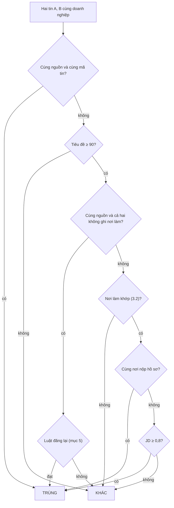

# Gộp trùng việc làm

Cách hệ thống quyết định hai tin tuyển dụng là cùng một việc. Vị trí của bước này trong pipeline:
[ARCHITECTURE.md](ARCHITECTURE.md) mục 6.

- **Tin** (`job_postings`): một bản đăng trên một nguồn, khoá duy nhất `(source, external_id)`.
- **Việc** (`jobs`): một vị trí tuyển dụng thật, gộp từ một hoặc nhiều tin, khoá duy nhất
  `(company_id, cluster_key)`.

Mọi phép so chỉ diễn ra **trong một doanh nghiệp**: việc của hai doanh nghiệp khác nhau không bao giờ
bị gộp.

Mã nguồn: [`pipeline/dedup.py`](../backend/jobcrawler/pipeline/dedup.py) (luật so),
[`pipeline/store.py`](../backend/jobcrawler/pipeline/store.py) (gắn vào việc đã lưu),
[`pipeline/verify.py`](../backend/jobcrawler/pipeline/verify.py) (`mark_reposts`),
[`modules/maintenance/maintenance_service.py`](../backend/jobcrawler/modules/maintenance/maintenance_service.py) (`dedupe_jobs`).

## 1. Các lớp chống trùng

| Lớp                             | Ở đâu                                         | Chặn                                                   |
| ------------------------------- | --------------------------------------------- | ------------------------------------------------------ |
| 1. Khoá tin                     | upsert `job_postings (source, external_id)`   | tải lại cùng một tin                                   |
| 2. Loại tin đăng lại cùng nguồn | `verify.mark_reposts`                         | một tin đăng nhiều lần trên cùng nguồn, trong một lượt |
| 3. Gom cụm                      | `dedup.cluster_jobs`                          | cùng việc trên nhiều nguồn, trong một lượt             |
| 4. Gắn vào việc đã lưu          | `store.save_company_jobs`, `_ExistingMatcher` | cụm mới thực chất là việc đã có (đăng lại, đổi URL)    |
| 5. Index trong DB               | `ux_jobs_company_fingerprint_active`          | hai việc đang mở y hệt nội dung                        |

`external_id` là id của ATS / trang tuyển dụng; tin không có id riêng dùng hash của URL đã chuẩn hoá
(thêm thứ tự trên trang khi nhiều tin chung một URL, `jsonld.external_id_for_url`).

## 2. Chuẩn hoá trước khi so

| Trường             | Cách tính                                                                                      | Ví dụ                                               |
| ------------------ | ---------------------------------------------------------------------------------------------- | --------------------------------------------------- |
| `fold(x)`          | viết thường, bỏ dấu, chỉ giữ chữ và số, cách nhau một dấu cách                                 | "Kế Toán." → `ke toan`                              |
| `title_normalized` | `normalize_title`: `fold` + bỏ lương, "tuyển gấp", mã tin, tên địa điểm ở cuối                 | "Kỹ Sư Hiện Trường (20-30Tr)" → `ky su hien truong` |
| `jd_text`          | mô tả + yêu cầu (không tính phúc lợi)                                                          |                                                     |
| `places`           | nơi làm ở mức **tỉnh cũ** (trước sáp nhập 2025), từ địa chỉ và tiêu đề, giữ đơn vị cụ thể nhất | "[Hải Dương] Kinh doanh" → {Hải Dương}              |
| `provinces`        | tỉnh/thành hiện tại của các địa điểm                                                           | {Hải Phòng}                                         |

## 3. Các phép so

### 3.1. Tiêu đề — `title_similarity`, ngưỡng 90

1. **Chặn cấp bậc** (`rank_conflict`): hai tiêu đề lệch nhau ở một từ chỉ cấp bậc / vai trò → 0 điểm.
   Từ: senior, sr, junior, jr, lead, leader, principal, head, chief, manager, director, intern,
   internship, fresher, trainee, assistant, deputy, trưởng, phó, I, II, III, IV; cụm: thực tập,
   trợ lý, giám đốc.
2. **`token_set_ratio`** (rapidfuzz) trên `title_normalized`: tách thành tập từ, lấy phần chung, so
   phần chung với "phần chung + từ riêng của mỗi bên" theo tỉ lệ ký tự giống nhau, lấy điểm cao
   nhất (0–100). Tiêu đề này nằm trọn trong tiêu đề kia → 100.

| A                  | B                      | Điểm             |
| ------------------ | ---------------------- | ---------------- |
| Kế toán            | Kế toán tổng hợp       | 100              |
| Java Developer     | Java Backend Developer | 100              |
| Java Developer     | Senior Java Developer  | 0 (lệch cấp bậc) |
| Kế toán            | Kế toán trưởng         | 0 (lệch cấp bậc) |
| Tester             | Testers                | 92,3             |
| Frontend Developer | Backend Developer      | 74,3             |

Tiêu đề chỉ là **bộ lọc lỏng**; JD mới là phép quyết định.

### 3.2. Nơi làm

- **Khác nguồn** (`compatible_provinces`): chung ít nhất một tỉnh/thành; tin không ghi địa điểm thì
  không chặn.
- **Cùng nguồn** (`same_places`): `places` phải biết rõ ở cả hai và có chung ít nhất một tỉnh cũ. Hai
  tin khác mã trên cùng nguồn thường là hai nơi tuyển ("[Hải Dương] Kinh doanh" / "[Hải Phòng] Kinh
  doanh" — cùng Hải Phòng sau sáp nhập).

### 3.3. JD — MinHash, ngưỡng 0,8

1. `fold(jd_text)`, cắt thành các cụm 3 từ liên tiếp: "lap bao cao tai chinh" → `lap bao cao`,
   `bao cao tai`, `cao tai chinh`.
2. Độ giống = Jaccard của hai tập cụm: số cụm chung / tổng số cụm khác nhau.
3. Ước lượng bằng MinHash 128 hàm băm (sai số khoảng ±0,03); chữ ký tính một lần mỗi tin
   (`Signatures`). JD rỗng → 0.

Đổi một từ làm hỏng tới 3 cụm, nên JD càng ngắn điểm càng tụt. Ví dụ JD kế toán 56 từ: đổi "hàng
tháng" → "hàng quý" được 0,867; thêm một câu được 0,852.

### 3.4. Nơi nộp hồ sơ

`_apply_key`: `apply_url` đã chuẩn hoá; nguồn không ghi thì là URL của tin. Tin không có trang riêng
(chung URL trang danh sách: tin trong JSON của SPA, tin LLM đọc từ trang danh sách) chỉ dùng
`apply_url`.

## 4. Hai tin có phải một việc? — `same_job`

Dùng khi gom cụm trong một lượt. Đi từ trên xuống, dừng ở bước đầu tiên có kết luận:



## 5. Luật đăng lại — `is_repost`

Cùng nguồn, cả hai tin không ghi nơi làm (doanh nghiệp đăng lại tin cũ với mã mới, vd. MISA
`/tuyen-dung/5883` và `/5920`). Đòi gần như y hệt:

1. Địa danh nêu trong tiêu đề giống nhau (`title_places`);
2. tiêu đề so trên `fold` (không dùng `title_normalized`, vì nó đã bỏ phần trong ngoặc như
   "[VII.2026_Ba Đình]") ≥ 97;
3. JD ≥ 0,95.

## 6. Loại tin đăng lại trong lượt — `verify.mark_reposts`

Trước khi gom cụm, bước xác minh loại các bản đăng lại **cùng nguồn** trong số tin được nhận (lý do
`SPAM_REPOST`):

- `places` phải bằng nhau;
- không rõ nơi làm → luật đăng lại (mục 5);
- có nơi làm → tiêu đề ≥ 90 và JD ≥ 0,9.

Giữ bản mới nhất (`posted_at`, bằng nhau thì JD dài hơn), loại các bản còn lại. Tin bị loại không vào
cụm; việc cũ của nó vẫn được bản giữ lại nhận qua mục 8.

## 7. Gom cụm và bản chuẩn — `cluster_jobs`, `merge`

- So **từng cặp** tin được nhận của doanh nghiệp bằng `same_job`, nối bằng union-find
  (`connected_groups`).
- Trước khi nối hai nhóm, tập tỉnh của hai nhóm phải còn tương thích: một tin không rõ địa điểm (khớp
  với mọi nơi) không được nối tin Hà Nội với tin Đà Nẵng.
- **Bản chuẩn** (`canonical_rank`): website / ATS của doanh nghiệp trước trang tuyển dụng → cách bóc
  tin cậy hơn (ATS API > JSON-LD > parser > LLM > heuristic) → JD dài hơn → đăng mới hơn.
- `merge` bổ sung từ các tin khác những trường bản chuẩn còn thiếu (cấp bậc, loại hình, hình thức,
  lương, kinh nghiệm, yêu cầu, phúc lợi, hạn nộp, nơi nộp); gộp địa điểm và kỹ năng (≤ 30);
  `posted_at` lấy ngày sớm nhất. Việc giữ mọi URL nguồn (`source_urls`).

## 8. Gắn vào việc đã lưu — `save_company_jobs`

Mỗi cụm cần một `cluster_key`:

1. **Tin đã gắn việc từ lượt trước** (và được nhận lượt này) → dùng lại khoá của việc đó. Cụm chứa tin
   của nhiều việc cũ thì giữ việc đầu tiên chưa bị cụm khác dùng; các việc cũ còn lại không còn tin
   nào được nhận nên bị đóng (`removed`).
2. **Cụm mới** → `_ExistingMatcher.find`, chỉ xét việc **đang mở** chưa bị cụm nào của lượt này nhận:
   1. việc có **dấu vân tay y hệt** (mục 9);
   2. không có: nạp một lần danh sách việc đang mở (tiêu đề, nguồn chuẩn, địa điểm), lọc ứng viên tiêu
      đề ≥ 90, rồi mới nạp JD đã lưu (mô tả + yêu cầu) của các ứng viên đó;
   3. so bằng `same_existing`: cùng luật với `same_job` nhưng **không có lối tắt** cùng mã tin / cùng
      nơi nộp; nguồn của việc cũ là `canonical_source`;
   4. nhiều ứng viên khớp → chọn việc có JD giống nhất. Mỗi việc cũ chỉ nhận một cụm mỗi lượt.
3. **Không khớp việc nào** → việc mới, khoá `sha1(source:external_id)` của bản chuẩn.

Upsert việc theo `(company_id, cluster_key)`; `first_seen_at` chỉ lùi về sớm hơn (`least`), không
bao giờ tiến lên.

## 9. Dấu vân tay và index trong DB

```
fingerprint = sha1( fold(tiêu đề) | places sắp xếp, nối bằng dấu phẩy | sha1(fold(JD)) )[:32]
```

- Đổi dấu, hoa / thường, dấu câu, khoảng trắng: `fold` bỏ hết, dấu vân tay không đổi. Đổi một chữ
  hoặc số: dấu vân tay khác, chỉ còn so mờ (mục 8) bắt được.
- Index `ux_jobs_company_fingerprint_active`: `UNIQUE (company_id, fingerprint) WHERE status =
'active' AND fingerprint IS NOT NULL`. Upsert va index này (`IntegrityError`) → ghi vào việc đang
  mở có cùng dấu vân tay thay vì tạo việc mới (`_upsert_job`).
- Bảo trì (`dedupe_jobs`, ≤ 5000 việc mỗi lượt; chạy tay `jobcrawler db dedup`): chỉ xét việc **chưa
  có** dấu vân tay — điền dấu vân tay; trùng một việc đang mở khác thì chuyển tin sang việc đó, việc
  trùng → `removed`.

## 10. Ban ngày và ban đêm

- **Poll ban ngày**: so danh sách với các mã đã có, chỉ tin **mã mới** đi qua chuẩn hoá → xác minh →
  gom cụm. Với tin mới, bước quyết định là gắn vào việc đã lưu (mục 8). Tin đã gỡ được đóng sau đó,
  nên tin gỡ và tin đăng lại thấy trong cùng một lượt poll vẫn gắn vào việc cũ.
- **Lượt đủ ban đêm**: mọi tin của doanh nghiệp cùng đi qua gom cụm, bản cũ và bản đăng lại thường gộp
  ngay ở mục 7.

## 11. Ngưỡng

| Hằng số                           | Giá trị | Dùng ở                                              |
| --------------------------------- | ------- | --------------------------------------------------- |
| `TITLE_THRESHOLD`                 | 90      | tiêu đề (`same_job`, `same_existing`, lọc ứng viên) |
| `JD_THRESHOLD`                    | 0,8     | JD (`same_job`, `same_existing`)                    |
| `REPOST_TITLE_THRESHOLD`          | 97      | luật đăng lại                                       |
| `REPOST_JD_THRESHOLD`             | 0,95    | luật đăng lại                                       |
| `SPAM_JD_THRESHOLD` (`verify.py`) | 0,9     | `mark_reposts` khi có nơi làm                       |
| `SHINGLE` / `NUM_PERM`            | 3 / 128 | cụm từ / số hàm băm MinHash                         |

## 12. Giới hạn đã biết

Đo bằng chính các hàm trên. JD là từ ngẫu nhiên, đổi một ký tự trong một từ giữa JD, 200 lần mỗi
độ dài:

| Số từ JD | Đạt 0,8 | Đạt 0,95 (luật đăng lại) |
| -------- | ------- | ------------------------ |
| 30       | 62%     | 0%                       |
| 40       | 95%     | 0%                       |
| 60       | 100%    | 2%                       |
| 80       | 100%    | 14%                      |
| 120      | 100%    | 54%                      |
| 200      | 100%    | 94%                      |
| 400      | 100%    | 100%                     |

- **Đổi một ký tự vẫn có thể lọt** khi:
  - tiêu đề rất ngắn: "Sales" → "Sale" 88,9, "IT" → "IT1" 80 (< 90);
  - JD sát mức tối thiểu (`verify_min_jd_chars` = 200 ký tự, khoảng 30–40 từ);
  - rơi vào luật đăng lại: "Java Developer" → "Java Develper" 96,3 (< 97), JD dưới khoảng 200 từ.
- **Chỉ so với việc đang mở.** Việc đã `removed` / `expired` trước khi bản đăng lại xuất hiện (gỡ và
  đăng lại ở hai lượt poll khác nhau) → việc mới, `first_seen_at` mới.
- **Chỉ trong một doanh nghiệp.** Cùng một việc bị map vào hai doanh nghiệp thì không gộp.
- **Tiêu đề chứa nhau được 100 điểm.** Hai vị trí khác nhau dùng chung mẫu JD, cùng tỉnh ("Kế toán" /
  "Kế toán tổng hợp", JD ≥ 0,8) bị gộp làm một.
- **Số "mới" đếm tin, không đếm việc** (`SaveResult.new`, `PollOutcome.new`, `jobs_new`): tin đăng
  lại với mã mới đã gắn vào việc cũ vẫn được tính là mới.
- **Ban đêm so lại từng cặp, chạy trên event loop**: xem mục 13.

## 13. Chi phí tính toán

Không phải lượt nào cũng tính lại toàn bộ:

| Lượt                      | Đọc DB                                                                                                                                                                 | Tính                                                                                            |
| ------------------------- | ---------------------------------------------------------------------------------------------------------------------------------------------------------------------- | ----------------------------------------------------------------------------------------------- |
| Poll, không có tin mã mới | —                                                                                                                                                                      | không so gì                                                                                     |
| Poll, có tin mã mới       | tra dấu vân tay qua index (≤ 1 dòng); không trúng thì 6 cột nhẹ của mọi việc đang mở (không có JD), một lần mỗi lượt; JD (giải nén zstd) chỉ của ứng viên tiêu đề ≥ 90 | MinHash tin mới, so tiêu đề cụm mới × việc đang mở, MinHash JD ứng viên                         |
| Lượt đủ ban đêm           | —                                                                                                                                                                      | MinHash **mọi** tin; `mark_reposts` (cặp cùng nguồn) và `cluster_jobs` so **từng cặp**: n(n−1)/2 |

### 13.1. Số đo

DB local (43 doanh nghiệp, 2.478 việc đang mở), ba doanh nghiệp nhiều tin nhất, mã ở `6fc0813`. Cột
poll: 5 cụm lấy từ tin đã có, dấu vân tay giả để buộc đi đường so mờ.

| Tin được nhận | JD trung vị | MinHash mọi tin | `cluster_jobs`      | Poll: 5 cụm mới so với việc đã lưu |
| ------------- | ----------- | --------------- | ------------------- | ---------------------------------- |
| 595           | 318 từ      | 1,2 s           | 5,2 s (176.715 cặp) | 156 ms, nạp JD 7 việc              |
| 476           | 627 từ      | 1,2 s           | 4,0 s (113.050 cặp) | 323 ms, nạp JD 84 việc             |
| 176           | 225 từ      | 0,24 s          | 0,4 s (15.400 cặp)  | 79 ms, nạp JD 25 việc              |

Mỗi cặp khoảng 30 µs, nên chi phí tăng theo bình phương số tin (ngoại suy):

| Tin được nhận | Cặp       | `cluster_jobs` |
| ------------- | --------- | -------------- |
| 1.000         | 0,5 triệu | ~15 s          |
| 1.400         | 1 triệu   | ~30 s          |
| 2.000         | 2 triệu   | ~60 s          |

`SOURCE_MAX_JOBS` (500) giới hạn số tin mỗi nguồn, nhưng doanh nghiệp có website và nhiều trang tuyển
dụng thì số tin cộng dồn qua các nguồn.

### 13.2. Vấn đề

1. **Mã CPU chạy thẳng trên event loop.** `cluster_jobs`, `mark_reposts` và MinHash được gọi đồng bộ
   trong coroutine, không qua `to_thread`. Một runner chạy nhiều job cùng lúc trên một event loop, nên
   suốt đoạn này mọi job khác của runner đứng: không tải trang, không gia hạn lease. Watchdog của
   runner thoát process khi event loop đứng quá `min(WATCHDOG_SECONDS, QUEUE_RECLAIM_SECONDS / 2)` =
   30 s (mặc định). Doanh nghiệp có khoảng 1.400 tin được nhận trở lên làm runner tự thoát giữa lượt
   đêm; mọi job đang chạy trên runner đó bị chạy lại, và lượt chạy lại của doanh nghiệp này gặp lại
   đúng chỗ đó. `COMPANY_TIMEOUT_SECONDS` không cắt được, vì timeout của asyncio chỉ chạy khi event
   loop được trả quyền.
2. **Tính lại thứ không đổi.** Đêm nào cũng tính lại MinHash và so lại mọi cặp, kể cả tin có
   `content_hash` không đổi và cặp đã biết là khác nhau từ đêm trước. Chữ ký MinHash của việc đã lưu
   không được cất: ở poll, mỗi lần một việc lọt vào danh sách ứng viên là lại đọc JD, giải nén và tính
   lại MinHash.
3. **Bộ lọc tiêu đề lọc kém.** Tiêu đề chứa nhau được 100 điểm (mục 3.1), nên doanh nghiệp có nhiều
   tiêu đề gần nhau kéo theo nhiều ứng viên: ở doanh nghiệp thứ hai, 5 cụm mới phải nạp JD của 84 việc.

### 13.3. Hướng giảm (chưa làm)

- Chạy phần CPU ngoài event loop: `asyncio.to_thread` (vẫn tranh GIL nhưng event loop còn được chạy)
  hoặc process pool (tách hẳn).
- Cất chữ ký MinHash theo `content_hash` ở Redis cache (dữ liệu mất được).
- Tìm ứng viên bằng MinHash LSH (`datasketch.MinHashLSH`, cùng thư viện đang dùng) thay vì so mọi
  cặp: gần tuyến tính.
- Ban đêm chỉ gom lại tin mới / tin đổi nội dung; tin không đổi giữ cụm cũ.
