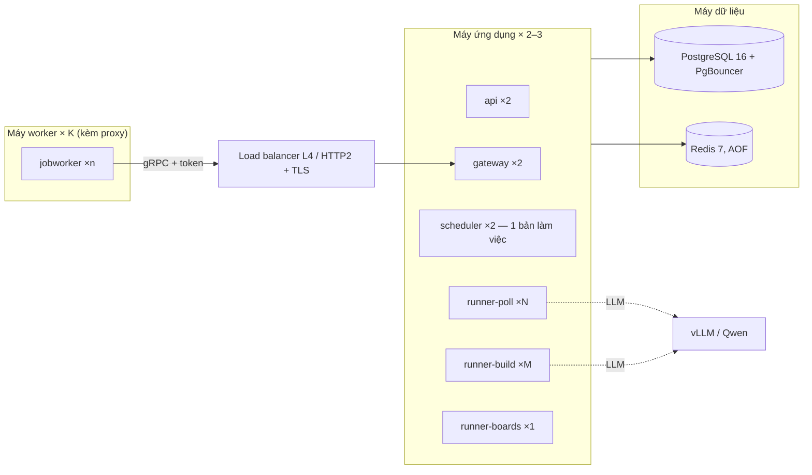

# Triển khai và quy mô 10.000 doanh nghiệp

Mục tiêu: 10.000 doanh nghiệp, tin mới của một doanh nghiệp được thấy trong **3 phút ở P95**
(ban ngày); mỗi đêm build lại bộ khung của mọi doanh nghiệp. Tài liệu này nói chạy những gì, ở
đâu, bao nhiêu bản, và cách tính lại khi số liệu thật khác. Kiến trúc chi tiết:
[ARCHITECTURE.md](ARCHITECTURE.md); vận hành hằng ngày: [OPERATIONS.md](OPERATIONS.md).

## 1. Sơ đồ triển khai



- **Máy dữ liệu**: Postgres + Redis (hoặc dịch vụ quản lý). Không chạy ứng dụng ở đây.
- **Máy ứng dụng**: một image backend (`backend/Dockerfile`, ~0,9 GB, không có Chromium), file
  `deploy/backend.compose.yaml`. `api` và `gateway` sau load balancer; `scheduler` chạy 2 bản để
  dự phòng (chỉ một bản giữ khoá); runner tăng bản theo bảng ở mục 3.
- **Máy worker**: image worker (`worker/Dockerfile`, Playwright + Chromium, ~3,9 GB), file
  `deploy/worker.compose.yaml`. Đặt gần nguồn proxy / IP sạch; chỉ cần ra Internet và tới gateway
  (cổng 50051, HTTP/2). Không cần quyền vào DB / Redis.

Thứ tự nâng cấp: build và đẩy image → `migrate` (một lần) → khởi động lại backend (runner dừng êm:
job đang chạy được xếp lại) → khởi động lại worker (worker làm nốt việc rồi thoát).

## 2. Số đo (19/10/2026, một máy dev, Docker Desktop 12 vCPU)

**10 doanh nghiệp thật** (Shopee, VNG, VNPAY, MISA, ACB, KiotViet, Vinamilk, Base.vn, GHN, Katalon;
961 việc đang mở, 1–10 trang danh sách mỗi nguồn):

| Lượt poll                                   | Số đo                                                          |
| ------------------------------------------- | -------------------------------------------------------------- |
| Request mỗi lượt                            | 1–10, trung bình ~6,5 (site phân trang đọc hết các trang)      |
| Thời gian mỗi lượt                          | 0,3–12 s, trung bình 7,3 s (phần lớn là chờ rate limit / mạng) |
| CPU backend mỗi lượt                        | trung bình ~140 ms, trung vị 125 ms, lớn nhất ~0,5 s (Shopee: 10 trang API) |
| Tin mới trên site giả đặt cùng hệ thống, T = 150 s | **16/16 thấy trong ≤ 180 s**: trung vị 43 s, P95 119 s, lâu nhất 130 s |
| Build một doanh nghiệp (LLM chạy được)      | ~76 s, ~130 request (cả lượt nối tiếp)                         |

**300 doanh nghiệp giả** (`scripts/loadtest/fake_sites.py`, 8 tin mỗi site, 0,5 tin mới / giây
trong 10 phút), T = 30 s để dồn tải:

| Đại lượng                                   | Số đo                                                                 |
| ------------------------------------------- | --------------------------------------------------------------------- |
| Lượt poll                                   | 7,8 / giây (4.658 lượt / 10 phút), không lượt nào lỗi, P95 ≤ 0,5 s   |
| Tin mới (site không đang build)             | 144 tin: trung vị 13,8 s, P95 30 s, lâu nhất 56 s                     |
| Tin mới (kể cả site đang build lúc đăng)    | 238/243 ≤ 180 s; mọi tin > 100 s đều rơi vào lúc doanh nghiệp đang build (poll chờ khoá doanh nghiệp; build kéo dài vì LLM lỗi 503 → nhiều lượt nối tiếp) |
| CPU `runner-poll`                           | ~25 ms mỗi lượt (site 1 trang); site thật ~140 ms (bảng trên)         |
| CPU `gateway`                               | ~6 ms mỗi request (Register/Lease/Complete + Redis)                   |
| CPU `worker`                                | ~10–20 ms mỗi request (gồm cả trang render)                           |
| Redis                                       | ~50 lệnh mỗi lượt poll / request; ~2% một core mỗi 1.000 lệnh / giây (phần nền ~3% do AOF) |
| Postgres                                    | ~10 ms CPU mỗi lượt poll                                              |

## 3. Tải và cấu hình cho 10.000 doanh nghiệp

Ký hiệu: `N` doanh nghiệp có nguồn website / ATS để poll (thường 60–100% danh sách; phần còn lại
chỉ có tin trên trang tuyển dụng), `T` = `POLL_INTERVAL_SECONDS`, `F` = request mỗi lượt poll,
`d` = thời gian một lượt, `c` = CPU backend một lượt. Số bên phải lấy theo nhóm 10 doanh nghiệp
lớn ở trên (doanh nghiệp nhỏ ít trang hơn nên rẻ hơn) — tức là ước lượng dè dặt.

| Đại lượng                     | Công thức                 | N = 10.000, T = 150 s                                                |
| ----------------------------- | ------------------------- | -------------------------------------------------------------------- |
| Lượt poll / giây              | N / T                     | **67**                                                               |
| Lượt poll chạy cùng lúc       | N / T × d                 | d ≈ 7–10 s → **500–670**                                             |
| CPU `runner-poll`             | N / T × c                 | c ≈ 0,14 s → **~9,5 core**                                           |
| Request poll / giây           | N × F / T                 | F ≈ 6,5 → **~440**; `POLL_MAX_LISTING_PAGES=2` → ~170                |
| Độ trễ phát hiện P95          | ≈ 0,95 × T + d            | 142 + 10 ≈ **152 s** (≤ 180 s)                                       |
| Lượt build / giây ban đêm     | N / độ dài `BUILD_WINDOW` | 10.000 / 6 giờ = **0,46**                                            |
| Build chạy cùng lúc ban đêm   | 0,46 × thời gian build    | 76–170 s → **35–80**                                                 |
| Request build / giây ban đêm  | 0,46 × request mỗi build  | ~130 → **~60**                                                       |
| Lệnh Redis / giây             | ~50 × (poll + request)/s  | **~25.000** (≈ nửa core Redis trên máy thật)                         |

Ban ngày tải nằm ở poll; ban đêm ở build (poll tắt ngoài `POLL_WINDOW`). Doanh nghiệp đang build
thì không poll (chung khoá), nên ban ngày build càng ít càng tốt: chỉ doanh nghiệp mới và bộ khung
hỏng.

Cấu hình đề xuất (giữ CPU mỗi process ≤ ~70%: mỗi process Python dùng tối đa một core):

| Thành phần       | Số bản / máy                                              | Cấu hình chính                                                                                 |
| ---------------- | --------------------------------------------------------- | ---------------------------------------------------------------------------------------------- |
| PostgreSQL 16    | 1 máy 8 vCPU, 32 GB RAM, SSD NVMe 500 GB (+ 1 bản sao đọc) | `shared_buffers` 8 GB, PgBouncer (transaction pooling) trước Postgres; bảng lịch đã có fillfactor / autovacuum riêng |
| Redis 7          | 1 máy 4 vCPU, 8 GB RAM                                    | AOF everysec, `maxmemory` 6 GB, `noeviction` (hàng đợi không được mất); giảm `HTTP_CACHE_TTL_SECONDS` nếu bộ nhớ căng |
| `runner-poll`    | **16 bản** (4 máy 4 vCPU × 4)                             | `RUNNER_POLL_CONCURRENCY=50` → 800 lượt cùng lúc ≥ 670 cần; ~9,5 core / 16 ≈ 60% mỗi bản        |
| `runner-build`   | **8 bản** × 10 (2 máy 4 vCPU)                             | 80 build cùng lúc ban đêm; ban ngày gần như rảnh                                               |
| `runner-boards`  | 1–2                                                       | index đủ ban đêm, đuôi ban ngày                                                                |
| `scheduler`      | 2 (dự phòng, một bản giữ khoá)                            | `SCHEDULER_BATCH=500`, tick 1 s → xếp được 500 job / giây                                      |
| `gateway`        | **4 bản** sau load balancer L4 (2 máy × 2)                | ~440 request / giây × ~6 ms ≈ 2,6 core                                                         |
| `api`            | 2                                                         | đặt `UI_PASSWORD`                                                                              |
| **worker HTTP**  | **8–10 máy** 2 vCPU / 4 GB, `WORKER_HTTP_SLOTS=64`, `WORKER_RENDER_SLOTS=0` | ~440 request / giây × ~0,7 s ≈ 310 request cùng lúc; 640 slot, dư ~50%; CPU ~4–9 core tổng |
| **worker render**| **3–4 máy** 4 vCPU / 8 GB, `WORKER_RENDER_SLOTS=6`, `WORKER_HTTP_SLOTS=16` | trang SPA chưa có API trong bộ khung + build đêm; ~300 MB RAM mỗi trang Chromium |
| LLM (vLLM Qwen)  | theo GPU                                                  | ban ngày: xác minh tin mới; ban đêm: KYC hết hạn, chọn trang careers, xác minh / chuẩn hoá — đặt `LLM_REQUESTS_PER_MINUTE` theo năng lực; LLM lỗi làm build kéo dài (lượt nối tiếp) |

Việc HTTP và việc render nằm ở hai stream riêng, nên tách máy HTTP / máy render không cần pool:
máy chỉ làm HTTP đặt `WORKER_RENDER_SLOTS=0` (không mở Chromium, không nhận việc render). Dùng
`WORKER_POOL` + `FETCH_ROUTES` khi muốn một nhóm domain đi qua nhóm máy / proxy riêng (vd. trang
tuyển dụng qua proxy dân cư).

Khởi đầu nhỏ hơn rồi tăng theo số đo (mục 4) thường rẻ hơn: ~3.000 doanh nghiệp cần ~20 lượt poll
/ giây ≈ 3 core → 5 `runner-poll`, 1–2 `gateway`, 3 máy worker HTTP + 1 máy render.

## 4. Theo dõi và tăng bản

| Dấu hiệu (trang / API)                                                   | Nguyên nhân                                    | Làm gì                                                                 |
| ------------------------------------------------------------------------ | ---------------------------------------------- | ---------------------------------------------------------------------- |
| Hàng đợi poll có việc **chờ** thường xuyên > 0 (trang Hàng đợi)          | thiếu slot runner-poll                         | thêm `runner-poll` hoặc tăng `RUNNER_POLL_CONCURRENCY` (khi CPU còn)  |
| CPU runner-poll > 70%                                                    | parse nhiều trang mỗi lượt                     | thêm bản; hoặc `POLL_MAX_LISTING_PAGES=2`                              |
| Workers: slot HTTP đang dùng > 70% tổng                                  | thiếu worker                                   | thêm máy worker                                                        |
| Tổng quan: P95 thời gian một lượt poll tăng, request "Lỗi / quá giờ" tăng | worker quá tải hoặc proxy chậm                 | thêm worker, đổi proxy                                                  |
| Tổng quan: P95 cửa sổ phát hiện > 180 s nhưng hàng đợi rỗng               | lượt poll dài (site phân trang dài, chậm)      | giảm `POLL_INTERVAL_SECONDS` (vd. 120) hoặc `POLL_MAX_LISTING_PAGES`   |
| "Bộ khung hỏng" tăng                                                      | site đổi cấu trúc / chặn                        | xem tab Bộ khung & lịch; build lại tự chạy                              |
| Build đêm chưa xong khi hết khung (Hàng đợi build còn việc lúc 6:00)      | thiếu runner-build / worker render / LLM chậm  | thêm `runner-build`, worker render; nới `BUILD_WINDOW`                 |
| Postgres CPU > 70% / chờ khoá                                              | ghi lịch + lưu tin                             | PgBouncer, máy lớn hơn; tách bản sao đọc cho `api`                      |

Mọi số trên đều có ở trang Tổng quan (độ trễ, độ tươi), Hàng đợi, Workers, và `jobcrawler stats`.

## 5. Kiểm chứng trước khi lên 10.000

1. Đo độ trễ đầu-cuối trên site giả (không phụ thuộc site thật):

   ```bash
   uv run python scripts/loadtest/sla_site.py --port 8765 --every 75 --count 16 --out sla.jsonl
   # nạp doanh nghiệp website http://<máy>:8765/, chờ build xong
   uv run python scripts/loadtest/sla_report.py sla.jsonl
   ```

2. Thử tải poll với hàng trăm – hàng nghìn site giả (một process, phân biệt theo tên miền
   `s<i>.<ip>.nip.io`):

   ```bash
   uv run python scripts/loadtest/fake_sites.py --sites 2000 --churn 2 --wait 600 --duration 900 \
       --domain 192-168-65-254.nip.io --csv sites.csv --out churn.jsonl
   uv run jobcrawler import sites.csv
   # trang Cài đặt: POLL_INTERVAL_SECONDS nhỏ lại (vd. 30) để dồn tải; theo dõi Tổng quan / Workers
   uv run python scripts/loadtest/sla_report.py churn.jsonl --quiet
   ```

   Nhân kết quả theo tỉ lệ `(10.000 / T_thật) / (số site / T_thử)`; xoá doanh nghiệp thử
   (`note = 'thử tải'`) sau khi đo.

3. Trên dữ liệu lớn (truy vấn giao diện): `scripts/loadtest/seed.py` + `bench.py` (OPERATIONS.md).

## 6. Bảo mật

- `GATEWAY_TOKEN` bắt buộc khi gateway mở ra ngoài; TLS ở load balancer (HTTP/2 tới gateway) hoặc
  `GATEWAY_TLS_CERT/KEY`. Worker chỉ có token, không có thông tin DB / LLM / SERP.
- API key SERP / LLM chỉ ở backend (SERP gọi thẳng từ backend, không qua worker).
- `UI_PASSWORD` cho giao diện (sai 20 lần / IP trong 5 phút → 429; sau reverse proxy đặt
  `FORWARDED_ALLOW_IPS` để thấy IP thật). Cổng Postgres / Redis không mở ra Internet (compose
  một máy chỉ mở ở `127.0.0.1`); máy dữ liệu riêng thì chặn bằng firewall, chỉ cho máy ứng dụng.
- Log được che bí mật trước khi ghi (URL có mật khẩu, token, khoá API); thao tác của người vận
  hành ghi ở `audit_events` (bí mật bị che). Báo lỗ hổng: [SECURITY.md](../.github/SECURITY.md).
- Proxy tại worker nằm trong file / biến môi trường của máy worker; danh sách proxy chung (nếu dùng
  `PROXY_MODE=central`) lưu ở DB, giao diện chỉ hiện dạng che mật khẩu.
