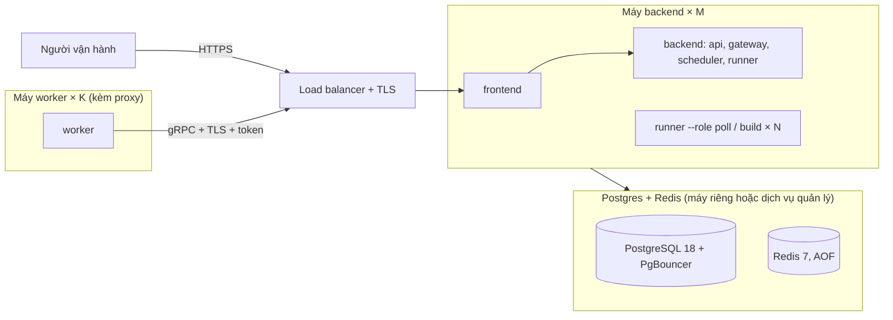

# Triển khai và quy mô

Chạy ở đâu, bao nhiêu bản, và tính lại thế nào khi số liệu thật khác. Kiến trúc:
[ARCHITECTURE.md](ARCHITECTURE.md); vận hành: [OPERATIONS.md](OPERATIONS.md).

Ràng buộc mọi mức đều phải giữ: **tin mới thấy trong ≤ 3 phút ở P95** (ban ngày), bộ khung ≤ 10
trang mỗi doanh nghiệp, build lại mọi doanh nghiệp trong 6 giờ đêm.

## 1. Triển khai

### Một máy bằng Docker Compose

Chỉ cần chép `docker-compose.prod.yaml` lên máy chủ:

1. File chạy được ngay bằng giá trị mặc định. Trước khi mở ra Internet, `Ctrl+F` từ `CHANGE_ME` và
   sửa giá trị ở trước comment đó: mật khẩu, token, khoá, image, cổng và giới hạn phần cứng.
   `database-password` phải khớp `database-url`; `redis-password` phải khớp `redis-url`; ba image
   phải dùng cùng tag phiên bản hoặc `sha-*`.
2. Giới hạn quyền đọc vì file chứa bí mật: `chmod 600 docker-compose.prod.yaml`.
3. Kiểm tra và tải image: `docker compose -f docker-compose.prod.yaml config --quiet`, rồi
   `docker compose -f docker-compose.prod.yaml pull` (đăng nhập GHCR trước nếu package riêng tư).
4. Khởi động và chờ healthcheck: `docker compose -f docker-compose.prod.yaml up -d --wait`.
5. Kiểm tra bằng `docker compose -f docker-compose.prod.yaml ps`; giao diện mặc định ở
   `127.0.0.1:8000`, dành cho reverse proxy HTTPS trên cùng máy.

File này không dùng `build`, `env_file`, `.env` hay file trong repo. Chỉ `frontend` mở cổng; Postgres,
Redis và backend không mở cổng host; Postgres/Redis còn nằm trên mạng dữ liệu `internal`. Muốn truy
cập HTTP trực tiếp từ máy khác thì đổi `web-listen` thành `0.0.0.0:8000:8080`, nhưng production nên
đặt cổng `8000` sau reverse proxy HTTPS.
`docker-compose.yaml` chỉ dành cho dev: build từ mã nguồn và nạp `backend/.env`, `worker/.env`.

Mặc định phần cứng dành cho máy khoảng 8 vCPU / 16 GB (giới hạn có thể overcommit, Docker chia sẻ
CPU khi các service cùng tải):

| Service  | CPU tối đa | RAM tối đa |
| -------- | ---------- | ---------- |
| Postgres | 2          | 2 GB       |
| Redis    | 1          | 1 GB       |
| Backend  | 4          | 4 GB       |
| Frontend | 0,5        | 256 MB     |
| Worker   | 4          | 4 GB       |

Redis bắt buộc mật khẩu cả ở healthcheck và backend. Hãy đổi các bí mật trước lần chạy đầu tiên.
`redis-maxmemory` phải thấp hơn `redis-memory` để Redis còn bộ nhớ nền và trả lỗi ghi theo
`noeviction`, thay vì container bị OOM-kill.
Riêng `POSTGRES_PASSWORD` chỉ khởi tạo mật khẩu khi volume `pgdata` còn trống; với DB đã có dữ liệu,
phải đổi mật khẩu role trong Postgres trước rồi mới sửa hai giá trị trong compose.



- **Một máy production**: dùng `docker-compose.prod.yaml` như hướng dẫn trên. Nếu dùng Postgres /
  Redis quản lý, sửa `database-url` / `redis-url`, rồi bỏ hai service và hai điều kiện `depends_on`
  tương ứng khỏi một bản compose dành riêng cho hạ tầng đó.
- **Một cổng**: chỉ `frontend` mở cổng (mặc định `8000`); nginx chuyển gRPC của worker
  (`/jobcrawler.crawl.v1.CrawlGateway/`, HTTP/2) tới gateway. Load balancer trước `frontend` phải
  chuyển HTTP/2 cho đường đó (nginx `grpc_pass`, Caddy `h2c://`, ALB target group gRPC). Backend
  có `GATEWAY_TLS_CERT` thì đặt `GATEWAY_UPSTREAM=grpcs://backend:50051` cho `frontend`.
- **Máy worker** (chỉ cần ra Internet và tới cổng giao diện, không cần DB / Redis): dùng lệnh của nút
  "Thêm worker" trên trang Workers. Nếu tự viết compose riêng, lấy cấu hình service `worker` làm mẫu,
  đổi `GATEWAY_ADDR`, bật TLS và dùng `WORKER_JOIN_KEY` một lần hoặc `GATEWAY_TOKEN`.
- **Runner thêm**: cùng image và môi trường với `backend`, lệnh `jobcrawler runner --role poll` (hoặc
  `build`, `boards`). Mỗi process Python dùng tối đa một core: giữ CPU mỗi process ≤ ~70%.
- **Gateway thêm**: `jobcrawler gateway` sau load balancer L4 (HTTP/2); không giữ trạng thái.
- **Proxy / load balancer trước giao diện** (cập nhật trực tiếp `GET /api/events`, Server-Sent
  Events): không đệm và không nén `text/event-stream` (nginx của `frontend` đã tắt cho đường này;
  backend gửi `X-Accel-Buffering: no`), idle timeout > 15 s (backend gửi `: ping` mỗi 15 s; 60 s là
  đủ). Không cần sticky session: replica API nào cũng đọc Redis / Postgres chung. Nên bật HTTP/2 ở
  load balancer: mỗi tab giữ một kết nối SSE, HTTP/1.1 chỉ cho 6 kết nối mỗi origin (tab ẩn quá
  60 s tự đóng kết nối). Proxy không giữ được kết nối lâu thì giao diện tự quay về poll định kỳ.
  `jobcrawler api` dừng sau tối đa 5 s (`timeout_graceful_shutdown`) dù còn luồng mở; trình duyệt
  tự nối lại. Load balancer kết thúc TLS phải gửi `X-Forwarded-Proto: https`: nginx của `frontend`
  chuyển tiếp giá trị đó cho backend, backend mới đặt cookie đăng nhập `Secure`.
- **Image**: CI build và đẩy `jobcrawler-backend`, `-worker`, `-frontend` lên GHCR sau khi mọi kiểm
  tra xanh, mỗi lần push `main` (tag `main`, `sha-<7>`) và mỗi tag `vX.Y.Z`; pull request chỉ build thử.
  Production sửa ba image trong `x-production` và ghim cùng một tag; giá trị worker được dùng cả
  cho service lẫn lệnh sinh từ nút "Thêm worker". Quay lại bản trước bằng cách đổi tag rồi pull/up
  lại. Phát hành: `task release VERSION=X.Y.Z`.
  Cả backend và worker dựng trên `python:3.12-slim-bookworm` (chung lớp base), hai giai đoạn: image
  chạy chỉ có venv `/opt/venv`, không có uv / mã nguồn. Worker chỉ cài Chromium headless shell
  (`playwright install --with-deps --only-shell chromium`, worker luôn mở headless): ~1,4 GB thay vì
  ~4,2 GB của image Playwright chính thức (kèm Firefox, WebKit, Chromium đầy đủ). Backend ~0,7 GB.
- **Nâng cấp**: đẩy image → khởi động lại `backend` (migration chạy lúc khởi động, job đang chạy được
  xếp lại) → khởi động lại worker (làm nốt việc rồi thoát). Backend và worker khác phiên bản vẫn
  chạy được với nhau trong lúc chuyển: gateway mới giao được việc kiểu cũ còn trong stream, worker
  cũ không kể việc trong Heartbeat thì gateway không đối soát. Bỏ ngược về bản trước revision `0003`
  (bảng `company_fences`) thì không cần hạ schema: bản cũ không đọc bảng này.

## 2. Số đo (19/10/2026, Docker Desktop 12 vCPU)

10 doanh nghiệp thật (Shopee, VNG, VNPAY, MISA, ACB, KiotViet, Vinamilk, Base.vn, GHN, Katalon; 961
việc, 1–10 trang mỗi nguồn):

| Đại lượng               | Số đo                                                                    |
| ----------------------- | ------------------------------------------------------------------------ |
| Request mỗi lượt poll   | 1–10, trung bình **6,5**                                                 |
| Thời gian một lượt poll | 0,3–12 s, trung bình **7,3 s** (chủ yếu chờ rate limit 1 req/s / domain) |
| CPU backend mỗi lượt    | trung bình **~140 ms** (lớn nhất ~0,5 s: 10 trang API)                   |
| Tin mới, T = 150 s      | 16/16 trong ≤ 180 s: trung vị 43 s, **P95 119 s**                        |
| Một lượt build          | ~76 s, ~130 request (LLM chạy được)                                      |

300 site giả (T = 30 s để dồn tải): 7,8 lượt poll / giây không lỗi; gateway ~6 ms CPU / request;
worker ~10–20 ms CPU / request; Redis ~50 lệnh mỗi lượt poll / request; Postgres ~10 ms CPU mỗi lượt.

## 3. Công thức

`N` = số doanh nghiệp có nguồn website / ATS, `T` = `POLL_INTERVAL_SECONDS` (150), `F` = request mỗi
lượt poll (6,5 trung bình; trần 10 trang bộ khung + trang tin mới), `d` = thời gian một lượt (≤ 10 s
khi tính dư), `c` = CPU một lượt (0,14 s).

| Đại lượng                             | Công thức                                                     |
| ------------------------------------- | ------------------------------------------------------------- |
| Lượt poll / giây                      | N / T                                                         |
| Lượt poll cùng lúc (slot runner poll) | N / T × d                                                     |
| CPU runner poll                       | N / T × c                                                     |
| Request / giây ban ngày               | N / T × F                                                     |
| Slot worker HTTP                      | request / giây × 0,7 s × 1,5 (dư)                             |
| CPU gateway                           | request / giây × 6 ms                                         |
| Lệnh Redis / giây                     | 50 × (lượt poll + request) / giây                             |
| Lượt build / giây ban đêm             | N / 21.600 (6 giờ)                                            |
| Build cùng lúc ban đêm                | lượt build / giây × 76–170 s                                  |
| P95 độ trễ phát hiện                  | ≈ 0,95 × T + d ≈ 152–162 s (không đổi theo N nếu đủ năng lực) |

## 4. Các mức scale

| Mức | N (doanh nghiệp) | Poll / giây | Request / giây (F 6,5 – 10) | Build cùng lúc (đêm) | Lệnh Redis / giây |
| --- | ---------------- | ----------- | --------------------------- | -------------------- | ----------------- |
| S   | 1.000            | 6,7         | 43 – 67                     | 4 – 8                | ~2.500            |
| M   | 3.000            | 20          | 130 – 200                   | 11 – 24              | ~7.500            |
| L   | 10.000           | 67          | 430 – 670                   | 35 – 80              | ~25.000           |
| XL  | 30.000           | 200         | 1.300 – 2.000               | 105 – 240            | ~75.000           |
| XXL | 50.000           | 333         | 2.200 – 3.300               | 175 – 395            | ~125.000          |

Cấu hình đề xuất (máy worker HTTP = 2 vCPU / 4 GB, `WORKER_HTTP_SLOTS=64`, `WORKER_RENDER_SLOTS=0`;
máy worker render = 4 vCPU / 8 GB, `WORKER_RENDER_SLOTS=6`, `WORKER_HTTP_SLOTS=16`):

| Mức | Backend                                                                                                               | Worker                                       | Postgres / Redis                                                                                                                                                           |
| --- | --------------------------------------------------------------------------------------------------------------------- | -------------------------------------------- | -------------------------------------------------------------------------------------------------------------------------------------------------------------------------- |
| S   | 1 máy 8 vCPU / 16 GB chạy cả compose (runner tự tính: poll 96, build 20)                                              | 1 container trên cùng máy (64 HTTP + render) | trên cùng máy                                                                                                                                                              |
| M   | 1 máy 8 vCPU: `backend` + 3 `runner --role poll` (× 70) + 2 `runner --role build` (× 10)                              | 3 máy HTTP + 1 máy render                    | 4 vCPU / 16 GB; Redis 2 vCPU / 4 GB                                                                                                                                        |
| L   | 16 `runner-poll` × 50 (4 máy 4 vCPU), 8 `runner-build` × 10 (2 máy), 2 `scheduler`, 4 `gateway`, 2 `api` + `frontend` | 8–11 máy HTTP + 3–4 máy render               | Postgres 8 vCPU / 32 GB + PgBouncer (+ bản sao đọc); Redis 4 vCPU / 8 GB, cache tách `CACHE_REDIS_URL`                                                                     |
| XL  | ~40 `runner-poll` × 60 (10 máy 4 vCPU), ~24 `runner-build` × 10, 12 `gateway`                                         | 22–33 máy HTTP + 8–10 máy render             | Postgres 16 vCPU / 64 GB + PgBouncer + bản sao đọc; Redis máy riêng CPU nhanh — **sát trần một Redis** (~100.000 lệnh đơn / giây), bắt buộc tách cache                     |
| XXL | —                                                                                                                     | —                                            | **Chưa đạt với kiến trúc hiện tại**: một Redis không chịu nổi ~125.000 lệnh / giây. Cần chia hàng đợi / việc lấy trang ra nhiều Redis (shard theo doanh nghiệp) — chưa làm |

Ghi chú:

- Bảng tính dè dặt theo 10 doanh nghiệp lớn; doanh nghiệp nhỏ ít trang hơn nên rẻ hơn. Đo lại ở mức
  hiện tại (mục 6) rồi nhân theo tỉ lệ trước khi lên mức sau.
- Ban ngày tải nằm ở poll; ban đêm ở build (poll tắt): request build ban đêm ~N / 21.600 × 130 (mức L:
  ~60 / giây) nhưng tốn render và LLM. LLM (vLLM Qwen) theo GPU: ban ngày xác minh tin mới, ban đêm
  KYC + tìm trang careers + xác minh — đặt `LLM_REQUESTS_PER_MINUTE` theo năng lực; LLM chậm làm build
  kéo dài.
- Muốn P95 ≤ 3 phút cả đêm (`POLL_WINDOW` 00:00–24:00): năng lực ban đêm = poll (như ban ngày) + build;
  thêm `runner-build` và máy render, giữ nguyên số máy HTTP (+ ~15%).
- Trang tuyển dụng (`runner --role boards`): 1–2 bản ở mọi mức; trang chặn IP cần pool worker có proxy
  dân cư (`FETCH_ROUTES`).

## 5. Theo dõi và tăng bản

| Dấu hiệu                                                                    | Làm gì                                                                  |
| --------------------------------------------------------------------------- | ----------------------------------------------------------------------- |
| Hàng đợi poll có việc chờ thường xuyên (trang Hàng đợi: đang chạy = tối đa) | thêm `runner-poll` hoặc tăng `RUNNER_POLL_CONCURRENCY` khi CPU còn      |
| CPU runner-poll > 70%                                                       | thêm bản; hoặc giảm `PLAN_MAX_PAGES`                                    |
| Trang Workers: slot HTTP đang dùng > 70% tổng                               | thêm máy worker                                                         |
| P95 thời gian một lượt poll tăng, request lỗi / quá giờ tăng                | worker quá tải hoặc proxy chậm: thêm worker, đổi proxy                  |
| P95 cửa sổ phát hiện > 180 s nhưng hàng đợi rỗng                            | lượt poll dài: giảm `POLL_INTERVAL_SECONDS` (120) hoặc `PLAN_MAX_PAGES` |
| Hàng đợi build còn việc lúc 06:00                                           | thêm `runner-build`, máy render; kiểm tra LLM; nới `BUILD_WINDOW`       |
| Postgres CPU > 70% / chờ khoá                                               | PgBouncer, máy lớn hơn, bản sao đọc cho `api`                           |
| Redis CPU > 70%                                                             | tách cache (`CACHE_REDIS_URL`), máy CPU nhanh hơn                       |

## 6. Kiểm chứng trước khi lên mức sau

```bash
cd backend
# 1. Độ trễ đầu-cuối trên site giả
uv run python scripts/loadtest/sla_site.py --port 8765 --every 75 --count 16 --out sla.jsonl
uv run python scripts/loadtest/sla_report.py sla.jsonl
# 2. Tải poll với hàng nghìn site giả (rồi giảm POLL_INTERVAL_SECONDS để dồn tải)
uv run python scripts/loadtest/fake_sites.py --sites 2000 --churn 2 --wait 600 --duration 900 \
    --domain 192-168-65-254.nip.io --csv sites.csv --out churn.jsonl
uv run jobcrawler import sites.csv
uv run python scripts/loadtest/sla_report.py churn.jsonl --quiet
# 3. Truy vấn giao diện trên 100 nghìn doanh nghiệp / 1 triệu việc
uv run python scripts/loadtest/seed.py && uv run python scripts/loadtest/bench.py --prepare
```

Nhân kết quả theo tỉ lệ `(N thật / T thật) / (số site / T thử)`; xoá doanh nghiệp thử (`note = 'thử
tải'`) sau khi đo.

## 7. Bảo mật

- Gateway mở ra ngoài: bắt buộc `GATEWAY_TOKEN` và TLS (load balancer HTTP/2 hoặc
  `GATEWAY_TLS_CERT/KEY`) — danh sách proxy chung có mật khẩu đi qua kênh này. Máy worker mới dùng khoá
  tham gia **một lần** thay vì chép `GATEWAY_TOKEN`; worker chỉ có token riêng, không có thông tin DB /
  LLM / SERP.
- Giao diện: `UI_PASSWORD` + `JWT_SECRET` (một người vận hành) hoặc SSO qua proxy (nhiều người);
  `REAL_IP_FROM` khi sau load balancer. Postgres / Redis không mở ra Internet.
- File compose production chứa bí mật: chỉ cho quản trị viên đọc, không commit hoặc gửi công khai.
  Khoá LLM / SERP và proxy chung lưu mã hoá bằng `ENCRYPTION_KEYS` — đặt và sao lưu khoá riêng, không
  cùng bản dump.
- `DEMO_COMPANIES=false` ở production. Sao lưu: Postgres quản lý (snapshot + PITR) hoặc WAL liên tục
  (pgBackRest / WAL-G); thử khôi phục định kỳ. Báo lỗ hổng: [SECURITY.md](../.github/SECURITY.md).
