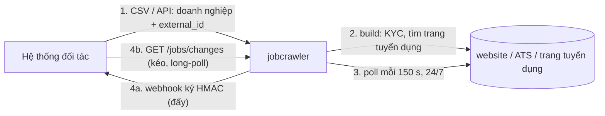

# Tích hợp hệ thống đối tác với jobcrawler

Tài liệu cho đội phát triển của hệ thống đối tác (gọi tắt **đối tác**): đưa danh sách doanh nghiệp
vào jobcrawler, nhận việc làm mới / đổi / đóng gần thời gian thực. Phía vận hành jobcrawler:
[OPERATIONS.md](OPERATIONS.md) mục 11; kiến trúc: [ARCHITECTURE.md](ARCHITECTURE.md) mục 12.

## 1. Luồng tổng quát



1. Vận hành jobcrawler tạo **hệ thống ngoài** cho đối tác ở trang Tích hợp, gửi **khoá API** (và
   **secret webhook** nếu nhận đẩy) qua kênh bí mật.
2. Đối tác đẩy doanh nghiệp, mỗi doanh nghiệp một **mã của đối tác** (`external_id`): file CSV, API lô
   hoặc API từng doanh nghiệp. Gọi lại nhiều lần không sinh trùng.
3. jobcrawler build từng doanh nghiệp mới (xác minh pháp nhân, tìm trang tuyển dụng / ATS, đọc đủ
   tin, ghi **bộ khung**), rồi poll bộ khung mỗi 150 s cả ngày lẫn đêm.
4. Mỗi việc làm tạo / đổi / đóng thành một **sự kiện** có số thứ tự `seq` tăng dần. Đối tác nhận
   bằng **webhook** (khuyến nghị) hoặc **feed** kéo về; lần đầu lấy **snapshot** để có dữ liệu sẵn có.

Địa chỉ gốc API: `https://<máy chủ jobcrawler>/api/integration/v1` (cùng địa chỉ với giao diện,
trang Tích hợp hiện sẵn). Spec OpenAPI để sinh client: `GET /api/integration/v1/openapi.json` (cần
khoá).

## 2. Xác thực

### 2.1 Khoá API (đối tác → jobcrawler)

Mọi request gửi `Authorization: Bearer jca_…` (hoặc `X-API-Key: jca_…`), qua HTTPS.

| Thuộc tính       | Giá trị                                                                                       |
| ---------------- | --------------------------------------------------------------------------------------------- |
| Dạng             | `jca_` + 43 ký tự ngẫu nhiên; jobcrawler chỉ lưu sha256, không xem lại được                  |
| Quyền (scope)    | `companies:write` (đẩy doanh nghiệp, thu thập ngay), `jobs:read` (việc làm, feed)            |
| Phạm vi đọc      | chỉ việc làm của doanh nghiệp đối tác đã đẩy (mặc định), hoặc mọi việc làm nếu được bật        |
| Giới hạn         | 600 request / phút / khoá (vượt → 429 + `Retry-After`); gửi khoá sai 30 lần / 5 phút → IP bị 429 |
| Đổi khoá         | xin khoá mới → chuyển sang → báo thu hồi khoá cũ (hết hiệu lực sau ≤ 10 s); nhiều khoá dùng song song được |

Khoá chỉ dùng được cho `/api/integration/v1/*`; không mở được giao diện hay API khác.

### 2.2 Chữ ký webhook (jobcrawler → đối tác)

Mỗi request webhook là `POST` JSON kèm:

| Header           | Ý nghĩa                                                                     |
| ---------------- | --------------------------------------------------------------------------- |
| `X-JC-Timestamp` | giây Unix lúc ký                                                            |
| `X-JC-Signature` | `v1=` + hex(HMAC-SHA256(secret, `"<X-JC-Timestamp>.<body thô>"`))           |
| `X-JC-Delivery`  | id của lô (giữ nguyên khi gửi lại lô đó)                                    |
| `User-Agent`     | `jobcrawler-webhook/1`                                                      |

Bên nhận: tính lại chữ ký trên **body thô** (trước khi parse JSON), so bằng hàm so sánh hằng thời
gian, từ chối nếu lệch giờ quá 5 phút.

```python
import hashlib, hmac, time

def verify(secret: str, headers: dict[str, str], body: bytes) -> bool:
    ts = headers.get("X-JC-Timestamp", "")
    expected = "v1=" + hmac.new(secret.encode(), f"{ts}.".encode() + body, hashlib.sha256).hexdigest()
    fresh = ts.isdigit() and abs(time.time() - int(ts)) <= 300
    return fresh and hmac.compare_digest(headers.get("X-JC-Signature", ""), expected)
```

```js
import crypto from "node:crypto"

export function verify(secret, headers, rawBody /* Buffer */) {
  const ts = headers["x-jc-timestamp"] ?? ""
  const expected = "v1=" + crypto.createHmac("sha256", secret).update(`${ts}.`).update(rawBody).digest("hex")
  const got = Buffer.from(headers["x-jc-signature"] ?? "")
  const fresh = /^\d+$/.test(ts) && Math.abs(Date.now() / 1000 - Number(ts)) <= 300
  return fresh && got.length === expected.length && crypto.timingSafeEqual(got, Buffer.from(expected))
}
```

Đổi secret: secret cũ hết dùng ngay, nên đối tác nhận secret mới trước; lô bị từ chối trong lúc đổi
được gửi lại (mục 5.3).

## 3. File CSV danh sách doanh nghiệp

UTF-8 (có BOM cũng được), dòng đầu là tên cột, phân cách `,` `;` hoặc tab, tối đa 20 MB.

| Cột           | Bắt buộc | Nội dung                                                                                         |
| ------------- | -------- | ------------------------------------------------------------------------------------------------ |
| `external_id` | có       | mã doanh nghiệp bên đối tác: chữ, số, `. _ : @ -`, ≤ 128 ký tự; ổn định, không dùng lại cho doanh nghiệp khác |
| `name`        | có       | tên doanh nghiệp (tên pháp lý hoặc tên thường gọi)                                               |
| `tax_code`    | nên có   | mã số thuế 10 số, chi nhánh thêm `-xxx` (`0101234567-001`); Excel làm mất số 0 đầu thì tự sửa    |
| `website`     | nên có   | website / domain chính (`abc.vn`, `https://www.abc.vn`)                                          |
| `careers_url` | không    | trang tuyển dụng hoặc bảng ATS nếu biết (`https://abc.vn/tuyen-dung`, `https://boards.greenhouse.io/abc`) |
| `note`        | không    | ghi chú                                                                                          |
| `active`      | không    | trống / `1` = theo dõi; `0`, `false`, `no`, `không` = ngừng thu thập doanh nghiệp này            |

```csv
external_id,name,tax_code,website,careers_url,note,active
DN-000123,Công ty Cổ phần VNG,0303490096,vng.com.vn,https://career.vng.com.vn,,
DN-000124,Ngân hàng TMCP Á Châu,0301452948,acb.com.vn,,khách hàng VIP,
DN-000125,Công ty TNHH ABC,,abc.vn,https://abc.vn/tuyen-dung,,0
```

File mẫu: [integration/companies-sample.csv](integration/companies-sample.csv).

- Có MST và website thì nhận diện doanh nghiệp đúng và nhanh hơn (không nhầm với doanh nghiệp cùng
  tên); có `careers_url` thì bỏ qua bước tìm trang tuyển dụng.
- Không tạo trùng: mã đã có → cập nhật doanh nghiệp đang gắn; mã mới → khớp doanh nghiệp đã có
  (cùng MST, hoặc cùng tên không mâu thuẫn MST / website) rồi gắn mã. Hai mã có thể cùng trỏ một
  doanh nghiệp (vd. hai bản ghi bên đối tác cùng một pháp nhân).
- Trường sai định dạng (MST, website) bị bỏ kèm cảnh báo, dòng vẫn được nạp; dòng thiếu mã / tên bị
  bỏ. Mã lặp lại trong file: dòng đầu được dùng.

Nạp file: trang Doanh nghiệp → "Nạp danh sách" → chọn hệ thống của đối tác (vận hành làm), hoặc
`POST /companies/import` (mục 4).

## 4. API doanh nghiệp (`companies:write`)

| Request                                | Việc                                                                           |
| -------------------------------------- | ------------------------------------------------------------------------------ |
| `PUT /companies/{external_id}`         | tạo / cập nhật một doanh nghiệp (idempotent)                                   |
| `POST /companies/batch`                | tối đa 1.000 doanh nghiệp, kết quả từng mục theo đúng thứ tự                   |
| `POST /companies/import`               | file CSV mục 3 (`multipart/form-data`, trường `file`)                          |
| `GET /companies`                       | danh sách mã đã đẩy (`page`, `limit` ≤ 100, `search`, `active`, `crawl_state`) |
| `GET /companies/{external_id}`         | trạng thái thu thập của một doanh nghiệp                                       |
| `POST /companies/{external_id}/refresh` | thu thập ngay (poll nếu đã có bộ khung, không thì build), một lần / phút      |

```bash
curl -X PUT "$BASE/companies/DN-000123" -H "Authorization: Bearer $KEY" -H "Content-Type: application/json" \
  -d '{"name":"Công ty Cổ phần VNG","tax_code":"0303490096","website":"vng.com.vn","careers_url":"https://career.vng.com.vn"}'
```

```json
{"external_id":"DN-000123","result":"created","company_id":"01a16…","active":true,"warnings":[],"error":null}
```

```bash
curl -X POST "$BASE/companies/batch" -H "Authorization: Bearer $KEY" -H "Content-Type: application/json" \
  -d '{"items":[{"external_id":"DN-000124","name":"Ngân hàng TMCP Á Châu","tax_code":"0301452948"},
               {"external_id":"DN-000125","name":"Công ty TNHH ABC","active":false}]}'
```

```json
{"results":[{"external_id":"DN-000124","result":"linked","company_id":"01a15…","active":true,"warnings":[],"error":null},
            {"external_id":"DN-000125","result":"created","company_id":"01a16…","active":false,"warnings":[],"error":null}],
 "created":1,"linked":1,"updated":0,"unchanged":0,"errors":0}
```

`result`: `created` (doanh nghiệp mới), `linked` (gắn mã vào doanh nghiệp đã có), `updated`,
`unchanged`, `error` (không ghi; lý do ở `error`). Website / `careers_url` đổi → jobcrawler build lại
doanh nghiệp đó. `active=false` ở mọi mã của một doanh nghiệp → ngừng thu thập (`crawl_state`
`paused`); gửi lại `active=true` → build lại ngay.

`GET /companies/{external_id}` trả `crawl_state`:

| `crawl_state` | Ý nghĩa                                                                               |
| ------------- | ------------------------------------------------------------------------------------- |
| `new`         | chờ / đang build lần đầu (thường 1–3 phút; nạp hàng nghìn doanh nghiệp thì xếp hàng)  |
| `ready`       | đang poll theo bộ khung (`sources` nguồn), độ trễ ≤ 3 phút                            |
| `no_sources`  | không có trang tuyển dụng riêng / ATS: chỉ việc làm từ các trang tuyển dụng chung     |
| `broken`      | bộ khung hỏng (site đổi cấu trúc), đang build lại                                     |
| `paused`      | đã ngừng theo dõi (`active=false`)                                                    |

kèm `kyc_status`, `active_jobs`, `last_build_at`, `last_poll_ok_at` (mốc chắc chắn đã thấy mọi tin
đăng trước đó), `next_poll_at`, `last_error`.

## 5. Nhận việc làm (`jobs:read`)

### 5.1 Việc làm

Mỗi việc làm (`job`) là tin đã xác minh và gộp trùng giữa các nguồn (website, ATS, trang tuyển
dụng). Khoá là `job.id` (UUID, không đổi).

| Trường                                                   | Nội dung                                                                                 |
| -------------------------------------------------------- | ---------------------------------------------------------------------------------------- |
| `id`, `company_id`, `company_external_ids`               | id việc làm, id doanh nghiệp trong jobcrawler, các mã bên đối tác của doanh nghiệp đó    |
| `status`                                                 | `active` / `expired` (quá hạn nộp, tính theo `expires_at`) / `removed` (gỡ khỏi nguồn)   |
| `title`, `company_name`, `locations[]`                   | tiêu đề; tên doanh nghiệp trên tin; `{province, address_raw}`                            |
| `level`, `employment_type`, `work_mode`, `education`     | `intern…director`; `full_time…freelance`; `onsite/hybrid/remote`; `none…postgraduate`; `unknown` khi không rõ |
| `categories[]`, `skills[]`, `openings`                   | ngành nghề (ngành chính trước), kỹ năng, số người cần tuyển                              |
| `salary`                                                 | `{min, max, currency, period: month/year/hour, negotiable, raw}` hoặc null              |
| `experience_years`                                       | `{min, max}` hoặc null                                                                   |
| `description_md`, `requirements_md`, `benefits_md`       | nội dung Markdown (rỗng / null nếu hệ thống được cấu hình không gửi mô tả)               |
| `apply_url`, `source_urls[]`, `canonical_source`         | link ứng tuyển, các link tin gốc, nguồn chính                                            |
| `posted_at`, `expires_at`                                | ngày đăng, hạn nộp (theo nguồn, có thể null)                                             |
| `first_seen_at`, `last_seen_at`, `updated_at`            | lần đầu / gần nhất jobcrawler thấy tin, lần ghi gần nhất                                 |
| `confidence`, `verification_reasons[]`                   | độ tin cậy xác minh 0–1 và lý do                                                         |

### 5.2 Sự kiện

| `type`     | Khi                                                                                      |
| ---------- | ---------------------------------------------------------------------------------------- |
| `created`  | việc làm lần đầu thấy                                                                    |
| `updated`  | nội dung đổi (tiêu đề, lương, nơi làm, mô tả, hạn nộp…) hoặc chuyển sang doanh nghiệp khác (hai bản ghi được gộp) |
| `closed`   | gỡ khỏi nguồn, hết hạn, hoặc gộp vào việc làm khác                                       |
| `reopened` | việc đã đóng được đăng lại                                                               |
| `deleted`  | bản ghi bị xoá (gộp doanh nghiệp trùng; `job` = null)                                    |

```json
{"seq":184233,"type":"created","occurred_at":"2026-10-22T09:41:07Z","job_id":"01a16…","company_id":"01a16…",
 "job":{"id":"01a16…","company_external_ids":["DN-000123"],"status":"active","title":"Kỹ sư phần mềm Python", "...": "..."}}
```

- `job` là **trạng thái hiện tại** lúc gửi, không phải lúc xảy ra: luôn **upsert theo `job.id`** và
  lấy `job.status` làm sự thật; `type` chỉ để biết điều gì vừa xảy ra.
- `seq` tăng dần, không lặp: lưu `seq` lớn nhất đã xử lý; gặp lại `seq` cũ thì bỏ qua.
- Giao **ít nhất một lần**: cùng một sự kiện có thể đến hai lần (lỗi mạng, gửi lại).
- Không có sự kiện khi việc làm chỉ quá hạn nộp theo ngày: so `expires_at` với ngày hiện tại nếu cần.

### 5.3 Cách A — webhook (khuyến nghị: độ trễ thấp nhất)

Đối tác cung cấp URL HTTPS nhận `POST`; vận hành nhập URL, tạo secret, bật, "Gửi thử" (lô thử có
`"test": true`, `events` rỗng).

```json
{"delivery_id":"01a16…","client":"Đối tác","events":[ /* ≤ 100 sự kiện, theo seq tăng dần */ ],
 "cursor":"184233","head":"184233"}
```

- Trả **2xx trong 10 s** (nhận rồi xếp hàng xử lý sau); mọi mã khác, timeout hay chuyển hướng là lỗi.
- Lỗi → jobcrawler giữ chỗ và gửi lại **đúng lô đó** sau 1 s, 2 s, 4 s… tối đa 5 phút; lô sau chỉ đi
  khi lô trước thành công, nên thứ tự `seq` được giữ.
- Bật lần đầu: bắt đầu từ thời điểm bật → lấy dữ liệu sẵn có bằng snapshot (mục 5.5). Tắt rồi bật
  lại: tiếp tục từ chỗ dừng.
- Webhook lỗi liên tục quá 14 ngày (thời gian giữ sự kiện) thì phần cũ bị bỏ: đồng bộ lại bằng
  snapshot. Vận hành nhận cảnh báo sau 5 phút lỗi liên tục.

### 5.4 Cách B — feed kéo về (long-poll)

```
GET /jobs/changes?cursor=<cursor>&limit=500&wait=25
→ {"events":[…], "next_cursor":"184233", "has_more":false, "head":"184233"}
```

```python
cursor = load_cursor()                     # lần đầu: feed_cursor của snapshot (mục 5.5)
while True:
    r = api.get("/jobs/changes", params={"cursor": cursor, "limit": 500, "wait": 25}, timeout=40)
    if r.status_code == 410:               # resync_required: cursor đã bị dọn
        cursor = full_resync(); continue
    r.raise_for_status()
    page = r.json()
    for e in page["events"]:
        upsert_job(e["job_id"], e["job"])  # idempotent theo job.id; job null → xoá
    cursor = page["next_cursor"]
    save_cursor(cursor)                    # chỉ lưu sau khi xử lý xong trang
```

- `wait` (≤ 25 s): chưa có sự kiện thì giữ request tới khi có hoặc hết giờ — sự kiện về trong
  ~1 s mà không phải gọi dồn. `has_more=true` thì gọi tiếp ngay.
- Có thể dùng song song với webhook (vd. feed để đối soát), mỗi bên một cursor riêng.

### 5.5 Đồng bộ ban đầu và đối soát

```
GET /jobs?status=active&limit=500                    → {"data":[…], "next_cursor":"…", "feed_cursor":"184001"}
GET /jobs?status=active&limit=500&cursor=<next_cursor> → … tới khi next_cursor = null
GET /jobs?external_id=DN-000123&external_id=DN-000124  (≤ 100 mã)
GET /companies/{external_id}/jobs?status=all
```

1. Lấy hết snapshot (`status=active`: đang mở, chưa quá hạn; `all`: mọi trạng thái), giữ
   `feed_cursor` của **trang đầu**.
2. Đọc feed từ `feed_cursor` (hoặc bật webhook): thay đổi xảy ra trong lúc lấy snapshot đều có trong
   feed, đến hai lần cũng không sao vì upsert theo `job.id`.
3. Đối soát định kỳ (vd. mỗi đêm): so tập `id` đang mở hai bên bằng snapshot; lệch thì lấy lại.

## 6. Độ trễ: P95 ≤ 3 phút

Độ trễ = lúc tin xuất hiện trên trang của doanh nghiệp → lúc đối tác nhận sự kiện.

| Phần                                                      | Thời gian                         |
| --------------------------------------------------------- | --------------------------------- |
| Chờ tới lượt poll kế tiếp (mỗi 150 s ± 10 s, 24/7)        | 0–160 s (P95 ≈ 0,95 × 150 s)      |
| Một lượt poll: đọc bộ khung, mở trang tin mới, xác minh   | thường 1–15 s                     |
| Relay đánh số sự kiện + gửi webhook                       | ≤ 1 s + một request               |
| **Tổng P95**                                              | **≈ 155–170 s < 180 s**           |

Điều kiện: doanh nghiệp đã ở `ready` (đã build xong); tin có trên website / ATS của doanh nghiệp. Tin
chỉ có trên trang tuyển dụng chung (`no_sources`) được thấy qua lượt quét các trang đó (mỗi 2 phút +
một lượt poll), có thể chậm hơn. Site chặn / lỗi tạm thời làm lượt poll đó trễ; jobcrawler theo dõi
P95 và cảnh báo vận hành khi vượt 180 s.

Đo đầu-cuối ngày 22/10/2026 trên stack Docker một máy (site giả đăng 14 tin, cách nhau ~75 s; bên
nhận webhook kiểm chữ ký): 14/14 tin tới bên nhận, **P50 79 s, P95 150 s, lâu nhất 150 s**, mọi
chữ ký hợp lệ; webhook tới chậm nhất ~0,1 s sau khi lượt poll lưu xong.

## 7. Quy mô 10.000 doanh nghiệp

- **Nạp lần đầu**: đẩy theo đợt 1.000–2.000 doanh nghiệp (lô 1.000 / request). Mỗi doanh nghiệp mới
  cần một lượt build (~1–3 phút, chạy song song theo năng lực); 10.000 doanh nghiệp mất vài giờ — theo
  dõi bằng `GET /companies?crawl_state=new`.
- **Lưu lượng**: ~67 lượt poll / giây phía jobcrawler (đã tính sẵn năng lực); sự kiện thường vài nghìn
  đến vài chục nghìn mỗi ngày. Webhook gom ≤ 100 sự kiện / request, feed ≤ 1.000 / trang.
- **Phía đối tác**: endpoint webhook trả 2xx nhanh, xử lý bất đồng bộ; upsert theo `job.id` (index
  duy nhất), khử trùng theo `seq`; lưu cursor bền. Giới hạn 600 request / phút / khoá đủ cho long-poll
  liên tục + đẩy doanh nghiệp; cần hơn thì báo vận hành.

## 8. Mã lỗi

Lỗi trả JSON `{"detail": "…"}` (tiếng Việt).

| Mã  | Khi                                                                                   |
| --- | ------------------------------------------------------------------------------------- |
| 400 | cursor / file CSV không hợp lệ                                                        |
| 401 | thiếu khoá, khoá sai / đã thu hồi (`WWW-Authenticate: Bearer realm="jobcrawler-integration"`) |
| 403 | khoá không có quyền (scope) cho request này                                           |
| 404 | không có doanh nghiệp với mã này (của hệ thống đối tác)                               |
| 410 | `resync_required`: cursor cũ hơn 14 ngày (đã dọn) → đồng bộ lại bằng snapshot         |
| 422 | dữ liệu gửi lên sai kiểu / thiếu trường (chi tiết trong `detail`)                     |
| 429 | vượt giới hạn request, hoặc gửi khoá sai quá nhiều lần; chờ `Retry-After` giây        |
| 503 | jobcrawler đang khởi động lại; thử lại sau vài giây                                   |

## 9. Checklist cho đối tác

- [ ] Nhận khoá API (và secret webhook) qua kênh bí mật, lưu trong kho bí mật.
- [ ] Xuất CSV theo mục 3 (ưu tiên có MST, website; `external_id` ổn định), nạp hoặc gọi API lô.
- [ ] Endpoint webhook HTTPS: kiểm chữ ký + timestamp, trả 2xx < 10 s, xử lý idempotent.
- [ ] Lưu `job` theo `job.id`, lưu `seq` / cursor sau khi xử lý.
- [ ] Đồng bộ ban đầu bằng snapshot, rồi bật webhook / đọc feed từ `feed_cursor`.
- [ ] Đẩy thay đổi danh sách doanh nghiệp (thêm, sửa, `active=false`) bằng `PUT` / lô.
- [ ] Đối soát định kỳ; xử lý 410 (đồng bộ lại) và 429 (`Retry-After`).
